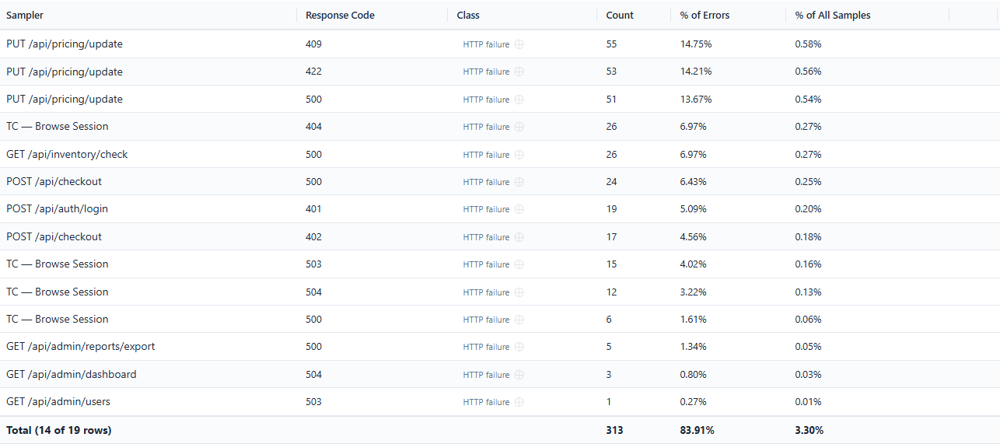
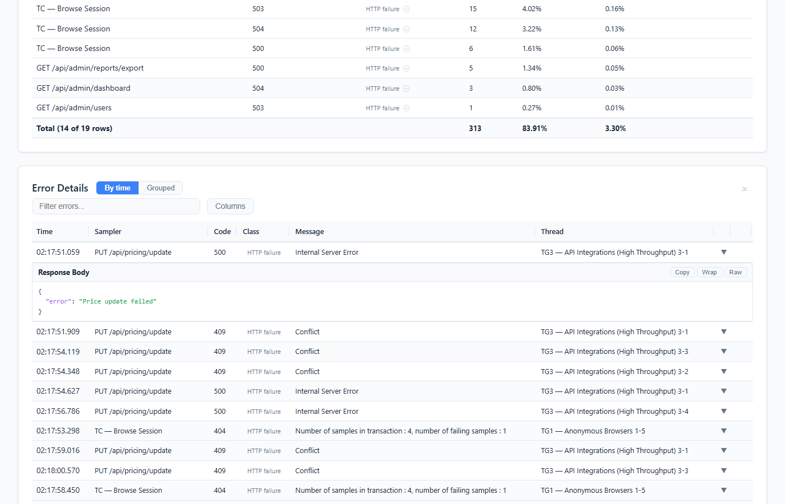
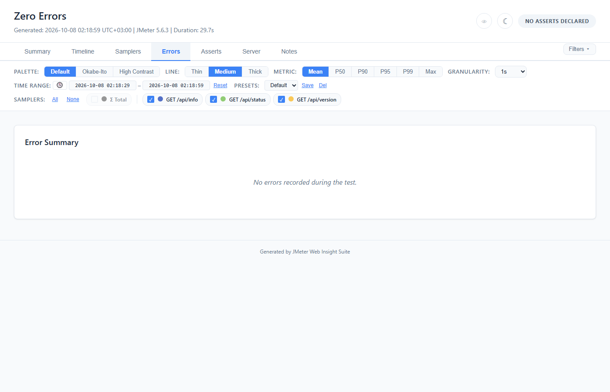
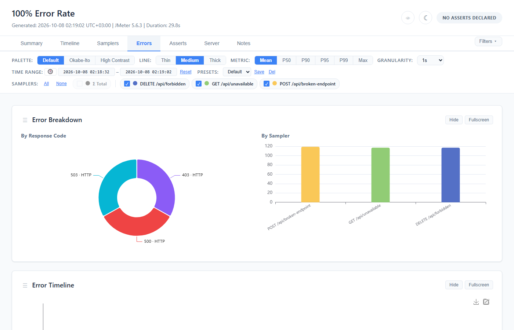

# Errors Tab

Error breakdown charts and detail tables for investigating test failures.


## Error classes — where a failure was decided

Every row in this tab is a sample JMeter judged failed (`success = false`). That is **not** the
same as an HTTP error, and the report now says which is which.

| Class | Condition | What it means |
|---|---|---|
| **HTTP failure** | code in 100–599, outside 2xx | The server answered and the status said no — 404, 500, 503. 3xx lands here too: a redirect reaching the error set means redirect handling was off or the target failed, which is an HTTP-level story either way. |
| **Non-protocol failure** | code in 200–299 | The server answered *successfully* and the sampler failed it anyway — a Response Assertion, or a script calling `setSuccessful(false)`. |
| **Transport failure** | anything else | No HTTP status at all. Either JMeter wrote the exception into the code field (`Non HTTP response code: java.net.ConnectException`), or it wrote **`000`** — its marker for "no status line was ever read", which is a connection refused, a timeout before the first byte, or a failed TLS handshake. Numeric codes outside the status range land here too, which is what a JDBC, JMS or TCP sampler writes. |

> **`000` was classified as an HTTP failure until 2.4.1.** It is all digits, so it parsed as a
> status and fell outside 2xx. The effect was the worst possible shape: `class=transport` — the
> selector written precisely to gate on connection failures — counted **zero** on a run whose
> errors were all connection failures, while `class=protocol` claimed them. Digits alone no
> longer make a status; the range does.

> **This is inferred, not read.** The class comes from the response code of a sample already known
> to have failed — nothing more. The report cannot tell you *which* assertion fired, or whether an
> assertion fired at all rather than a JSR223 marking the sample failed: `failureMessage` and
> `getAssertionResults()` are captured on neither ingestion path. It says **where** the failure was
> decided, never why. That is also why it is the same answer on a live listener run and on a JTL
> re-parsed by `-g`.

**Why a non-protocol row shows no message.** Its response message is the HTTP reason phrase —
`OK` — which says nothing about why the sampler failed it. Printing that in an errors table
asserts something untrue, so it renders as `—`. A 500's message and a transport exception are
real and are never suppressed.

Before this, a run with assertion failures showed a bare `200` in the breakdown, and a row reading
`200 | OK` in the detail table, accounting for however many of the errors. The class appears on
every surface: both tables, the by-response-code chart, and both CSV exports.


## Error Charts

Three charts provide different views of error data. The first two sit side by side in the
**Error Breakdown** card:


### Error Breakdown by Response Code (Pie Chart)

- Donut/pie chart showing error distribution by HTTP status code, each slice labelled with the
  code and its [class](#error-classes--where-a-failure-was-decided) (`500 · HTTP`)
- Fixed colors per code: 500=red, 401=blue, 404=orange, etc.
- Hover for exact counts and percentages

### Error Breakdown by Sampler (Bar Chart)

- Bar chart showing error count per sampler, one column each
- Uses the sampler palette colors (matches the filter bar color dots)
- Quickly identifies which requests fail most

### Error Timeline (Scatter Plot)

- Individual error occurrences plotted over time
- Each dot = one error, colored by sampler
- Reveals error bursts and patterns (e.g., errors clustered during a specific time window)

### Chart Controls

All error charts have:
- **Hide/Show** button — same behavior as Timeline tab
- **Fullscreen** button
- **"Show N Hidden Charts"** restore link when charts are hidden

## Error Summary Table



Groups errors by **sampler + response code** with aggregate counts.

| Column | Description |
|--------|-------------|
| **Sampler** | Request label |
| **Response Code** | HTTP status code (e.g., 500, 404) |
| **Class** | Where the failure was decided — see [Error classes](#error-classes--where-a-failure-was-decided) |
| **Count** | Number of occurrences |
| **% of Errors** | Percentage of total errors |
| **% of All Samples** | Percentage of all requests |

Both percentages count every recorded sample, transaction children included — the population the
rows are drawn from — so they can differ from the header's error rate, which leaves children out.

**The Total row is the sum of the rows shown.** Its Count adds up the Count column above it, and
its two percentages are that count's share of every error and of every sample — the same two
numbers each row divides by. Each row's percentage is rounded to two decimals and the Total's is
worked out from the count, so a percentage column can add up to a hundredth or two more or less
than the Total says: the rows' % of Errors can add up to 100.01% above a Total of 100.00%.

A row the search, an X or a collapsed transaction child hides is not in the Total, and the Total
changes as soon as one of those does: it reads **100.00%** of errors only when every row is
counted, and when some are not, its first cell says how many are — `Total (12 of 17 rows)`. The
search never hides the Total itself.

On a run with Transaction Controllers the children start collapsed, so the Total opens on the
top-level rows and its % of Errors is below 100% — the children's errors are the rest. Turn on
**Transaction Details** (Samplers tab) and it covers every row.

> **Before this fix the Total was wrong on every report with an error.** It was built by column
> position from before the Class column existed, so it summed Class, wrote `100%` under Count and
> `0.00%` under % of Errors, and left % of All Samples empty — `Total · 0 · 100% · 0.00%` even on
> a run where every sample failed.

**Controls:**
- **Search** — filter rows by text
- **Column toggle** — show/hide columns
- **Row hide** — X button per row; "Show N Hidden Rows" brings back what X hid and nothing else —
  the search and the collapsed transaction children keep theirs
- **CSV download** — exports as `error-summary.csv`

## Error Details Table

Individual error records with request-level detail.

| Column | Description |
|--------|-------------|
| **Time** | Timestamp of the error |
| **Sampler** | Request label |
| **Code** | HTTP response code |
| **Class** | Where the failure was decided — see [Error classes](#error-classes--where-a-failure-was-decided) |
| **Message** | Response message text |
| **Thread** | JMeter thread name |

### Expandable Error Rows



Click any error detail row to expand it. The panel shows what was captured for that sample:
- **Request URL** — the URL that failed, when the sample has one (a sampler that is not HTTP has none)
- **Request Headers** — *not captured.* Nothing populates this on either ingestion path: the
  listener passes null and a JTL has no headers to read. The field exists in the model, so the
  panel is plumbing waiting for a capture change rather than a feature you are missing.
- **Response Body** — the error response body with JSON auto-formatting and syntax highlighting,
  and **Copy**, **Wrap** (word wrap) and **Raw** (the body as received, unformatted)

**Response body size limit:** Default 16KB. Configure via:
```bash
-Jwebinsight.error.body.maxsize=32768   # 32KB
```

Click again to collapse.

**Note:** the **response body is listener-only** — a JTL carries none, so a `-g` report shows
response code, message, thread and URL but no body. The **URL is available in both**: listener
mode reads it from the sample, and JTL mode reads a `URL` column when the file has one, which
JMeter writes under `jmeter.save.saveservice.url=true`.

**Controls:** Same as Error Summary (search, column toggle, row hide, CSV download as `error-details.csv`)

## Sampler Filter Integration

The error charts respect the sampler filter:
- **Uncheck a sampler** → its errors disappear from all 3 charts
- **Re-check** → errors reappear
- This allows focusing on specific request types when investigating failures

The two tables do not: they list every error whatever the filter shows, and so does the Error
Summary's Total. Use a table's search to narrow it.

## Edge Cases

- **Zero errors:** Error tab shows no charts and empty tables (no crashes or layout issues)



- **100% errors:** All charts render normally, all table rows show error data


