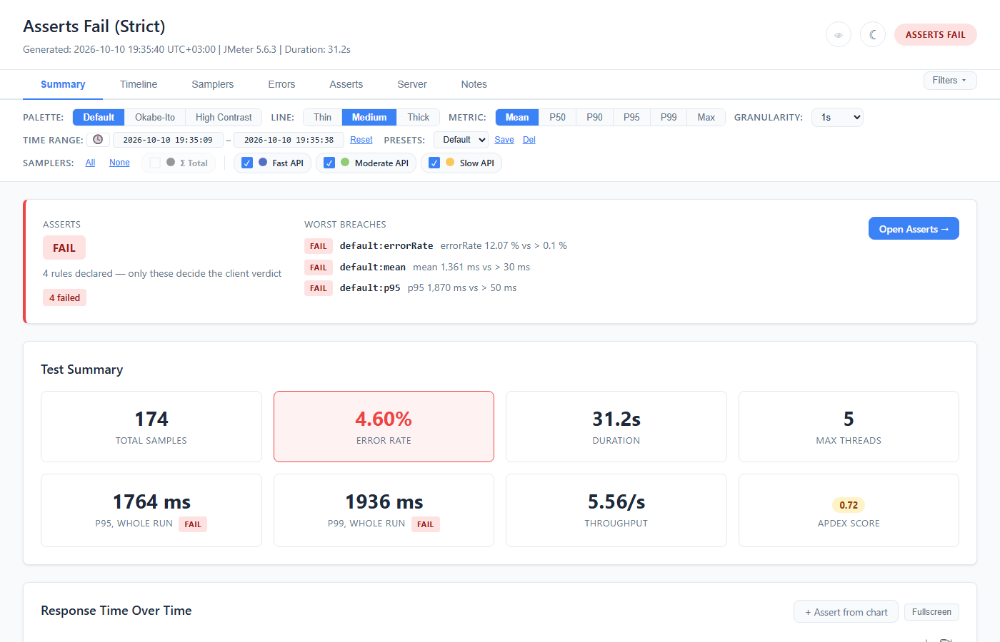

# Asserts & Apdex Score



A JMeter run tells you what happened. A **quality gate** tells you whether that was acceptable —
and that is a question only you can answer, so you declare it.

```json
{
  "assertions": [
    {
      "id": "checkout-p95",
      "description": "Payment gateway budget, contract §4.2",
      "target": { "sampler": "POST /api/checkout" },
      "metric": "p95",
      "warn": { "gt": 650 },
      "fail": { "gt": 800 }
    }
  ]
}
```

Put that in `report-annotations.json` in the report's output directory (or point at it with
`-Jwebinsight.report.annotations=…`) and the run is judged by it.

## Four principles

**Declared ≡ judged.** Only rules you wrote decide the verdict. Everything else in the report is
data. One rule on one metric of one sampler is a complete, valid gate.

**Assertable ≡ displayed.** Every number the report shows can be asserted — any metric, any
percentile from p50 to p99.99, per sampler, per group, or for the whole run.

**You write the direction.** Bands are explicit comparisons: `fail: {"gt": 800}` for latency,
`fail: {"lt": 30}` for throughput. There is no per-metric table of which way is bad, which is
why latency, throughput and apdex share one rule shape.

**Mistakes are loud.** A JSON Schema drives editor completion. Load-time validation names the
rule and the fix. A rule the *file* got wrong is `NOT_JUDGED / INVALID_RULE` and exits the run
non-zero under `failonerror`. A rule that merely matched nothing is `NOT_JUDGED / NO_MATCH` —
reported on every surface, never hidden, but not fatal on its own, because a plan running a
subset is legitimate.

---

## The rule

| Field | Required | Notes |
|---|---|---|
| `id` | no | Unique. Names the JUnit testcase and appears in every failure message. Derived from the target and metric when omitted. |
| `target` | **yes** | Exactly one form — see below. |
| `metric` | **yes** | Case-insensitive. `p95` ≡ `p95.0`, `median` ≡ `p50`. What follows the `p` is read as Java reads a double, so `p95d`, `p+95` and `p9.5e1` are p95 too; the rule is reported under the canonical name, and a percentile below 0.001 is named in E notation: `p0.0001` is reported as `p1.0E-4`. |
| `fail`, `warn` | **at least one** | Predicates. `fail` is tested first. A rule with neither
cannot decide anything and is INVALID. |
| `enabled` | no | `false` parks a rule without deleting it. |
| `description` | no | Carried into failure messages and shown in the report. |

### Targets

```json
{ "sampler":  "POST /api/checkout" }
{ "samplers": ["GET /a", "GET /b"] }
{ "match":    "POST /api/*", "exclude": ["POST /api/health"] }
{ "scope":    "overall" }
```

**Reach matters.** Naming a sampler reaches it whatever it is — a transaction-controller child,
a hidden utility sampler, a row the report does not display by default. Naming is an unambiguous
request.

A `match` pattern reaches only **top-level, non-hidden** samplers. If patterns reached children,
a blanket rule would start failing on rows whose time is already counted inside their parent.

**Patterns are globs.** `*` is the only special character; everything else is literal, because
sampler names are full of `{id}`, `?`, `+` and query strings of `&`, and you mean them. Prefix
with `regex:` for a full expression.

### Predicates

Exactly one operator per band.

| | |
|---|---|
| `gt` / `gte` | breach above — latency, error rate |
| `lt` / `lte` | breach below — throughput, apdex, sample count |

Comparisons are strict where they say so: `{"gt": 800}` does not fire at exactly 800.

There is no corridor operator. A range is **two rules** — `{"lt": 40}` and `{"gt": 80}` — and
written that way each one says which end was missed, and each can show how far past its own
limit the run was. A single `outside: [40, 80]` band could do neither: two thresholds have no
one number to measure against.

### Metrics

> ### What `errorRate` counts — read this if you have an error threshold
>
> **`errorRate` and `errorCount` include samples that returned HTTP 200.**
>
> An error, to this report, is any sample JMeter marked `success = false`. That is JMeter's own
> failure signal, and it includes a sample failed by a **Response Assertion**, a JSON Assertion,
> a Duration Assertion, or a JSR223 calling `setSuccessful(false)` — none of which need an HTTP
> error to fire. A checkout that returns `200 OK` with the wrong body is an error here, and
> always has been.
>
> This is the right behaviour: a gate that ignored assertion failures would pass a run where
> every response was wrong. But it was **never written down**, so a threshold written as "fail
> above 2% errors" may have been read by its author as "2% HTTP failures" while meaning
> something broader. Nothing about the numbers has changed — the report can now *show* you the
> split, via [error classes](05-Errors-Tab.md#error-classes--where-a-failure-was-decided).
>
> If you want a threshold on one kind, say which:
> `errorRate:class=protocol` for HTTP failures, `errorRate:class=nonProtocol` for the rest.

**Per sampler:** `sampleCount` · `errorCount` · `errorRate` (%) · `mean` · `median` · `min` ·
`max` · `stdDev` (ms) · `latency` (ms) · `connectTime` (ms) · `throughput` (/s) ·
`receivedKbPerSec` · `sentKbPerSec` (KB/s) · `apdex` · **p50…p99.99** (ms)

`latency` is JMeter's Latency field — time to first byte — and `connectTime` its Connect time.
Both are means, as `mean` is. They matter because `elapsed` cannot see them: a connect-time
regression is the signature of a TLS, DNS or connection-pool problem while the total response
time barely moves.

The two byte rates are named in **kilobytes**, matching the `Recv KB/s` column they sit under in
the samplers table. What a rule judges is the number the report shows — otherwise the ⊕ beside
that cell would seed a threshold three orders of magnitude off.

### Gating one kind of error

`errorRate` and `errorCount` accept a selector, so a rule can name a slice of the errors instead
of all of them:

```json
{ "target": { "sampler": "POST /checkout" },
  "metric": "errorRate:class=nonProtocol", "fail": { "gt": 0 } }

{ "target": { "scope": "overall" },
  "metric": "errorRate:class=transport", "fail": { "gt": 0 } }

{ "target": { "sampler": "POST /checkout" },
  "metric": "errorRate:code=5*", "fail": { "gt": 1 }, "warn": { "gt": 0.2 } }
```

| Selector | Values |
|---|---|
| `class=` | `protocol`, `nonProtocol`, `transport` — see [error classes](05-Errors-Tab.md#error-classes--where-a-failure-was-decided) |
| `code=` | A glob over the response code as JMeter wrote it. `404`, `5*`, `Non HTTP*`. |

A 2% error rate that is all 404s from a stale data file is not the same run as 2% connection
resets under load. One number covered both, so the gate either fired on noise or was set loose
enough to miss a real failure.

**`code=` is a glob and nothing cleverer.** `errorType` *is* the response code, and JMeter writes
`Non HTTP response code: java.net.ConnectException` into that field verbatim. A glob over the
string is the honest expression; a richer taxonomy would be the plugin inventing one JMeter does
not provide. `*` is the only special character; prefix with `regex:` for a full expression
(`code=regex:5[0-9]{2}`). A pattern that will not compile makes the rule INVALID at load time,
with the reason, rather than failing later.

**`code=` is case-sensitive; `class=` is not.** `class=NONPROTOCOL` and `class=nonProtocol` are
the same selector, because that vocabulary is closed and there is exactly one thing the writer
can have meant. `code=` is a glob over free text, so it matches literally: `code=non http*`
finds nothing against `Non HTTP response code: …`, and matching nothing is a legitimate answer
for a code glob, so it will not look like a mistake. Use `class=transport` — that is what it is
for, and it is the reason the glob is rarely the right tool for these.

**Seeding one without typing it.** The Errors tab's Class column carries a ⊕ on every row: it
opens the editor with `errorRate:class=…` for that sampler, already filled in. That is the
intended way to reach a class-qualified rule — the metric dropdown lists the plain metrics
only, so a qualified one is written in the file or seeded from a row you are already reading.
It seeds `class=`, never `code=`: a class is a closed vocabulary of three and keeps its meaning
next run, whereas a seeded `code=503` pins one literal string, and 503 is not the failure mode,
it is this run's spelling of it.

Three things worth knowing:

- **A mistyped selector is INVALID, never a silent match.** `errorRate:clss=nonProtocol` and
  `class=funcional` both fail the rule and say what is wrong. Neither falls back to "all errors",
  because a typo that quietly widened a gate is the failure this whole feature exists to prevent.
- **No matching error is zero, and passes.** `errorRate:code=404` on a run with no 404s is `0` —
  the question was asked and answered "none". That is different from a malformed selector, and
  different again from a sampler that recorded nothing, which is `NOT_JUDGED / NO_MATCH`.
- **A qualified metric inherits its base's scope.** `errorRate:…` works whole-run and per sampler;
  `errorCount:…` is per-sampler only, exactly as the plain metrics are.

> Selectors are written in the file. The editor's metric dropdown offers the plain names, and an
> existing qualified rule keeps its own entry when you open it — but a new one is hand-written for
> now.

**Whole run:** `totalSamples` · `errorRate` (%) · `duration` (s) · `maxThreads` · `mean` ·
`median` · `throughput` (/s) · `apdex` · **p50…p99.99** (ms)

Arbitrary percentiles ride the t-digest the report already computes — nothing extra is
calculated to be displayed, but any quantile can be asserted. The whole-run figures come from
one shared resolver, so the number in a verdict is the number in the header tile.

---

## Examples

```json
{
  "assertions": [
    { "id": "checkout-p95",
      "target": { "sampler": "POST /api/checkout" },
      "metric": "p95", "warn": { "gt": 650 }, "fail": { "gt": 800 } },

    { "id": "api-errors",
      "target": { "match": "POST /api/*", "exclude": ["POST /api/health-probe"] },
      "metric": "errorRate", "fail": { "gt": 5 } },

    { "id": "run-throughput",
      "target": { "scope": "overall" },
      "metric": "throughput", "fail": { "lt": 30 } },

    { "id": "search-tail",
      "target": { "match": "GET /search*" },
      "metric": "p99.9", "fail": { "gt": 4000 } },

    { "id": "rate-floor",
      "target": { "scope": "overall" },
      "metric": "throughput", "fail": { "lt": 40 } }
  ]
}
```

---

## The statuses

**There are four, and no more.** Every rule ends in exactly one of them, and the counts in the
`gate` block add up to the number declared — `passed + warned + failed + notJudged.total ==
declared`, and `disabled + noMatch + noValue + invalidRule + sourceFailed + lowCoverage +
loadNotAchieved == notJudged.total` — so a pipeline can check its own arithmetic instead of
trusting that nothing fell between the buckets. The last three reasons belong to server
asserts and are always zero on a client rule; they are in the block so it has one shape.

| Status | Gates? | What it means | Typical fix |
|---|---|---|---|
| **PASS** | ✅ yes | Measured; nothing breached. | — |
| **WARN** | ✅ yes | Measured. The `warn` band breached, the `fail` band did not. | Watch it, or tighten. |
| **FAIL** | ✅ yes | Measured. The `fail` band breached. Tested before `warn`, so a value past both is a failure, not a warning. | The system, or the budget. |
| **NOT_JUDGED** | ❌ **never, in either direction** | Nothing was compared to anything. Carries a `reason` — see below. | Depends entirely on the reason. |

Only a comparison makes a status. That is the whole model: three verdicts, and one value for
every way of not reaching one.

### Why a rule was not judged

| reason | Cause | Fix |
|---|---|---|
| `DISABLED` | `enabled: false`. | Nothing; it was parked on purpose. |
| `NO_MATCH` | The target selected nothing — no sampler matched, or every match recorded no samples. | Usually the target: check it against the sampler names the run produced. The report offers a did-you-mean. |
| `NO_VALUE` | The metric is real but this run cannot produce it — an off-grid percentile with no retained distribution, a JTL column the test did not write. | **The run**, not the file. The rule would work against a run carrying the data. |
| `INVALID_RULE` | The file is wrong: unknown metric, a metric that does not exist in the rule's scope, an unparseable pattern, no bands, an unreadable target. | The rule. The message names what is wrong and suggests the nearest valid name. |
| `SOURCE_FAILED` | *Server asserts only.* The series could not be collected — the metric source refused it or never answered (authentication, timeout, DNS, a 5xx), or a row of a `--csv` export could not be read. The reason quotes the collector's error, and the rest of the source may still have answered (`PARTIAL`). | What the reason names: credentials or the endpoint, usually DevOps, not the test author; or, for a CSV row, the file that was exported. |
| `LOW_COVERAGE` | *Server asserts only.* Data arrived, but below the coverage floor — coverage measured over the collected window. | The collector's wait, the source's step, or the floor. |
| `LOAD_NOT_ACHIEVED` | *Server asserts only.* The load it depends on was not established: the client load rule it names (`requiresLoad`) FAILED, or was not judged at all — so a band written for the target load says nothing about this run. | A FAIL: re-run the test; the load rule already carries the FAIL. Not judged: that rule's own reason — a renamed load sampler stands the server asserts down without failing the build. |

The three server-only reasons are counted on every gate and are always zero on a client rule; they
are in the vocabulary so a server assert and a client rule that matched nothing say the same word.
`SOURCE_FAILED` and `LOW_COVERAGE` are configuration errors like `INVALID_RULE` — they exit the run
non-zero under `failonerror`, on every server component, since every component can fail the
build. `LOAD_NOT_ACHIEVED` is neither: the load rule already carries whatever is wrong. Server
asserts have their own tab and are grouped by component:
see [Server tab](13-Server-Tab.md).

**`INVALID_RULE` is not a verdict, and it still fails the run.** Those are two different
statements and both are true.

It is not a verdict. It used to be a *status* that outranked `FAIL`, so a mistyped metric name
produced a red gate while no measured number had exceeded anything — a judgement about
performance, from a rule that measured no performance. That is gone: a broken rule contributes
nothing to `gate.status`, and a run whose only problem is a broken rule does not report `FAIL`.

It still fails the run, because the *gate was not built from what the file declared*. Your file
asked for six checks and five of them never ran. That is the plugin failing to do what it was
told — the same category as an output directory it could not write to — and it exits non-zero
under the same flag:

```bash
# a rule the file got wrong: exit 1, and a CONFIG ERROR line on stderr
jmeter -n -t plan.jmx -l results.jtl

# report it and carry on: exit 0, marker still printed
jmeter -n -t plan.jmx -l results.jtl -Jwebinsight.report.failonerror=false
```

The distinction that matters: **a breached threshold is yours to act on, a file the plugin could
not honour is not.** One is the answer you asked for; the other is the plugin telling you it never
asked the question.

The report is still written, on both settings. Failing a build must not cost you the artifact that
explains why — and it is reported on every channel that exists: the finding, `jmeter.log`, the
`CONFIG ERROR` console line, the JUnit `<failure>`, the red banner at the top of the Asserts tab,
and `gate.notJudged.invalidRule` in the CI/CD JSON.

**And if you want the verdict itself to fail the run**, there is a flag for that too:

```bash
jmeter -n -t plan.jmx -l results.jtl -Jwebinsight.report.failonassert=true
```

Default off, and it will stay off. It fires on `FAIL` only — not on `WARN`, because a warn band
exists to say "look at this" without stopping anything, and not on `NOT_JUDGED` for any reason.
The FAIL it folds is the client gate's **or that of any server component**. There is no
observe-only component: a server metric you only want to watch gets a warn band and no fail band.
See [Export & CI/CD](11-Export-Integration.md#gating-on-the-gate) and
[Upgrading — asserts](../UPGRADING-ASSERTS.md).

Plus one state that belongs to the run rather than to a rule:

| | |
|---|---|
| **NOT EVALUATED** | No rule gated. Either nothing was declared, or everything declared was disabled or skipped. **This is not a pass.** A run with no gate has not passed one — it was reported, not judged, and the CI/CD JSON says `"assertsEvaluated": false`. |

> **Why there is no "inconclusive".** It was proposed and rejected. In CI an eighth status has to
> resolve to pass or fail anyway: if it fails the build it is FAIL with extra vocabulary, and if
> it passes it is a silent green — the one outcome this whole feature exists to prevent. Where
> the honest answer is "the question was wrong rather than the system", the report says so as a
> **fact about the run** — a number, a target and a shortfall — not as a verdict that withholds
> judgement. And where a rule genuinely cannot be answered, INVALID is correct and the message
> says which of the reasons above applies.

## How a verdict is reached

1. Rules that are `enabled: false` are **DISABLED** and never affect anything.
2. A rule that cannot run is **`NOT_JUDGED / INVALID_RULE`**. It counts as a *configuration
   error*, not a failure: it moves `gate.status` in neither direction, and it exits the run
   non-zero under `failonerror`. A typo'd metric name silently passing is precisely the failure
   a gate exists to prevent — and so is a metric that does not exist at the scope it was asked
   for, such as `stdDev` on a whole-run rule or `maxThreads` on a per-sampler one. So are a band
   with two operators (`{"gt": 100, "lt": 50}`) even beside a readable sibling band, a band
   nothing can breach (`{"lt": -19}` — no metric here is ever negative), a threshold that is not
   a finite number (`{"gt": 1e400}` is past the largest double, so it reads as Infinity), and the
   retired keys `observe` and `onMissing`. All are rejected before anything is resolved.
3. The target resolves to matched samplers. **Nothing matched — or every matched row recorded
   zero samples** — is **`NOT_JUDGED / NO_MATCH`**, which gates in neither direction: the rule was not
   evaluated, so there is no performance verdict to report. What there *is* is a configuration
   problem, and the report says so as a finding and an unmatched count rather than as a
   verdict — a renamed sampler is not a slow one. A row
   that never ran has undefined latency stored as zero, so judging it would make every "under X"
   threshold pass. The report distinguishes the two cases, because the fixes differ: a name that
   matches nothing is a typo, a name that matches an empty row is a thread group that never
   started or a run that stopped early.
4. Per match: `fail` first, then `warn`, else PASS. The rule takes the **worst** match, and
   every match is kept, passing ones included.
5. **The run verdict is the worst status across rules that decided something.** `NOT_JUDGED` is
   neutral whatever its reason — it never moves the verdict in either direction. A gate of
   nothing but `NOT_JUDGED` rules reports **NOT EVALUATED**, which is not a pass.

Declaring nothing is not the same as passing. A run with no gate reports
`"assertsEvaluated": false`; it was reported, not judged.

---

## Load validity — was the run even valid?

Ask for 5 requests a second, achieve 3, and every latency threshold in the file passes
comfortably: the system was never put under the load those thresholds were written for. The run
reports success and means nothing.

JMeter records what was *achieved* and never what was *intended*, so the target has to be
declared:

```json
"loadValidity": {
  "metric": "throughput",
  "target": 5,
  "warn": { "tolerance": 0.05 },
  "fail": { "tolerance": 0.20 }
}
```

That expands into an ordinary whole-run rule — `warn` below 4.75/s, `fail` below 4.0/s — so both
evaluators judge it, the editor previews it, the charts draw it, and the CI/CD JSON and JUnit XML
carry it. **No new status was invented for it**: a shortfall is a fact about the run, and the rule
row already shows the number, the limit and the gap between them.

| Field | |
|---|---|
| `metric` | Any whole-run metric. `throughput` (default) or `maxThreads` are the honest answers to "did we apply the load we asked for". |
| `target` | The load asked for. Omitted, zero or negative disables the check. |
| `warn` / `fail` | The bands, each with its own `tolerance` — a fraction of slack. `0.05` means "within 5 % of target is fine". An omitted tolerance means no slack at all. |

**The block decides nothing on your behalf.** There is no default consequence and no
`fail`-versus-`warn` switch:

- Declare only `warn` and **nothing here can fail a build**.
- Declare only `fail` and there is no warning stage.
- Declare **both** and you get the policy people actually want — warn when slightly short, fail
  when badly short — which a single switch could not express at all.
- Declare **neither** and no rule is produced. A block naming a target and no consequence has not
  asked for anything to be judged, and what gates a run is your decision, not the plugin's.

**The block is migrated into `assertions[]` at load**, as one ordinary rule with the id
`load:<metric>` — editable, disableable, deletable and retunable exactly like a rule written by
hand. It is *consumed*: a save from the Asserts tab writes the rule and no `loadValidity` block
at all, so the file never declares the same check twice. Until you save, it is re-created on
every run, so a tester who never opens the report loses nothing. This replaces the old
behaviour, where the block produced a rule the report refused to edit, disable or delete.

One consequence worth knowing: a `tolerance` of 1 or more is no longer clamped. `1 − 1` is
zero, so the clamp produced `lt 0` — a band nothing can breach, the most lenient outcome
available. The raw value now reaches validation, the rule is `NOT_JUDGED / INVALID_RULE`, and
the run exits non-zero. A tolerance meant as a percentage is written as a fraction: `0.2`.

---

## Apdex

Apdex scores each sample against a threshold **T**: satisfied under T, tolerating under 4×T,
frustrated beyond. The report's T defaults to 500 ms and is configurable.

An apdex assertion therefore asserts that configuration as much as the score — "apdex fell below
0.8" means nothing without knowing T — so the report carries T alongside.

| Score | Reading |
|---|---|
| 0.94 – 1.00 | Excellent |
| 0.85 – 0.93 | Good |
| 0.70 – 0.84 | Fair |
| 0.50 – 0.69 | Poor |
| below 0.50 | Unacceptable |

---

## Validation

Every finding lands in three places — the JMeter log, the CI/CD JSON, and a notice in the
report — and names the rule and the fix:

- unknown metric, with the nearest valid name
- **target matched nothing, listing the samplers the run actually contained**
- an invalid glob or regex, with the position
- a band with no operator or several; a rule with no band at all; a non-numeric threshold
- an **unreachable warn band** — `warn > 500` beside `fail > 400` can never fire, because
  `fail` is tested first. Verdicts stay correct, so the loader warns; the report's editor
  refuses to author one.
- duplicate ids

**An unrecognised key is not one of them.** This plugin parses one specific shape, and a key
outside it — a field from a newer version, a note you added by hand, something another tool
writes — is not a defect in your file. It is ignored, in silence, and preserved when the report
saves the file back.

That is affordable because an unknown key cannot change a verdict by definition, and because a
key *mistyped* from one of ours still surfaces through what it costs rather than how it is
spelt: `"faill": {"gt": 800}` leaves the rule with no band at all, which is `INVALID_RULE`, which
is loud. The one gap is a mistyped **optional** key — `"warnn"` beside a valid `fail` runs
without a warn band and says nothing.

**The report is always written.** A rule that cannot run reports `NOT_JUDGED / INVALID_RULE` and
you still get the HTML, the JSON and the JUnit XML — they are the artifacts you need in order to
fix the config, so producing them is not conditional on the config being right.

**The verdict does not go red, but the run does.** `gate.status` stays clean: a FAIL comes from a
declared assert measured against a real number, and from nothing else. The process exits non-zero
anyway, because a rule the file got wrong means the gate is not checking what its author believes
it is checking. Silence there is how a typo'd metric name goes green for six months.
`-Jwebinsight.report.failonerror=false` buys back the exit code and nothing else — the marker,
the finding and the banner all still appear.

---

## Where to go next

- [Asserts tab](12-Asserts-Tab.md) — reading, tuning and saving rules in the report
- [Server tab](13-Server-Tab.md) — server asserts: the expected server metrics, compared with what
  was collected for the run
- [Export & CI/CD](11-Export-Integration.md) — the `gate` block and the JUnit testcases
