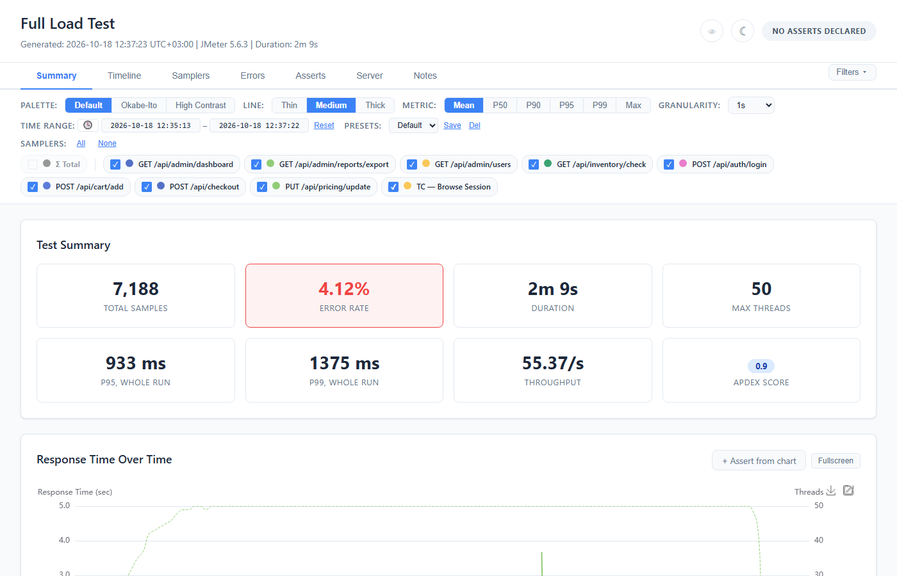
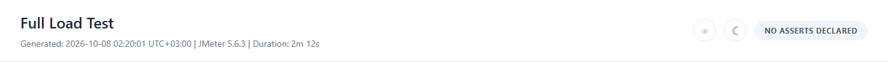
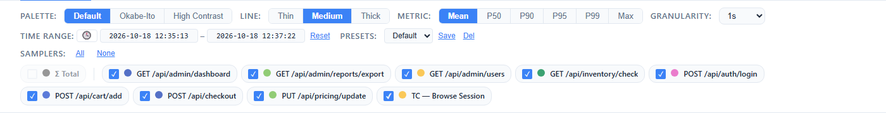

# Getting Started

## What Is Web Insight Report?

Web Insight Report is an **Apache JMeter plugin** that generates modern, interactive web reports from your load test results — a powerful alternative to JMeter's built-in HTML dashboard.

**Why use it instead of the native report?**

| | Native JMeter Report | Web Insight Report |
|---|---|---|
| Interactivity | Static charts, no filtering | Zoom, pan, filter, sort, fullscreen, drag-reorder |
| Sampler filtering | None | Per-sampler toggle, color picker, presets |
| Error analysis | Basic table | Charts (pie, bar, timeline), expandable error rows with response bodies |
| Asserts / Pass-Fail | Not supported | Declarative rules with PASS/WARN/FAIL verdicts, authored and tuned in the report itself, Apdex score |
| Server metrics | Not supported | Server asserts — the values you expect from the servers, compared with the metrics fetched for the run (Prometheus, a recording of it, or a CSV export), on their own tab and with their own status |
| Baseline comparison | Not supported | Side-by-side comparison with regression detection |
| Dark mode | No | Full dark theme + colorblind mode |
| Annotations | No | Markdown notes, timeline markers, sampler notes |
| CI/CD integration | `statistics.json` only | JSON summary with the assert verdicts + JUnit XML output |
| Chart export | No | PNG, SVG, CSV per chart/table |
| Customization | Limited | Palette, line thickness, metric toggle, granularity, presets |

The report is a **single self-contained HTML file** — no server, no CDN, no internet required. Just open it in any browser. (On a large run the chart data goes into a sibling `-data.js` file; keep it beside the HTML.)

## Requirements

- Apache JMeter **5.6.3+**
- Java **21+**

## Installation

### 1. Install the JAR

1. Download `jmeter-web-insight-report-X.Y.Z.jar` from the
   [latest release](https://github.com/aharon890/JmeterWebInsightReport/releases/latest).
2. Copy it into `$JMETER_HOME/lib/ext/`, removing any older `jmeter-web-insight-report-*.jar`
   first. One plugin JAR belongs there, never two — it is self-contained, so nothing else from
   this project goes beside it.
3. For `jmeter -g results.jtl -o dir`, register the exporter with one line in
   `$JMETER_HOME/bin/reportgenerator.properties`:

   ```properties
   jmeter.reportgenerator.exporter.webinsight.classname=com.jmeterwebinsightreport.report.exporter.WebInsightDataExporter
   ```

   The listener (GUI and `jmeter -n -t`) needs no registration.

**Building from source** instead: `./scripts/build-and-deploy.sh` builds the JAR, installs it and
registers the exporter in one step. The README's
[Installation](https://github.com/aharon890/JmeterWebInsightReport#installation) section has the
details, including installing a built JAR by hand.

### 2. Use in JMeter

**GUI mode:** Add the **Web Insight Report** listener to your test plan (Add → Listener → Web Insight Report).

**CLI mode (non-GUI):** The listener works with `-n` flag — the report generates automatically when the test ends.

```bash
jmeter -n -t test.jmx \
  -Jwebinsight.report.output=/results \
  -Jwebinsight.report.filename='report_${timestamp}.html' \
  -Jwebinsight.report.title="My Load Test"
```

Single-quote the filename: unquoted, the shell expands `${timestamp}` to nothing before JMeter
sees it.

**From existing JTL (no test plan change)** — needs the exporter line from step 1:

```bash
jmeter -g results.jtl -o report-dir/
```

See [Export & CI/CD](11-Export-Integration.md) for setup details on the `-g -o` path.

## Quick Configuration

| Property | Default |
|----------|---------|
| `webinsight.report.title` | `JMeter Web Insight Report` |
| `webinsight.report.output` | Listener run: normally the working directory (see below). `jmeter -g … -o DIR`: `DIR` |
| `webinsight.report.filename` | `web-insight-report.html` |
| `webinsight.apdex.threshold` | `500` (ms) |
| `webinsight.report.junit` | `false` |
| `webinsight.report.servermetrics` | none — the payload `wir-collect` wrote, for server asserts |

With no output directory configured, a listener run writes to the first of these it can actually
write to (each is probed with a real write, and the log names the one chosen): the directory of
the listener's own results file — the `filename` property in the `.jmx`, which this listener's GUI
does not show and `-l` does not set, so it is normally empty — then the working directory, then
the test plan's directory, then `~/.jmeter-web-insight-report`, then a `web-insight-report` folder
in the system temp directory. A `jmeter -g … -o DIR` run writes to `DIR`.

`report-annotations.json` (asserts, notes, timeline markers) and `baseline.jtl` (run comparison)
are auto-detected in that output directory only; with `-g -o` (which needs an empty directory)
pass them with `-Jwebinsight.report.annotations` / `-Jwebinsight.report.baseline`. Server asserts take two more steps after the run — fetch the metrics, then generate the report that judges them — see [Server tab](13-Server-Tab.md).

---



## Report Layout

The report has 3 main areas:

### Header


- **Report title** — configurable via GUI or `-Jwebinsight.report.title`
- **Subtitle** — shows "Generated: YYYY-MM-DD HH:mm:ss UTC±hh:mm" in your browser's time zone
  (hover it for the time as the generating machine wrote it, which is what the CI/CD JSON's
  `generatedAt` carries), JMeter version, and test duration
- **Colorblind toggle** (eye icon) — swaps green/red to blue/orange
- **Dark mode toggle** (moon/sun icon) — full dark theme
- **Status badge** — shows overall test status:
  - `ASSERTS PASS` / `ASSERTS WARNING` / `ASSERTS FAIL` (when the run declared asserts) — click
    it to open the Asserts tab
  - `NO ASSERTS DECLARED` (nothing was declared — reported, not judged)
  - `ASSERTS NOT EVALUATED` (asserts were declared and none of them judged anything — a renamed
    sampler, a metric this run could not produce, a rule the file got wrong, everything parked, or
    only server asserts on a report that has not judged them: the interim report, or one whose
    payload was refused)
  - `SERVER ASSERTS ONLY` (no client rule gave a verdict and the server asserts were judged — the
    server chip beside it carries their verdict)

  The badge answers one question: what did the declared asserts decide. It does **not** report
  errors — an error count is not a verdict, and errors have their own header card and tab.
- **Server chip** — beside the badge, on a run that declares server asserts. It speaks for the
  server side, which is judged separately and never folded into the badge:
  - `Server · Kafka FAIL · 2 more` — the worst component (FAIL, then NOT EVALUATED, then WARN,
    then PASS), and how many other components the Server tab shows
  - `Server · nothing judged` — the server asserts were evaluated, but no component was reported
  - `Server · NOT COLLECTED` — the interim report: nothing has been collected yet
  - `Server · REFUSED` — the server-metrics payload given to the report was refused

  Click it to open the Server tab.

### Tab Navigation

Eight tabs organize the report:

| Tab | Purpose |
|-----|---------|
| **Summary** | Asserts and server verdict cards, at-a-glance metrics, response time chart, top 5 slowest |
| **Timeline** | Full time-series charts (9 chart types) |
| **Samplers** | Statistics table with sorting, filtering, inline detail charts |
| **Errors** | Error breakdown charts and detail tables |
| **Compare** | Baseline vs current comparison (only visible when a baseline was loaded) |
| **Asserts** | Every declared rule and its verdict; author, tune and save them. Always shown, even on a run that declared nothing — it is where you go to *declare* |
| **Server** | Server asserts — expected server metrics against what was collected for the run, by component. Always shown; on a run that declared none it says so (see [Server tab](13-Server-Tab.md)) |
| **Notes** | Test notes (Markdown), timeline markers, the baseline summary |

A **"Filters ▾"** dropdown next to the tabs controls which filter bar rows are visible.

### Filter Bar



A persistent bar below the tabs with 3 collapsible rows:

- **Row 1:** Palette (Default/Okabe-Ito/High Contrast), Line thickness (Thin/Medium/Thick), Metric (Mean/P50/P90/P95/P99/Max), Granularity (1s to 10min)
- **Row 2:** Time range display (wall-clock/elapsed toggle), Presets (save/load/delete)
- **Row 3:** Sampler checkboxes (select/deselect individual samplers, All/None buttons, color dots)

The filter settings apply to the charts on every tab; the bar is hidden on the Server tab, whose
charts it does not affect. Palette, line thickness, custom colours and row visibility persist in
browser localStorage; save a preset to keep the rest.

## Output Files

Each report generation produces:

| File | Description |
|------|-------------|
| `web-insight-report.html` | Self-contained interactive report |
| `web-insight-report.json` | Machine-readable CI/CD summary |
| `web-insight-report.xml` | JUnit XML (when enabled) |
| `web-insight-data.js` | External chart data (large tests, or when `-Jwebinsight.report.externaldata=true` forces it; `<name>-data.js` for a report with another name) |
