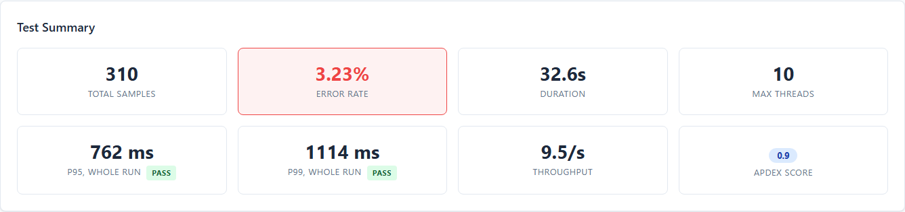

# Summary Tab

The default view when opening the report. Provides at-a-glance test metrics.

## Quality gate strip

When the run declared a gate, the Summary tab opens with it: the verdict, its make-up as counts
that add up to the number of rules declared, and the three worst entries — a breach with the rule
id, the measured number **and the limit that rejected it**, or a rule that could not run with the
reason it could not.

The actual-versus-limit is the point: a one-word verdict says something is wrong and leaves you
to find out what. **Open Asserts →** leads to the full table. See [Asserts](12-Asserts-Tab.md).

The counts and the worst entries are the gated run's — the rules this report shipped with and the
verdicts the run gave them — and a draft never moves them: when the page's rule edits would change
the file a Download writes, the strip adds one line, **Draft differs — see Asserts**, and leaves
judging the draft to that tab.

The mini badges beside *P95, whole run* and *P99, whole run* are the worst verdict across the
rules judging that metric, on any sampler — so a FAIL there can come from one slow sampler while
the whole-run figure beside it looks fine. A metric no rule mentions gets no badge — nothing judged
it, so nothing is claimed — and neither does one whose every rule decided nothing. The badges are
the gated run's and do not follow a draft.

## Server card

When the run declares server asserts, a second card sits under the strip, in the same shape: the
server verdict (the worst component's, as the header chip says it), one count per component, the
three server asserts that most need looking at with actual against limit, and **Open Server →**.
On the interim report it says NOT COLLECTED, and over a refused payload REFUSED. See
[Server tab](13-Server-Tab.md).

## Metric Cards

### Row 1 — Primary Metrics (always visible)

| Card | Value | Behavior |
|------|-------|----------|
| **Total Samples** | Integer count of all requests | Formatted with comma separators (e.g., 6,654) |
| **Error Rate** | Percentage of failed requests | Card background turns red (`card-error` class) when errors > 0 |
| **Duration** | Test execution time | Human-readable: "2m 11s", "1h 5m 30s" |
| **Max Threads** | Peak concurrent threads | Maximum active thread count during test |

### Row 2 — Statistical Metrics (visible when data available)

| Card | Value | Behavior |
|------|-------|----------|
| **P95, whole run** | The 95th percentile of every sample, all samplers together (not an average of per-sampler P95s) | Shows an assert mini-badge (PASS/WARN/FAIL) when a rule judges p95 |
| **P99, whole run** | The 99th percentile of every sample, all samplers together | Shows an assert mini-badge |
| **Throughput** | Overall requests per second | Up to 2 decimals (e.g., "49.8/s", "54.32/s") |
| **Apdex Score** | The overall Apdex | Coloured by band — see [Apdex Card](#apdex-card) below |

### Apdex Card

Displays the overall Apdex (Application Performance Index) score:

- **Score range:** 0.00 to 1.00
- **Color coding:**
  - Excellent (> 0.94) — green
  - Good (0.85–0.94) — blue
  - Fair (0.70–0.85) — amber
  - Poor (0.50–0.70) — orange
  - Unacceptable (≤ 0.50) — red
- **Threshold T:** `-Jwebinsight.apdex.threshold` (default 500 ms)
- **Calculation:** `Apdex = (Satisfied + Tolerating/2) / Total` where Satisfied = a successful
  sample at or under T, Tolerating = a successful sample over T and at or under 4T; a failed sample
  is frustrated whatever its time

## Response Time Over Time Chart

A line chart showing response time trends per sampler during the test.

**Default metric:** Mean response time (configurable via the Metric toggle in the filter bar).

**Controls:**
- **Fullscreen** — button expands chart to full viewport; **Exit Fullscreen** returns it
- **Chart legend** — click a sampler name to hide/show its line
- **Zoom** — scroll the mouse wheel over the chart
- **Pan** — click-drag while zoomed
- **Time range slider** — draggable slider at bottom of chart
- **PNG/SVG export** — the two icons in the chart toolbox (top-right)
- **+ Assert from chart** — and the rule lines drawn on it, as on the Timeline tab's response
  time chart (see [Timeline](03-Timeline-Tab.md#threshold-lines-are-rules))

**Active threads overlay:** A dashed line showing thread count over time (right Y-axis).

## Top 5 Slowest Samplers (by P95)

A ranked list of the 5 samplers with the highest P95 response times.

Each row shows:
- **Rank** — number 1-5
- **Sampler name** — the request label
- **P95 value** — "p95: 1234 ms"
- **Mean value** — "mean: 567 ms"
- **Error rate** — shown only when errors > 0 (e.g., "4.05% errors")

**CSV download:** Click the ↓ icon to download as `top5-slowest-samplers.csv`.

## Copy Summary

The **"Copy Summary"** button copies the metric cards and the Top 5 Slowest list to the clipboard as HTML tables, suitable for pasting into:
- Confluence pages
- SharePoint documents
- Email reports

**"Copy Verdict"**, beside it, copies the verdict as a few plain-text lines for a chat or an email — the test name and the time the header shows, the client verdict in the header badge's word with the gate strip's counts (the word alone when the page could not load its rules, "Asserts: none declared" when the run declared none), the server chip's verdict when server asserts are declared, "Draft differs — see Asserts" when the strip says so, and the report's file name — read from what the page shows and never judged again.
