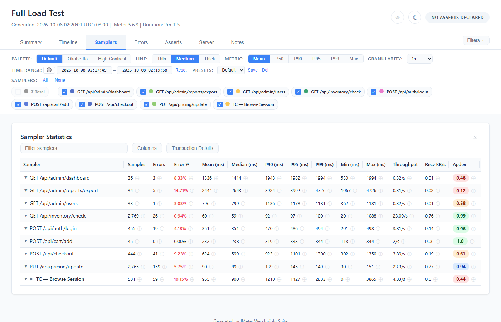

# Samplers Tab

Detailed per-sampler statistics table with sorting, filtering, column control, and inline chart expansion.

## Statistics Table

### Columns (14 total, all visible by default)

| Column | Description | Format |
|--------|-------------|--------|
| **Sampler** | Request label name | Text (truncated with ellipsis, hover for full name) |
| **Samples** | Total request count | Integer with comma separator |
| **Errors** | Failed request count | Integer with comma separator |
| **Error %** | Error rate | Percentage (e.g., "4.05%") |
| **Mean (ms)** | Average response time | Whole milliseconds |
| **Median (ms)** | P50 response time | Whole milliseconds |
| **P90 (ms)** | 90th percentile | Whole milliseconds |
| **P95 (ms)** | 95th percentile | Whole milliseconds |
| **P99 (ms)** | 99th percentile | Whole milliseconds |
| **Min (ms)** | Minimum response time | Whole milliseconds |
| **Max (ms)** | Maximum response time | Whole milliseconds |
| **Throughput** | Requests per second | Up to 2 decimals (e.g., "15.23/s") |
| **Recv KB/s** | Received kilobytes per second | Up to 2 decimals |
| **Apdex** | Application Performance Index | 0 to 1 with up to two decimals (e.g., "0.9", "0.85"), coloured as on the [Apdex card](02-Summary-Tab.md#apdex-card) |

### Σ Total Row

A virtual aggregate row that always appears at the top of the table:
- **Default state:** Hidden (Σ Total checkbox is unchecked in the filter bar)
- **Enable:** Check the "Σ Total" checkbox in the sampler filter bar
- **Values:** Summed counts, throughput and Recv KB/s; overall error rate; the true whole-run
  median and percentiles; sample-weighted mean and Apdex; transaction children left out
- **Chart behavior:** When enabled, appears as a dashed line in time-series charts

### Assert badges on the row

When the run declared a quality gate (via `report-annotations.json`):

- Each sampler row a rule judges shows a badge next to its name — the **worst verdict of the
  rules judging that sampler**, not a single threshold comparison. A sampler no rule judges has
  no badge: it is reported, not judged.
- Badge colours: green (PASS), amber (WARN), red (FAIL).
- **Click a badge** to open the judging-rules row under the sampler: one line per rule that
  judged it — its verdict, the rule id, the measured number and the band it was decided against.
  Click the badge again to close it. The row travels with its sampler through sorting, searching
  and hiding, and can be open together with the chart panel.
- The badge follows a draft. Relax a rule in the [Asserts tab](12-Asserts-Tab.md) and the
  badge here changes with it, before anything is saved.

### Assert markers — the cell

The row badge answers *"is anything unhappy about this sampler"*. It does not tell you **which
metrics are gated at all** — and that is the question you need before adding a rule.

So every metric cell a rule judges carries its own marker: `✓` pass, `!` warn, `✕` fail, `?` the
run could not produce the value. A glyph as well as a colour, because the report ships colourblind
and high-contrast palettes precisely because hue is not a channel this audience can rely on.

- **Hover** names the rule, the measured value and the limit — `p95 FAIL · checkout-p95 ·
  2,340 ms vs > 2,000 ms · click to edit`.
- **Click** switches to the Asserts tab and opens the editor on the rule that decided the cell.
  Where several rules judge one cell, the worst decides and the tooltip says how many there are.
- Read down a column and you see coverage: which samplers are gated on p95 and which are not.
  Nothing else in the report shows that.
- Markers follow drafts, so a rule seeded from a cell marks that cell immediately.

### Asserting a number you are looking at

Every metric cell — all thirteen columns after Sampler — has a faint **⊕**. Click it and the
Asserts tab opens with the assert editor targeting that sampler and metric, bands already seeded
from the observed value: fail at +20 % rounded to a number a person would pick, warn at 80 % of
fail or 16 % above today's value, whichever is higher. For throughput, Recv KB/s and apdex the
direction flips automatically, because worse means smaller there.

Where a rule already exists the ⊕'s tooltip reads **"Add another assert on …"** rather than plain
"Assert …", and the cell's marker is the shorter path: editing the existing rule is almost
always what was meant, and a second rule for the same sampler and metric means two rules and two
JUnit testcases for one intention.

See [Asserts](12-Asserts-Tab.md).

### Sampler Notes

When sampler notes are configured in annotations:
- A blue (i) icon appears next to the sampler name
- Hover to see the note text as a tooltip; click the icon to keep it open

## Table Interactions

### Sorting

- Click any **column header** to sort ascending
- Click the **same header again** to sort descending
- Visual indicator (▲/▼) appears on the sorted column

### Search / Filter

- A **text input** above the table filters rows by sampler name
- Matching is case-insensitive
- Non-matching rows are hidden (not removed)
- Clear the input to restore all rows

### Column Visibility

- Click the **"Columns"** button to open a dropdown
- All 14 columns listed with checkboxes (all checked by default)
- **Uncheck** a column → it disappears from the header and all data rows
- **Re-check** → column reappears where it was
- Multiple columns can be hidden simultaneously; a **"Show N Hidden Columns"** button brings them
  all back

### Column Order and Width

- **Drag a header** onto another to reorder the columns; the order is saved to localStorage
- **Drag a header's right edge** to resize that column; **double-click** the edge to fit it to its
  contents. Widths are saved, and **Reset Widths** (shown once a width is set) returns every column
  to its automatic width

### Row Hiding

- Each data row has an **× (hide) button** at the right of the Sampler cell, shown on hover
- Click × → the row and anything open under it disappear from the table
- A **"Show N Hidden Rows"** button appears above the table
- Click it → all hidden rows restored; a Transaction Controller child comes back into view
  while **Transaction Details** is on, and with the other children when it is next turned on

### CSV Export

- Click the **↓ icon** to download the table as `sampler-statistics.csv`
- Exports **every sampler**, hidden rows and columns included, plus columns the table does not
  show (Std Dev, Sent B/s, Avg Connect, Avg Latency)

## Click-to-Expand Detail View

Click any sampler row to expand an inline detail panel:

### Expand/Collapse

- **Click row** → detail panel appears below the row
- **Chevron** changes from ▼ (grey) to ▲ (blue)
- **Click row again** → panel collapses, chevron reverts

### Chart Slots

The detail panel has **3 chart slots** by default:

| Slot | Default Chart | Description |
|------|---------------|-------------|
| 1 | Response Time Distribution | Histogram of response time bins |
| 2 | Response Time Over Time | Line chart for this sampler only |
| 3 | Bytes (Recv / Sent) | Received and sent bytes over time |

### Chart Slot Controls

- **Dropdown selector** on each slot — change the chart type:
  - Response Time Distribution (histogram)
  - Response Time Over Time
  - Bytes (Recv / Sent)
  - Throughput Over Time
  - Error Rate Over Time
  - Connect Time & Latency
  - Percentiles Over Time (P50/P90/P95/P99)
- **"+ Add Chart"** button in the table toolbar, shown while a row is expanded — adds a 4th slot,
  starting as Throughput Over Time (max 4)
- **"× Remove Chart"** button, shown while there are 4 slots — removes the 4th (min 3)
- Changes apply to **all currently expanded rows** (global sync)
- Configuration saved to localStorage

The chart panel and the [judging-rules row](#assert-badges-on-the-row) are separate: either can be
open without the other, and both follow their sampler when the table is sorted or filtered.

## Transaction Controller Hierarchy

When the test has Transaction Controllers (parent/child sampler hierarchy):

### Default Behavior

- Only **parent transactions** and **standalone samplers** are shown
- Child samplers are hidden from the table, filter bar, charts and the Errors tab's tables
- This matches JMeter's native Aggregate Report behavior
- **No double-counting:** Parents aggregate their children
- A parent that came from a Transaction Controller carries a ▶ icon before its name

### Transaction Details Toggle

- A **"Transaction Details"** button appears in the Samplers tab toolbar
- **Default:** OFF (children hidden); the choice is remembered in localStorage
- **Toggle ON:**
  - Child samplers appear, indented
  - Children show full statistics and expand to their own charts like any row
  - Children also appear in the filter bar with checkboxes
- **Toggle OFF:**
  - Children hidden again
  - Σ Total values unchanged (never double-counted)

### Detection

The hierarchy comes from the result tree the listener receives, never from sampler names: a
sample's sub-results are its children — a Transaction Controller's parent sample, and also embedded
resources and redirect hops. Only a parent that came from a Transaction Controller gets the ▶ icon.
A report generated from a JTL with `jmeter -g` has no hierarchy, so every sampler is listed at the
top level there.
