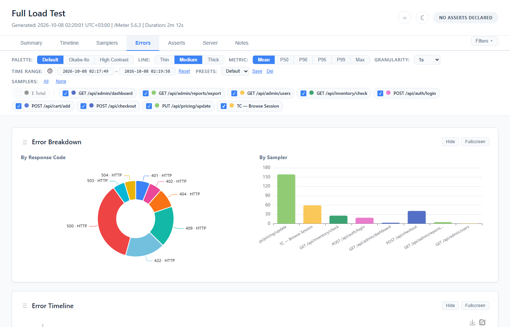
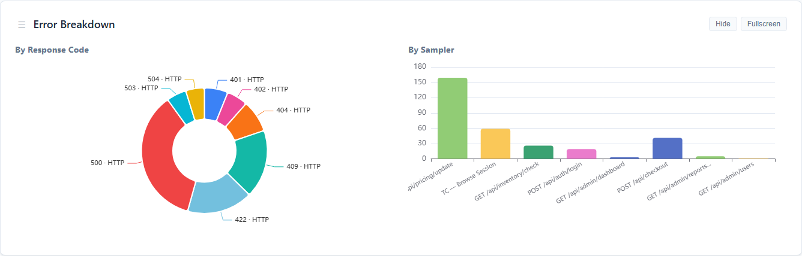
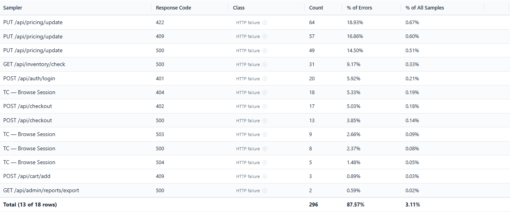
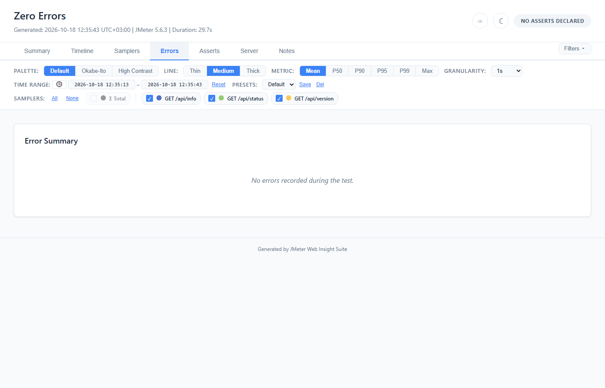
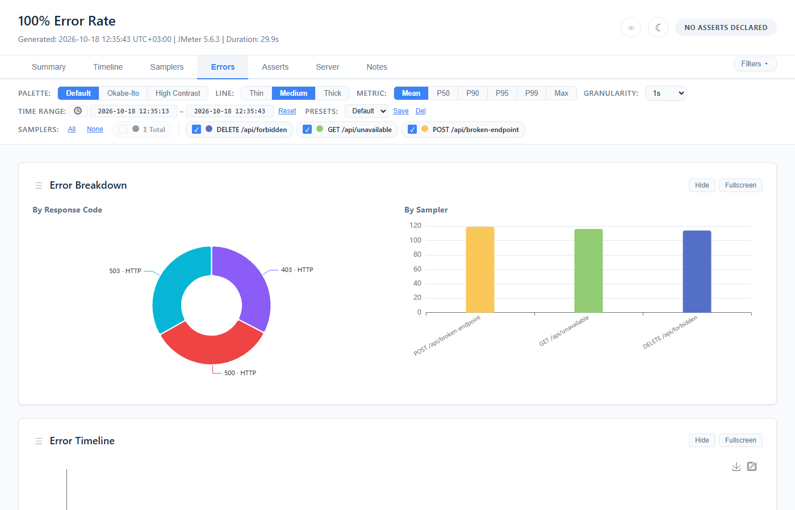

# Errors Tab

Error breakdown charts and detail tables for investigating test failures.




## Error classes: where a failure was decided

Every row in this tab is a sample JMeter judged failed (`success = false`). That is **not** the
same as an HTTP error, and the report says which is which.

| Class (selector token) | Condition | What it means |
|---|---|---|
| **HTTP failure** (`protocol`) | code in 100–599, outside 2xx | The server answered and the status said no — 404, 500, 503. 3xx lands here too: a redirect reaching the error set means redirect handling was off or the target failed, which is an HTTP-level story either way. |
| **Non-protocol failure** (`nonProtocol`) | code in 200–299 | The server answered *successfully* and the sampler failed it anyway — a Response Assertion, or a script calling `setSuccessful(false)`. |
| **Transport failure** (`transport`) | anything else | No HTTP status at all. Either JMeter wrote the exception into the code field (`Non HTTP response code: java.net.ConnectException`), or it wrote **`000`** — its marker for "no status line was ever read", which is a connection refused, a timeout before the first byte, or a failed TLS handshake. Numeric codes outside the status range land here too, which is what a JDBC, JMS or TCP sampler writes. |

> **`000` is a transport failure.** It is all digits, but digits alone do not make a status — the
> 100–599 range does. So a run whose errors are all connection failures counts them under
> `errorRate:class=transport`, the selector written to gate on exactly that, and none under
> `class=protocol`.

> **The class is inferred from the code.** It comes from the response code of a sample already
> known to have failed, and says **where** the failure was decided, never why — so it is the same
> answer on a live listener run and on a JTL re-parsed by `-g`, whatever the JTL saved. The *why* is
> the **type of error** below.

**The type of error is JMeter's.** Errors are grouped per sampler by the "Type of error" JMeter's
HTML report groups them by: the code and the response message (`500/Internal Server Error` and
`500/Database timeout` are two rows), or, for a failed response JMeter counts as a success (a code
from 200 to 399) or one with no code, the first failed assertion's message (`Test failed: text
expected to contain /order-id/`) — `Assertion failed` when the results file saved none. The
listener reads that message off the sample; `-g` reads the JTL's `failureMessage` column, which
JMeter writes by default. With `jmeter.save.saveservice.assertion_results_failure_message=false`
JMeter types every such failure `Assertion failed`, and so does the report (JMeter's own `-g` then
refuses the file, which lacks the column). A non-protocol row's response message is the HTTP reason phrase — `OK` —
which says nothing about why the sampler failed it, so the tab shows the type of error there
instead.

The class appears on every surface: both tables, the grouped error view, the by-response-code
chart, and both CSV exports.


## Error Charts

Three charts provide different views of error data. The first two sit side by side in the
**Error Breakdown** card:



### Error Breakdown by Response Code (Pie Chart)

- Donut/pie chart showing error distribution by HTTP status code, each slice labelled with the
  code and its [class](#error-classes-where-a-failure-was-decided) (`500 · HTTP`)
- Fixed colors per code: 500=red, 401=blue, 404=orange, etc.
- Hover for exact counts and percentages

### Error Breakdown by Sampler (Bar Chart)

- Bar chart showing error count per sampler, one column each
- Uses the sampler palette colors (matches the filter bar color dots)
- Quickly identifies which requests fail most

### Error Timeline (Scatter Plot)

- Individual error occurrences plotted over time
- Each dot = one error, colored by sampler; hover for its time and response code
- Reveals error bursts and patterns (e.g., errors clustered during a specific time window)

**The first 500 errors.** The report keeps the details of the first 500 failed samples. The error
timeline plots those, and says so under the chart, with the time of the last one plotted, when the
run had more. The two breakdown charts then count every error instead — and the sampler filter
stops applying to them, which their caption also says. The Error Summary table always counts every
error.

### Chart Controls

The Error Breakdown card and the Error Timeline each have:
- **Drag handle** (☰) — reorder the two
- **Hide** button and a **"Show N Hidden Charts"** button to bring them back, as on the Timeline tab
- **Fullscreen** button

## Error Summary Table



Groups errors by **sampler + type of error** with aggregate counts.

| Column | Description |
|--------|-------------|
| **Sampler** | Request label |
| **Response Code** | HTTP status code (e.g., 500, 404) |
| **Type of error** | As JMeter's HTML report words it: `500/Internal Server Error`, or a failed assertion's message |
| **Class** | Where the failure was decided — see [Error classes](#error-classes-where-a-failure-was-decided) |
| **Count** | Number of occurrences |
| **% of Errors** | Percentage of total errors |
| **% of All Samples** | Percentage of all requests |

The tab counts **failed requests**, as JMeter's HTML report's Errors table does: every sample but a
Transaction Controller's own result, transaction children included. A transaction fails because a
request inside it failed, so its own result is left out of the rows, the charts and both
percentages' totals — listing it as well counted that failure twice. The Summary tab's Error Rate
card counts samples as JMeter's Aggregate Report does, transactions included and their requests
inside them, so on a run with transactions the two differ, and the tab says so above its charts.
The asserts' `errorRate:code=` and `errorRate:class=` still count a failed transaction, as the
Error Rate card does.

**The Total row is the sum of the rows shown.** Its Count adds up the Count column above it, and
its two percentages are that count's share of every error and of every sample — the same two
numbers each row divides by. Each row's percentage is rounded to two decimals and the Total's is
worked out from the count, so a percentage column can add up to a hundredth or two more or less
than the Total says: the rows' % of Errors can add up to 100.01% above a Total of 100.00%.

A row the search or an X hides is not in the Total, and the Total changes as soon as one of those
does: it reads **100.00%** of errors only when every row is counted, and when some are not, its
first cell says how many are — `Total (12 of 17 rows)`. The search never hides the Total itself.

**Transaction Details** (Samplers tab) does not collapse anything here: the rows are the requests,
and no transaction row stands for them. While it is off, the sampler filter shows a request's
errors in the charts when the transaction it is inside is ticked.

**Controls:**
- **Search** — filter rows by text
- **Sort** — click a column header
- **Column toggle** — show/hide columns; drag a header's right edge to resize a column
- **Row hide** — X button per row; "Show N Hidden Rows" brings back what X hid and nothing else —
  the search keeps its rows
- **CSV download** — exports as `error-summary.csv`, every row, with the response message
- **⊕ on the Class cell** — opens the assert editor on the Asserts tab with a rule for that
  sampler's error rate in that class (`errorRate:class=transport`, for example), seeded from the
  observed rate

## Error Details Table

Individual error records with request-level detail — the first 500 failed samples (see
[the first 500 errors](#error-timeline-scatter-plot)).

A **By time / Grouped** switch beside the heading picks the view, and the choice is remembered.

### By time

One row per error, in the order they happened.

| Column | Description |
|--------|-------------|
| **Time** | Time of the error (`HH:mm:ss.SSS`) |
| **Sampler** | Request label |
| **Code** | HTTP response code |
| **Class** | Where the failure was decided — see [Error classes](#error-classes-where-a-failure-was-decided) |
| **Message** | Response message text; for a failed 2xx, the type of error (the assertion's message) |
| **Thread** | JMeter thread name |

### Grouped

One row per sampler and type of error, most frequent first: **Count**, **Code** (with its class),
**Sampler**, **Type of error**, **First seen** and **Last seen**. Click a group to list each occurrence's
time and thread; **Expand All** and **Collapse All** open or close every group, and the search box
filters the groups.

### Expandable Error Rows


In the By time view, click any row to expand it. The panel shows what was captured for that sample:
- **URL** — the URL that failed, when the sample has one (a sampler that is not HTTP has none)
- **Response Body** — the error response body with JSON auto-formatting and syntax highlighting,
  and **Copy**, **Wrap** (word wrap) and **Raw** (the body as received, unformatted). A body cut at
  the size limit is marked *(truncated)*

Request and response headers are captured neither by the listener nor from a JTL, so the panel
never shows them. A record with neither a URL nor a body says the body is not available and points to the
listener.

**Response body size limit:** 16,384 characters by default. Configure via:
```bash
-Jwebinsight.error.body.maxsize=32768
```

Click again to collapse.

**Note:** the **response body is listener-only** — a JTL carries none, so a `-g` report shows
response code, message, thread and URL but no body. The **URL is available in both**: listener
mode reads it from the sample, and JTL mode reads a `URL` column when the file has one, which
JMeter writes under `jmeter.save.saveservice.url=true`.

**Controls:** Same as Error Summary (search, sort, column toggle, row hide), and a CSV download as
`error-details.csv` holding every kept record with its URL and response body, whichever view is
showing.

## Sampler Filter Integration

The error charts respect the sampler filter:
- **Uncheck a sampler** → its errors disappear from all 3 charts (from the breakdown charts only
  when the run kept every error's details — see [the first 500 errors](#error-timeline-scatter-plot))
- While **Σ Total** is checked the filter does not apply: all 3 charts show every sampler's errors
- **Re-check** → errors reappear
- This allows focusing on specific request types when investigating failures

The two tables do not: they list every error whatever the filter shows, and so does the Error
Summary's Total. Use a table's search to narrow it.

## Edge Cases

- **Zero errors:** Error tab shows no charts or tables, only *No errors recorded during the test.*



- **100% errors:** All charts render normally, all table rows show error data


