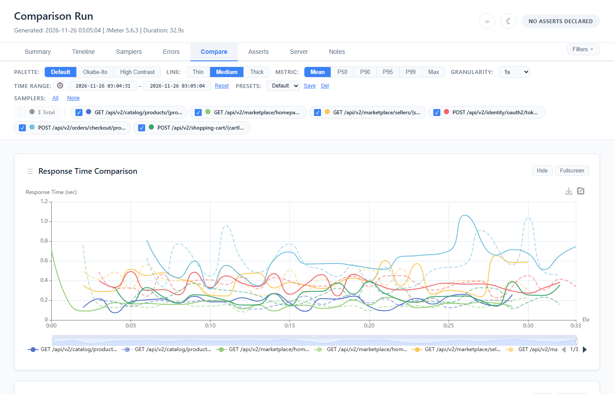
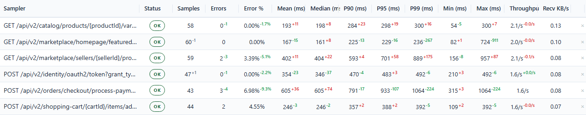

# Compare Tab

Baseline vs current run comparison with regression detection.

## Setup

**Auto-detection:** Place a previous run's JTL file as `baseline.jtl` in the report output directory. The plugin auto-detects it and enables the Compare tab.

```bash
# Example: copy previous results as baseline
cp previous-results.jtl /output/dir/baseline.jtl

# Run new test — Compare tab will appear in the report
jmeter -n -t test.jmx -Jwebinsight.report.output=/output/dir
```

**Explicit path via CLI:** Use `-Jwebinsight.report.baseline` to point to a specific file:

```bash
jmeter -n -t test.jmx \
  -Jwebinsight.report.baseline=/path/to/previous-results.jtl
```

This is useful when the baseline JTL is stored in a different location (e.g., a CI artifact from the previous build), and it is the way to give `jmeter -g results.jtl -o dir` a baseline, since `-o` takes an empty directory.

When a baseline is loaded, the **Compare** tab button becomes visible in the tab navigation (it is hidden by default when no baseline exists).

### What a baseline can be

A baseline is either of two files, and the report tells them apart by what is in them, never by the file's name:

- **A JMeter results file** (a JTL in JMeter's CSV format), read as it always was.
- **Run data** of any load tool (`.jsonl` or `.jsonl.gz`, [the common format](18-Run-Data.md)): a JMeter run writes
  it with `-Jwebinsight.report.rundata=true`, a k6 run with `build-report --from k6 ... --write-run-data`.

A file that is neither gets no Compare tab, and one WARNING line in the log names it and says what a baseline is. A
baseline works on a report of any tool: `jmeter -g`, the listener, and `build-report --baseline FILE`
([k6 and other load tools](17-Other-Load-Tools.md)).

### Two runs of one tool, two runs of two tools

- **One tool** (JMeter against JMeter, k6 against k6): the Compare tab below, judged by the regression thresholds, in
  that tool's words. On a k6 run Recv KB/s reads "not measured" on both sides, since k6 records no bytes per request.
- **Two tools** (JMeter against k6, either way round): the two tools time a request differently, so their numbers are
  two readings, not faster or slower. The tab compares them without judging: see
  [A pair of two tools](#a-pair-of-two-tools).



## Comparison Charts

### Response Time Comparison

- **Current run:** solid lines per sampler
- **Baseline run:** dashed lines per sampler
- Both aligned by elapsed time (starting from 0)
- Respects the **Metric toggle** (Mean/P50/P90/P95/P99/Max), the Σ Total line included
- Respects the **Sampler filter** (deselected samplers hidden)

### Throughput Comparison

- Same current (solid) vs baseline (dashed) layout for throughput
- Per-sampler series

With **Σ Total** checked in the filter bar, both charts add a thicker total line: solid for the
current run, dashed for the baseline.

Both charts draw the runs' 1-second data: the filter bar's **Granularity** setting does not apply
to them.

Both charts support: drag-to-reorder, fullscreen, hide/show, zoom, cross-chart sync, dark mode, PNG/SVG export.

## Sampler Comparison Table



| Column | Description |
|--------|-------------|
| **Sampler** | Request label |
| **Status** | Badge: OK, REGRESSION, NEW or REMOVED |
| **Samples** | Current count with delta (superscript) |
| **Errors** | Current count with delta |
| **Error %** | Current rate with delta |
| **Mean (ms)** | Current value with delta |
| **Median (ms)** | Current value with delta |
| **P90 (ms)** | Current value with delta |
| **P95 (ms)** | Current value with delta |
| **P99 (ms)** | Current value with delta |
| **Min (ms)** | Current value with delta |
| **Max (ms)** | Current value with delta |
| **Throughput** | Current value with delta |
| **Recv KB/s** | Current value with delta |

Each current value is written as the Samplers table writes it (whole milliseconds, Throughput per
second, minute or hour, two decimals for Error % and KB/s), so a row reads like the same sampler's
row in an Aggregate Report.

### Σ Total Row

With **Σ Total** checked in the filter bar, the table's first row is the whole run: this run's
**Σ Total** against the baseline's, what a JMeter user reads off two Aggregate Reports' TOTAL rows
side by side (JMeter itself has no comparison view). Its figures are this run's Samplers Σ Total row,
counted per sample over the whole run, never added up from the rows; the delta beside each is the
baseline's whole run, counted the same way; its status is judged by the same thresholds as every
row. It stays first whatever the sort, the search or the status chips, as the whole run is no one
sampler's, and the CSV writes it first, as the table shows it.

### Delta Values

Each metric shows a superscript delta — the current value minus the baseline's, in the column's
own unit:
- **Green** (or blue in colorblind mode) — improvement: lower on Errors, Error % and every time
  column (Mean to Max, Min included), higher on Throughput and Recv KB/s
- **Red** (or orange in colorblind mode) — regression: the opposite direction on those columns
- **Neutral** (no colour) — Samples: more samples means a longer or busier run, not a better or
  worse one
- Format: "+120" or "-1.2s" on a time column, "+0.5%" on Error % (percentage points), "-3.4/s" on
  Throughput. No delta is shown only when the change is exactly zero; a change smaller than the
  column's precision still shows, as "+0" or "+0.0/s"

### Status Badges

The badges are outlined, so they read as a comparison rather than an assert verdict.

| Badge | Color | Condition |
|-------|-------|-----------|
| **OK** | Green | No regression detected |
| **REGRESSION** | Red | Any enabled threshold crossed — by default P95 increased > threshold OR error rate increased > threshold |
| **NEW** | Blue | Sampler exists in current but not in baseline |
| **REMOVED** | Red, dimmed | Sampler ran in the baseline but not in this run; its row shows dashes. Counts as a regression, whatever the thresholds |

### Table Controls

The toolbar every table of the report has: search, status chips with their counts (REGRESSION, NEW,
REMOVED, OK; several at once), **Group by** status, **Columns**, × on a row and **Show N hidden**, and **CSV**
(`comparison.csv`, the rows and columns shown). Every header sorts by the column's value, from the mouse or the
keyboard, and columns can be dragged to a new order and resized. **Apply** keeps the search, the hidden rows
and the sort, and each cell stays under its own header whatever order the columns are in.

## Regression Thresholds

Thresholds that determine what constitutes a "regression":

> **Informational only.** A REGRESSION badge decides nothing outside the page: the comparison is
> not in the CI/CD JSON or the JUnit XML, and it never changes the exit code. To fail a build on
> a slower run, declare a rule on the [Asserts tab](12-Asserts-Tab.md).

| Metric | Default | Meaning |
|--------|---------|---------|
| **P95 % change** | 10% | P95 increase > 10% → REGRESSION |
| **Error rate change** | 2% | Error rate increase > 2pp → REGRESSION |
| **Mean % change** | Disabled (-1) | Not checked by default |
| **P99 % change** | Disabled (-1) | Not checked by default |
| **Throughput % drop** | Disabled (-1) | Not checked by default; when set, a throughput *decrease* past it is a regression |

### Configuration

**Via `report-annotations.json`:**
```json
{
  "comparisonThresholds": {
    "p95PctChange": 15,
    "errorRateChange": 3,
    "meanPctChange": 20,
    "p99PctChange": -1,
    "throughputPctChange": -1
  }
}
```

**Via JMeter CLI properties:**

| Property | Default |
|----------|---------|
| `webinsight.compare.p95.threshold` | `10` (%) |
| `webinsight.compare.errorrate.threshold` | `2` (percentage points) |
| `webinsight.compare.mean.threshold` | `-1` (disabled) |
| `webinsight.compare.p99.threshold` | `-1` (disabled) |
| `webinsight.compare.throughput.threshold` | `-1` (disabled) |

```bash
-Jwebinsight.compare.p95.threshold=15
-Jwebinsight.compare.errorrate.threshold=3
-Jwebinsight.compare.mean.threshold=20
-Jwebinsight.compare.p99.threshold=25
-Jwebinsight.compare.throughput.threshold=10
```

Set any threshold to **-1** to disable that check. CLI properties override annotation values.

### Live Threshold Controls


The Compare tab includes UI controls to adjust thresholds on-the-fly:
- Input fields for each threshold: *P95 increase >*, *Error rate increase >*, *Mean increase >*,
  *P99 increase >*, *Throughput decrease >* (`-1` = disabled)
- **"Apply"** button to re-evaluate regression flags client-side, by the same rules the report
  was generated with: a removed sampler stays a regression, and a metric whose baseline was 0
  counts any increase as +100%
- Useful for exploring what thresholds make sense for your application
- Changes are local (do not modify the annotations file)

## What Changed summary

Auto-generated in the **Notes tab** when baseline comparison exists:
- Overall: the two runs' **Σ Total** rows, the baseline's and this run's, in the Compare table's
  columns: each written as that run's own Samplers Σ Total row is, as a JMeter user reads two
  Aggregate Reports' TOTAL rows side by side. Each run's whole run is counted per sample, never
  added up from the rows.
- Regressed samplers with their P95 % change (the top three, then "…and N more"); a removed
  sampler is listed as "(removed)"
- Improved samplers — P95 down by more than 5 % — likewise
- New samplers not in baseline

Rebuilt each time you press **Apply** on the Compare tab's threshold controls.

On a pair of two tools the regressed, improved and new lists are left out: see below.

## A pair of two tools

A JMeter run and a k6 run (or a k6 run and a JMeter baseline) are compared as perf hub's Compare page compares them:
both numbers in every cell, and nothing judged.

- **The title** is the pair's tools, the baseline's first: **JMeter against k6**. Beside it: "Each cell: JMeter → k6,
  with the difference under it".
- **Each cell** reads `baseline → this run`, each number written as that run's own Samplers table writes it, with the
  difference (this run minus the baseline, in the column's unit) in grey under it. A column a tool does not measure
  reads "not measured" on that tool's side, with no difference (k6's Recv KB/s).
- **Nothing is judged**: no OK, REGRESSION, NEW or REMOVED badge, no green or red, and no Regression Thresholds
  controls.
- **A request only one run has** reads "only in the baseline" or "only in this run" in the Status column, with that
  run's numbers and a dash on the other side. The status chips filter by them. Request names must match between the
  JMeter plan and the k6 script for a request to be compared; a name that differs is "only in" one run.
- **Connection time**: one line under the table says "Connection time: JMeter's times include opening a connection and
  k6's do not, so a request that opens one (often the first of each session) reads lower under k6."
- **The charts** overlay both runs as on any pair, the baseline dashed, each series named by its tool: "Login (k6)",
  "Login (JMeter baseline)".
- **What Changed** on the Notes tab shows the two runs' Σ Total rows, each named by its tool, then each request's
  change: its mean and P95, baseline → this run with the difference, or which run it was only in, with its samples
  and mean.

The comparison is in neither the CI/CD JSON nor the JUnit XML, on any pair.
