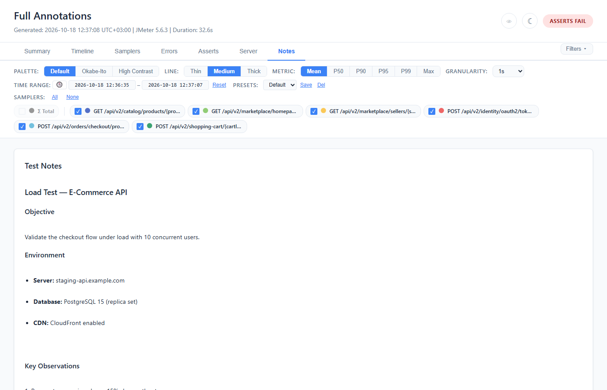

# Notes Tab

Test annotations: markdown notes, timeline markers, and the baseline summary.

> **Saving.** *Save Annotations* here and the save menu in the
> [Asserts tab](12-Asserts-Tab.md) write the same file, and both emit the **whole
> document** — notes, markers, sampler notes, comparison thresholds, assertion rules,
> the `serverMetrics` block with any server asserts edited on the [Server tab](13-Server-Tab.md),
> and any key this version of the plugin does not recognise, carried through verbatim. Editing
> notes never costs you your rules or your server asserts, and editing either never costs you
> your notes. Typed notes are a draft like any other edit: they count in the unsaved-changes pill,
> and *Discard drafts* on the Asserts tab drops them with the rest.

## With Annotations (report-annotations.json)

When the run was given a `report-annotations.json`, the Notes tab renders:

### Test Notes



The notes open as Markdown in an editable box, and **Preview** renders them as HTML (shown above;
press it again to go back to editing). The preview understands:
- Headings (`#`, `##`, `###`)
- Bold, italic, inline code
- Bullet lists (`- item`)
- Code blocks (```` ``` ````)

### Timeline Markers

Vertical dashed lines at annotated timestamps, drawn on the Response Time, Throughput and Error
Rate charts of the Timeline tab and on the Summary tab's chart. The **Timeline Annotations**
section of this tab lists every marker with its time, type, label and description.

| Marker Type | Color |
|-------------|-------|
| `info` | Blue |
| `warning` | Amber |
| `error` | Red |
| `incident` | Red |
| `deployment` | Blue |
| `custom` | Purple |
| none, or any other value | Grey |

A marker's own `color` key overrides its type's colour.

Each marker has:
- **Label** — short text shown on the chart
- **Description** — longer text, listed beside the marker on this tab

### Sampler Notes

Per-sampler annotations shown as blue (i) icons in the Samplers tab table:
- Icon appears next to the sampler name
- Hover to see the note text as a tooltip

### What Changed summary

When baseline comparison exists, an auto-generated summary of regressions and improvements appears in the Notes tab — see [Compare](06-Compare-Tab.md#what-changed-summary).

## Without Annotations

With no annotations file, the same editor starts empty:


### Markdown Editor

- **Textarea** — type markdown text
- **Preview** — swaps the box for the rendered Markdown; press it again to go back to editing
- **"Save Annotations"** button — downloads `report-annotations.json`, a file that can be used in
  future runs. The confirmation says where it goes: put it in the report's output directory, or
  pass `-Jwebinsight.report.annotations=<path>`

This allows engineers to write notes directly in the report and export them for the next run.

## Annotations JSON Format

```json
{
  "version": "1.0",
  "testNotes": "## Test Objective\nValidate checkout under 500 users.",
  "assertions": [
    { "id": "checkout-p95",
      "target": { "sampler": "POST /api/checkout" },
      "metric": "p95", "fail": { "gt": 1000 } }
  ],
  "samplerNotes": {
    "POST /api/checkout": "Includes 2s payment delay"
  },
  "timelineMarkers": [
    {
      "timestamp": 1773702727000,
      "label": "DB Failover",
      "type": "warning",
      "description": "Primary DB switched to replica"
    }
  ],
  "comparisonThresholds": {
    "p95PctChange": 15,
    "errorRateChange": 3
  }
}
```

**Auto-detection:** With no output directory configured, a listener run writes to the first of
these it can actually write to (each is probed with a real write, and the log names the one
chosen): the directory of the listener's own results file — the `filename` property in the
`.jmx`, which this listener's GUI does not show and `-l` does not set, so it is normally empty —
then the working directory, then the test plan's directory, then `~/.jmeter-web-insight-report`,
then a `web-insight-report` folder in the system temp directory. A `jmeter -g … -o DIR` run
writes to `DIR`. `report-annotations.json` and `baseline.jtl` are auto-detected in that output
directory only; with `-g -o` (which needs an empty directory) pass them with
`-Jwebinsight.report.annotations` / `-Jwebinsight.report.baseline`.

Or specify explicitly: `-Jwebinsight.report.annotations=/path/to/annotations.json`, or the
listener's **Annotations File** field.
