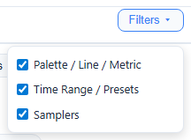

# Filter Bar

A persistent control bar below the tabs that affects the charts on every tab. It is hidden on the
Server tab, whose charts it does not affect.

## Collapsible Rows

The filter bar has 3 rows, each independently collapsible:

| Row | Contents | Default |
|-----|----------|---------|
| **Row 1** | Palette, Line thickness, Metric toggle, Granularity | Visible |
| **Row 2** | Time Range display, Timer/Clock toggle, Presets | Visible |
| **Row 3** | Sampler checkboxes, All/None buttons, color dots | Visible |

**Toggle visibility:** Click **"Filters ▾"** in the tab navigation → dropdown with 3 checkboxes (*Palette / Line / Metric*, *Time Range / Presets*, *Samplers*). Uncheck a row to hide it. Hiding a row does NOT reset its settings — all filters remain active.

**Persistence:** Row visibility state saved to localStorage.

## Row 1: Palette / Line / Metric / Granularity

### Palette Selection

Three built-in color palettes for chart lines:

| Palette | Description | Default |
|---------|-------------|---------|
| **Default** | Standard ECharts palette (blue, green, gold, red, ...) | Yes |
| **Okabe-Ito** | Colorblind-friendly (deuteranopia/protanopia safe) | No |
| **High Contrast** | Maximum visual separation between series | No |

**Behavior:** Click a button → all chart lines update to the new palette colors. Sampler color dots in the filter bar also update, and any per-sampler colour override is cleared. Persists in localStorage.

### Line Thickness

| Option | Width | Default |
|--------|-------|---------|
| **Thin** | 1px | No |
| **Medium** | 2px | Yes |
| **Thick** | 3px | No |

**Behavior:** Click a button → all chart line widths update. Persists in localStorage.

### Metric Toggle

| Option | Data Shown | Default |
|--------|------------|---------|
| **Mean** | Average response time | Yes |
| **P50** | 50th percentile (median) | No |
| **P90** | 90th percentile | No |
| **P95** | 95th percentile | No |
| **P99** | 99th percentile | No |
| **Max** | Maximum response time | No |

**Behavior:** Affects the Response Time Over Time chart on both Summary and Timeline tabs — and which rules draw their threshold lines there — and the Compare tab's Response Time Comparison. Other charts (Throughput, Error Rate, etc.) are unaffected.

### Granularity

Dropdown controlling time-series aggregation level:

| Option | Bucket Size |
|--------|-------------|
| **1s** | Raw 1-second data |
| **5s** | 5-second buckets |
| **10s** | 10-second buckets |
| **30s** | 30-second buckets |
| **1min** | 1-minute buckets |
| **5min** | 5-minute buckets |
| **10min** | 10-minute buckets |

Each bucket holds a sample-weighted average for response times, percentiles and error rates, the
bucket's rate for throughput and bytes, and the maximum for Max.

**Default:** Auto-detected from the test duration:

| Test duration | Default granularity |
|---------------|---------------------|
| Up to 5 minutes | 1s |
| Over 5 minutes | 10s |
| Over 15 minutes | 30s |
| Over 30 minutes | 1min |
| Over 1 hour | 5min |
| Over 2 hours | 10min |

**Behavior:** Changing granularity instantly re-renders the time-series charts. Underlying data stays at 1-second resolution — only the display aggregation changes. Does NOT affect the Samplers table values, the heatmap, the percentile bars or the Compare tab's
charts, which always draw 1-second data.

## Row 2: Time Range / Presets

### Time Range Display

- **Start/End inputs** — read-only, show the current visible time range as date and wall-clock time
- **Syncs with chart zoom** — when you zoom into a chart, these update
- **Reset button** — restores all charts to full time range

### Timer/Clock Toggle

- **Default:** Wall-clock time (e.g., "14:30:50"), clock icon
- **Click toggle** → switches to elapsed time (e.g., "1:20:15"), stopwatch icon
- **Click again** → back to wall-clock
- Affects the chart X-axis labels

### Filter Presets

Save and restore complete filter configurations:

| Action | Behavior |
|--------|----------|
| **Save** | Asks for a name, then saves: sampler visibility, metric, palette, line thickness, the Samplers table's hidden columns |
| **Load** | Select from dropdown → all saved settings restored |
| **Delete** | Select preset → click Del → removed |
| **Default** | Always-present option that restores what a preset saves to its defaults: every regular sampler checked (Σ Total, utility samplers and samplers with no samples unchecked), Mean, the Default palette (custom sampler colours cleared), Medium lines, and every Samplers table column shown. Granularity, chart zoom, the Timer/Clock mode and which filter rows are shown are left as they are |

Presets are stored in localStorage under the key `wir_filterPresets`.

## Row 3: Samplers

### Sampler Checkboxes

- One checkbox per sampler, labeled with the sampler name; transaction children are indented
  and listed only while **Transaction Details** is on (Samplers tab)
- **Default:** All regular samplers checked. Σ Total unchecked. Utility samplers (JSR223*, Debug*, BeanShell*, names starting `__`) and samplers with no samples unchecked.
- **Uncheck** a sampler → its data disappears from:
  - The charts on the Summary, Timeline and Compare tabs (line removed), along with the
    threshold lines of the rules about it
  - Error tab charts (errors hidden; the two error tables keep every row)
- The Samplers table and the header cards are not filtered: they always show every sampler
- **Re-check** → everything restored

### All / None Buttons

- **All** — checks every checkbox
- **None** — unchecks every checkbox

### Σ Total Checkbox

- The first, bold entry in the list
- **Default:** Unchecked (Total not shown)
- **Check:** Adds a virtual aggregate row to the Samplers table and a thicker, dashed total
  line to charts; on the Compare tab that line is solid for the current run and dashed for the baseline,
  and follows the Metric toggle like the per-sampler lines
- Values: see *Σ Total Row* on the [Samplers tab](04-Samplers-Tab.md)

### Per-Sampler Color Override

- Each sampler has a **color dot** next to its name
- **Click the dot** → color picker popup opens:
  - Grid of swatches from all palettes, the current colour marked
  - Native `<input type="color">` (**Custom...**) for any other colour
- **Select a color** → dot updates, chart line color updates
- **Persistence:** Custom colors saved to localStorage; choosing a palette clears them
- The Server tab opens the same picker from its **Line colour** dot, for the first line of every
  server chart (see [Server tab](13-Server-Tab.md#the-header-and-filters)), and from the dot on each
  entry of a chart's legend, for that instance; choosing a palette clears those too
