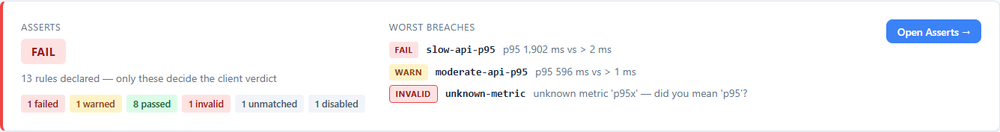
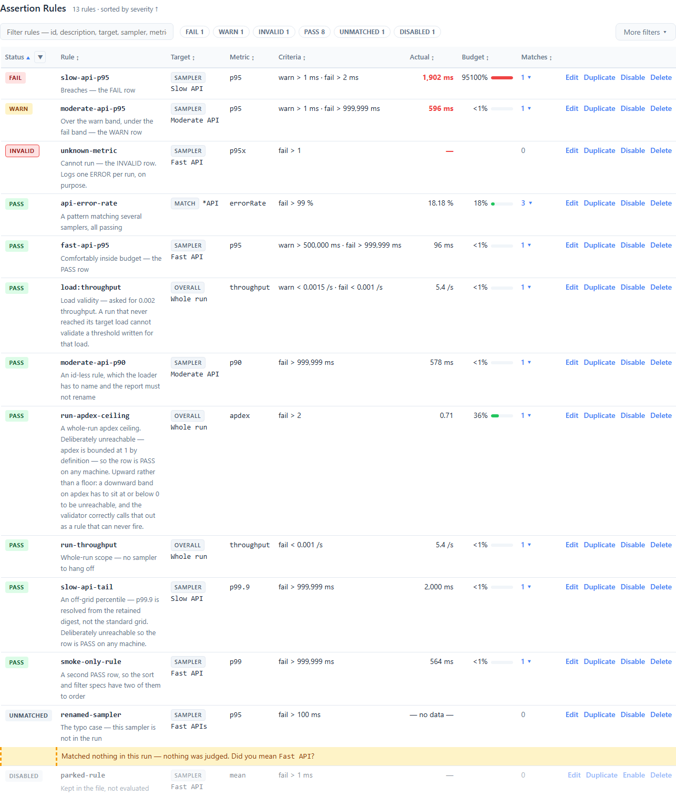
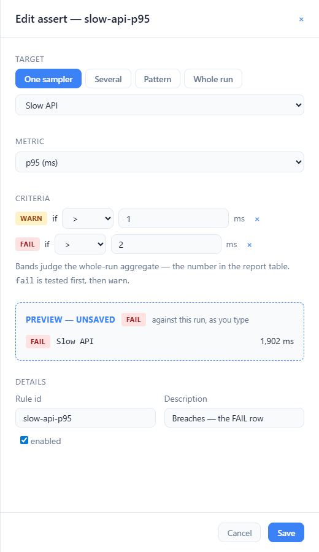
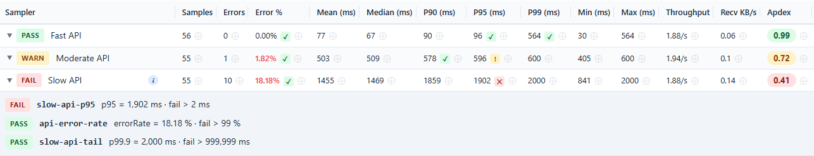
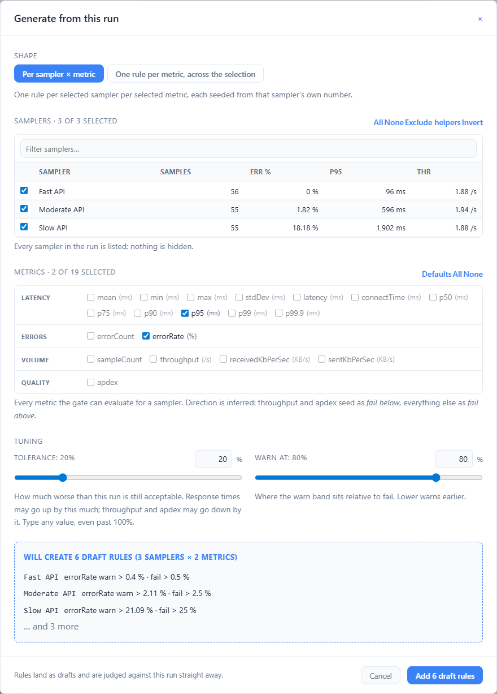
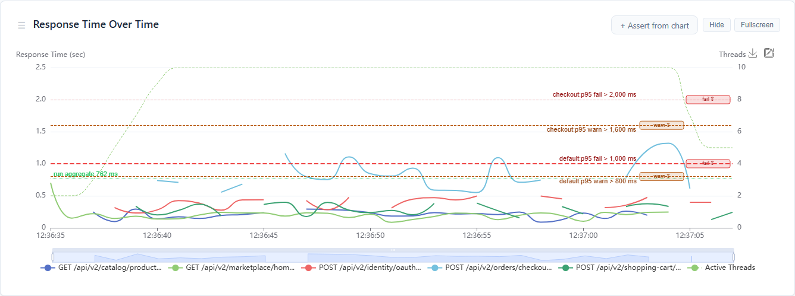

# Asserts Tab

> **Where it sits:** after Compare, before Server.

## These are not JMeter Assertions

The names are one letter apart and they are different mechanisms. Nothing in this tab replaces a
Response Assertion, and nothing in your test plan replaces a rule here.

| | JMeter Assertion | Asserts (this tab) |
|---|---|---|
| Where it lives | in the test plan, under a sampler | in `report-annotations.json` |
| When it runs | during execution, per sample | after the run, over the aggregated statistics |
| What it sees | one response — body, code, headers, duration | `p95`, `errorRate`, `throughput` — a whole run or a whole sampler |
| What it does | marks that sample `success = false` | decides the run's verdict, the CI/CD JSON and the JUnit XML |
| Scale | thousands per run | as many as you declared |

**They meet in one place, and it matters.** A sample failed by a Response Assertion is marked
`success = false`, which makes it an *error* to this report — so it is counted by `errorRate` and
`errorCount`, and therefore by any rule here that names them. See
[What `errorRate` counts](10-Asserts-Apdex.md#metrics),
and [error classes](05-Errors-Tab.md#error-classes--where-a-failure-was-decided) for gating one
kind and not the other.

A useful way to hold the two apart: a JMeter Assertion decides **whether a response was correct**.
An assert here decides **whether the run was acceptable**.

---

This is the tab where a quality gate stops being a number in a config file and becomes something
you can read, tune and save.

The loop it exists for:

**run → see every assert and its verdict → tune a limit against the observed number → the
verdict recomputes as you type → save the file → the next run gates on it.**

Converging on a threshold by hand-editing against numbers read off a screen takes three runs.
This makes it one.

---

## The gate strip

The Summary tab opens with it, because the gate is the run's headline and should not be hiding
in a tab.

It carries:

- **The verdict** — the worst status across every declared rule.
- **How it was made up** — chips counting failed, warned and passed, then why the rest judged
  nothing: invalid, unmatched, not measurable, load not achieved or disabled. Only the counts above
  zero get a chip. They add up to the number declared, deliberately; nothing falls between the
  buckets.
- **The three worst entries** — a breach with the rule id, the measured number **and the limit
  that rejected it**, or a rule that could not run with the reason it could not. A verdict without
  the actual-versus-limit tells you something is wrong and leaves you to find out what.
- **Open Asserts →**, which is where the rest of this page happens.

The strip speaks for the **client** rules only. Server asserts are judged separately and never
folded into it: they have the server chip in the header and the [Server tab](13-Server-Tab.md).

It speaks for the run **as gated**, too: its counts and worst entries are the verdicts on the rules
this report shipped with, never a draft's — while your rule edits would change the file a Download
writes, the strip adds one line, **Draft differs — see Asserts**, and this tab is where the draft is
judged.

---

## The rules table

Every declared rule, worst first, then by id — a table you read top-down and stop when it stops
being interesting.

| Column | What it tells you |
|---|---|
| **Status** | PASS, WARN or FAIL when the rule judged something; otherwise which kind of nothing — INVALID, UNMATCHED, NO VALUE or DISABLED |
| **Rule** | The id (which also names the JUnit testcase) and its description |
| **Target** | A kind chip — SAMPLER, SAMPLERS, MATCH or OVERALL — and what it selects |
| **Metric** | What is being measured |
| **Criteria** | The bands, read as bands, with every digit the file gives them: `warn > 650 ms · fail > 800 ms` |
| **Actual** | The worst matched value, highlighted when it breached — never written on or across a band (below) |
| **Budget** | How much of the fail band that value used — see below |
| **Matches** | How many samplers the rule judged — click to expand |

**Four statuses, seven words.** A rule has one of four statuses and only three of them are
verdicts; the fourth, `NOT_JUDGED`, carries a reason. The table shows the *reason* rather than the
status, because "3 not judged" sends you nowhere and "1 invalid, 1 unmatched, 1 disabled" sends
you to three different places. Full reference:
[Asserts & Apdex → The statuses](10-Asserts-Apdex.md#the-statuses).

**Neither number is rounded onto the other.** A band is written as the file holds it, never
rounded: `fail > 373.86 ms`, `fail ≥ 211.41 ms`. An actual is written whole for `ms` and `s` and
with two decimals otherwise — unless that would put it on a band it is not on, or across one, of
the warn band as much as the fail band. Then it gets the digits that keep it on its own side:

| Value | Rule | Actual reads |
|---|---|---|
| 373.8625 ms, FAIL | `fail > 373.86 ms` | `374 ms` — above the band, as the value is |
| 234.9117 ms, PASS | `fail > 235 ms` | `234.9 ms`, not `235 ms` |
| 119.4675 ms, WARN | `warn > 119.46 ms · fail > 1,000 ms` | `119.5 ms`, not `119 ms` |

The Summary tab's worst breaches (`mean 374 ms vs > 373.86 ms`), the Budget cell's title, the
samplers table's cell titles and judging rows, the chart labels (`run aggregate 234.9 ms`) and the
editor's preview write the same pair, and a drag's toast writes the band it would set with every
digit (`→ 558.82 ms`). A samplers-table cell that several rules judge keeps its number on its own
side of every one of their bands, as the JUnit sampler line does: a p95 of 119.36094 ms that fails
`fail > 119.36 ms` and passes another rule's `fail > 119.361 ms` reads `119.3609 ms` in the cell's
title and on both rules' lines of the judging row, not `119.4 ms` on one and `119 ms` on the other.
The one exception is float noise: a
percentile a T-Digest put 2e-13 past its band is written on it, because no reasonable number of
digits separates the two. The Server tab follows the same rule from two decimals, and so do the
CI/CD JSON's client `actual` and the JUnit XML
([Export & Integration](11-Export-Integration.md)).

### Budget — how close it came

`Actual` and `Criteria` sit beside each other, so the raw pair is on screen. **Budget** is what the
pair means: `24%` of the fail band used, or `212%` of it.

| Reads | Means |
|---|---|
| `24%` | comfortably inside |
| `96%` | inside, and worth knowing about — this is the number a status chip cannot tell you |
| `212%` | past the line, and by how much |
| `<1%` | a real budget, almost none of it used |
| *empty* | there is **no** budget to measure — no fail band, nothing measured, or the rule decided nothing |

`<1%` and *empty* are deliberately different: "used almost none of it" and "has none of it" are
opposite facts, and a rounded `0%` would read as the first while meaning the second.

The bar caps at 100%; the number does not. A rule that failed by 3× and one that failed by a hair
must not look alike. Only a value exactly on the line reads `100%`: one a hair off it keeps the
digits that say which side it is on, as the Actual column does — `100.001%` for 373.8625 ms
against `fail > 373.86 ms`, `99.998%` for 211.405 ms against `fail ≥ 211.41 ms`.

Budget describes the rule's **worst match**, the one the Actual cell shows: the most severe
status first, then, among matches of that status, the one furthest past the band that status was
decided against. On a corridor rule — `warn < 10 ms · fail > 100 ms` — a sampler that WARNed at
5 ms outranks one that passed at 60 ms, so Budget reads `5%` in the warn colour, though the 60 ms
came nearer the fail line.

The colour comes from the **status**, not the percentage — which is why the most useful thing this
column says is *96%, and still PASS*.

It is recomputed as you type. Drag a chart line or edit a threshold and the budget follows,
because it is calculated in the page rather than baked in when the report was written.

### Things the table says on purpose

**Expanding a rule shows every match, passing ones included.** A verdict alone does not tell you
which of eight matched samplers breached, nor how close the others were — and that is exactly
what you need in order to decide where to move a threshold.

**A rule that matched nothing gets its own follow-up row**, not just an empty Actual cell:

> Matched nothing in this run — nothing was judged. Did you mean `GET /api/inventory/check`?

That is a different problem from a breach, with a different fix. Usually the target has a typo
in it, or a sampler was renamed, and the rule has never run at all. The suggestion is the
nearest sampler name in the run — offered only when it is a genuine near miss, because a wild
guess would undermine the ones that are right.

**A parked rule is dimmed, not hidden.** `"enabled": false` keeps a rule in the file without
evaluating it, and you should still be able to see it is there.

**DISABLED, UNMATCHED, NO VALUE and LOAD NOT ACHIEVED never look like a pass.** They take a
neutral grey, because they are not verdicts. INVALID borrows the fail colours and adds an outline:
it is not a verdict either, but it fails the run under `failonerror`, and "this rule could not
run" and "this rule failed" should not be indistinguishable at a glance.

**A rule whose target the loader could not read still has a row.** Its kind chip reads
`INVALID` and the target column holds the problem — "target has more than one form (sampler,
match) — exactly one is allowed" — rather than a sampler name. Saving writes the rule back
exactly as the file had it, because the report has no idea what you meant and guessing would
replace a rule you still have to fix with a different one.

### Rules that could not run

A red banner sits at the **top of the tab**, above everything, listing every rule the file got
wrong — each with the sentence naming the problem and a **Fix** button that opens the editor on
it.

It is not dismissible, on purpose. A dismissible banner is one that gets dismissed once, by the
person who most needed it.

**Why it exists.** A rule that could not run does not move the verdict: nothing was measured, so
there is no performance judgement to make. The run still exits non-zero under `failonerror`, but
the verdict beside a broken rule can read PASS, so the tab needs a louder signal. This banner is
it: the tab cannot be read as healthy while a rule is broken, because the first thing on it says
which rule and why.

Only broken rules get a banner. A parked rule was parked deliberately, a metric the run could not
produce is about the run rather than the file, and an unmatched target already gets a follow-up
row under its own rule. Bannering all four would make it wallpaper.

### Configuration problems

Anything else the loader objected to appears above the table — the same findings that went to
`jmeter.log` and into the CI/CD JSON as `findings[]`. An unknown metric comes with the nearest
valid name; an unmatched target comes with the sampler names the run actually contained.

They appear **even on a run that declared no rules at all**, which is the case that most needs
them: a typo'd `-Jwebinsight.report.annotations` path produces zero rules, and without the
findings that report is indistinguishable from one that never wanted a gate.

The list is the one the build found, and it follows your edits to the rule each finding is about:

- A line under the heading says which document it describes. On a page nobody has edited it reads
  *In the file this report was generated with.* Once you edit a rule or the notes, it says the
  findings are marked for the draft.
- A finding whose rule no longer has the problem is struck through and marked *fixed in this
  draft*. For example, set the metric that an `unknown metric 'p95x'` finding names to `p95`.
  Disabling a rule does not fix it: the next run still checks a disabled rule's declaration, so
  its finding stands. An unmatched target is different. The next run skips a disabled rule's
  target, so that finding is marked fixed.
- A finding whose rule you edited so that the finding no longer says what the rule now says is
  marked *the rule is edited in this draft*, and still counted. For example, the rule is still
  refused but for another reason, its target is another name that matches nothing, or you renamed
  it. The next run checks it again, under the rule's new id.
- A finding whose rule you delete is struck through and marked *no rule in this draft is called
  this*, as is one whose rule you renamed and changed in the same edit. The heading counts only
  the findings that still stand.
- An edit that leaves the finding true, such as a new description on a rule whose target still
  matches nothing, leaves the finding unmarked.

The report checks findings by rule, never by matching sentences. A rule your draft breaks is listed
in the *could not run* banner above, which follows the draft. When every finding of the generated
file is settled but the draft has problems of its own, the heading says *None of the generated
file's problems remains in this draft* and the line under it counts them. It does not say the draft
has none.

The report is the artifact you debug the configuration *from*, so it is not the one place that
stays quiet about it.

---

## Editing a rule

**Edit** on any row, **+ Add assert** in the toolbar, the ⊕ on a metric cell in the Samplers
tab, the wizard, or a click on a chart — they all open the same slide-over.

### Target

A segmented control: one sampler, several, a pattern, or the whole run.

Sampler names come from the run and are picked from a list, never typed. That single decision
removes the entire class of failure where a rule silently judges nothing because of a typo.

Pattern mode shows what it selects **while you type it**:

> Matches 4 samplers in this run: GET /api/home, GET /api/search, …

or, when it does not:

> Matches nothing in this run, so this rule would judge nothing.

Editing a rule whose sampler is not in this run keeps that name, marked `(not in this run)`.
It is never silently retargeted at whatever happened to be first in the list.

### Metric

Grouped and unit-labelled, and filtered by scope — `stdDev` has no whole-run value, so it is not
offered for a whole-run rule. Switching scope drops a metric the new scope does not have rather
than leaving the form in a state the engine would reject.

### Criteria

A warn row and a fail row, each an operator and a value, independently removable. Every
operator takes one value, so the row never changes shape as you pick between them. A value keeps
every digit you type: the table's Criteria, the chart's rule line and the saved file all carry
`373.86`, and the preview writes each sampler's value against the bands as typed, so `373.863`
over a 373.8625 mean previews PASS `373.86 ms` rather than `374 ms`.

Removing the warn band reads as a choice, because it is one:

> No warn band — the rule goes straight from pass to fail. That is a choice, not an accident.

**Preview — unsaved** is the reason this editor exists. Every matched sampler, its value, and
the recomputed verdict, updating on every keystroke against this run's real numbers.

### Validation

Inline, on the field, not a wall on submit. The editor refuses to save:

- a **duplicate id** — ids name JUnit testcases, so two rules sharing one make the outputs
  ambiguous;
- a rule with **no bands** — it can never decide anything, so there is nothing to save;
- a band **the file declared and the run could not read** — two operators, an unknown operator,
  text where a number belongs. No box can hold it, so the form shows the band empty and refuses in
  the run's own words:

  > Fail has 2 operators (gt, lt) — exactly one is allowed — so this rule declares a limit it
  > cannot apply, and would report PASS without ever testing fail

  An empty box there means *the file's band*, not *no band*: type a number to replace it, or press
  × to remove it. Picking an operator, or typing a number and clearing it again, leaves the file's
  band where it was, so saving an unrelated change cannot drop it and leave the next run judging
  the rule on its other band alone.

A **dead warn band** is not refused. Fail is tested first and already decides every run the warn
band would have, so the rule's verdicts are right. The editor says so under the form and Save stays
on, just as the file loader reports it as a warning and nothing more:

> Warn never fires: fail > 400 ms is tested first and already covers warn > 500 ms.
> Swapped values? Save still works: the rule judges correctly, its warn band just never shows.

---

## Drafts

Everything you change is a draft. The report is a static HTML file: it cannot write to disk, so
**save means download or copy**, and until you do one of those nothing has changed for the next
run.

Two verdicts therefore exist at once, and the report never confuses them:

- **The header badge and the gate strip keep the verdict this run was actually gated on.**
  Moving them because you typed in a form would make the report lie about what happened.
- **The tab shows what the verdict would be** if the drafts were saved and the run repeated —
  labelled as such, in as many words: *Client verdict if saved and re-run*.

**One document, two slices.** The annotations file holds the client rules here and the server
asserts edited on the [Server tab](13-Server-Tab.md), and the drafts of both are one set: the
unsaved-changes pill counts both, and this tab's banner and save menu answer for both — the
Server tab has no Save or Discard of its own. When server asserts have unsaved changes the banner
adds `· server asserts: K changed — see the Server tab`. It does not fold a server verdict into
the client one: the two sides are judged separately, and a server edit cannot move the client
verdict.

Each changed row is marked `NEW` or `EDITED`. Drafts persist to `localStorage` keyed by the run —
one record holding both slices, and for server asserts also keyed by the collection, so a fresh
`wir-collect` does not revive drafts tuned against other data. An accidental refresh does not cost
you a tuning session, and a draft cannot follow you into a different report. **Discard drafts**
returns both slices to what the file said.

---

## Saving

Three ways, all in the toolbar:

| | |
|---|---|
| **Download report-annotations.json** | The whole file. Drop it beside the JTL. |
| **Copy file** | The same content, to the clipboard. |
| **Copy assertions** | Just the `assertions` array — the download's own, drafts included — for pasting into a file you already have. |

The download is **the whole document**, not just the rules: test notes, timeline markers, sampler
notes, comparison thresholds, the `serverMetrics` block with every server-assert draft — and any
key this version of the plugin does not recognise, carried through verbatim, per-rule keys
included. A save that dropped what it did not understand is how an editor teaches people not to
trust it. The Notes tab's *Save Annotations* writes the same document.

So is a band the run **could not read**. A rule shown INVALID because its fail band has two
operators is written back with that band exactly as the file had it, so a file downloaded with no
edits refuses the rule on the next run just as this one did, rather than judging it on its warn
band alone. A bare `1e400` comes back as the text `"Infinity"`, which is how the run holds it: the
next run still refuses it, as text rather than as the number.

### Edit document… — reaching every block

The rules table owns `assertions[]` and has a proper form for it. **Edit document…** opens the
rest: `samplerNotes`, `timelineMarkers`, `comparisonThresholds`, `version`, and any key a newer
plugin or another tool wrote.

It is the whole file as JSON, validated as you type — Apply is disabled until it parses, and the
message is the parser's own, naming the line. Applying makes it a **draft**, exactly like editing a
rule: the header badge keeps reporting what this run was actually gated on. The Server tab's toolbar
has the same button, for the `serverMetrics` keys no form there edits; the editor opens over
whichever tab asked for it, and Escape closes it.

Deliberately the whole document rather than a form per block. A form per block would have to be
written again for every block added later, and would still leave keys the plugin does not model
unreachable — which would contradict the promise to preserve them.

### Open file… — preview a file against this run

**Open file…** loads a `report-annotations.json` from disk and evaluates it against the run
already on screen. The table, the counts and *Client verdict if saved and re-run* all answer for
**your** data.

This is the shortest way to answer "what would this file have decided?" — without running JMeter
again with it.

A strip names what you are looking at: *Showing other.json evaluated against this run*. The header
badge does not move, because a file opened after the run is a question, not an answer.

**If you have unsaved changes**, the file is held back rather than applied, and you are told what
is at stake: *Opening other.json would replace 3 unsaved changes you have not downloaded* — with
**Discard my drafts and load the file** and **Keep my drafts**. Silently losing either would be
the wrong answer.

Two guarantees, both covered by tests:

1. **Round trip.** Open a report and save with no edits, and you get an equivalent file back.
2. **Next-run fidelity.** Feed a saved file to `jmeter -g` on the same data and it reproduces
   the verdicts the report previewed — client rules and server asserts alike, given the same
   collected payload. The browser and the engine run the same algorithm against a shared set of
   test vectors, so they cannot drift apart unnoticed, and scenario C38 saves a document from a
   real page, re-judges it with `jmeter -g` and compares the two field by field.

---

## Seeding a rule from a number

In the **Samplers** tab, every assertable metric cell has a faint ⊕. Click it and the editor
opens targeting that sampler and metric, with bands already seeded from the observed value:

- **fail** = observed + 20 %, rounded to a number a person would have chosen — 1925 ms seeds
  2500, not 2310;
- **warn** = 80 % of fail, unless the observed value + 16 % (80 % of the headroom) is higher. Then
  warn takes that value, so the new rule passes the run it was seeded from instead of warning on it.
  1925 ms seeds warn 2233, not 2000.

For **throughput** and **apdex** the direction flips automatically, because worse means smaller
and a `>` band on them would never fire.

The mini badge beside each sampler name is the worst verdict of the rules judging it. Click it
for a list of every rule that judged that sampler, with the number and the limit — or:

> No rules target this sampler — it is reported, not judged.

### Seeing what is already gated

A cell a rule already judges shows **its own verdict** rather than a bare ⊕ — `✓ ! ✕ ◎ ?`,
glyph as well as colour so it survives the colourblind palettes. Hovering names the rule and its
limit; clicking edits that rule.

This is there to stop the commonest mistake in the whole feature: seeding a second rule for
something already covered. The editor accepts one, quietly naming it `checkout-p95-2` — two rules,
two JUnit testcases, one intention. Where a rule exists the ⊕ reads *"Add another assert on …"*,
and the marker beside it is the shorter path.

The inverse is worth as much: read down a column and you can see which samplers are gated on p95
and which are not. Nothing else in the report shows coverage.

---

## Generate from run

**Generate from run…** is the first-run adoption path: a tester with no configuration at all
gets a credible gate in four clicks, then prunes.

Pick a shape — one rule per sampler × metric, or one blanket rule per metric across the selection.
Pick the samplers: every sampler in the run is listed, and the ones that look like helpers start
unticked. A filter narrows the list, and **All**, **None**, **Exclude helpers** and **Invert**
change the selection. Tick the metrics. Set the **Tolerance**, how much worse than this run is
still acceptable, and **Warn at**, where warn sits as a share of fail. The preview shows exactly
what it will create before it creates anything. Everything arrives as drafts.

It is a dialog like the editors: focus moves into it, Tab and Shift+Tab stay inside it, Escape
closes it, and Cancel, ×, Escape and Apply all put focus back on the button that opened it — on a
run with no rules yet, Apply replaces the empty state and focus lands on the toolbar's **Generate
from run…** instead.

Blanket rules seed from the **worst** observed value across their targets. Seeding from the best
would produce a gate that failed the moment it was written.

Each band is rounded to the nearest whole millisecond, or to two decimals, unless that would put it
across the value it was seeded from, or put a warn band on that value. Then it is rounded away from
the run instead. So every rule the wizard creates passes this run as written, with one exception:
a throughput, received KB/s or apdex below 0.01. Its fail band cannot go lower than 0.01, the
smallest floor two decimals can write, so it sits above the run and the rule FAILs as soon as it
is created. At Tolerance 0 a fail band can sit exactly on the observed value, which still passes.
A warn band with no room left between the run and the fail band is left out.

---

## Asserting from a chart

On the Timeline tab, every rule judging the charted metric draws its bands as dashed lines, fail
and warn alike, each labelled with the rule id and the band and carrying a handle to drag. The
strictest fail line is drawn bold and the other fail lines dimmed — five identical lines would
suggest five independent limits when only one can ever be the binding one. A warn line is thin and
never emphasised: it is context for the fail line above it, not a competing limit.

- **Only rules about samplers the chart is showing draw.** Untick a sampler in the filter bar
  and the rules judging it stop drawing. A limit stretched across a chart that is not showing
  the sampler it applies to is a limit over a series it does not judge. A `scope: overall` rule
  always draws — it applies to the whole chart whatever is on it.
- **Drag a line** to retune that rule. Releasing it commits a draft, exactly like typing in the
  editor.
- **+ Assert from chart** arms a crosshair; clicking a level opens the editor seeded with it.
  Click a series point and the rule targets that sampler; click the grid and it targets the whole
  run. The direction is the metric's, not the gesture's: on the throughput chart the level
  becomes a **floor** (`fail <`) rounded *down*, because worse means smaller there and rounding
  a floor upward moves it towards the value it exists to protect. On a latency chart it is a
  ceiling, rounded up. The button is offered whether or not any rule exists yet, so the chart
  is a way in on a report that declared nothing rather than a second way in for someone who
  already found the first.

A thin dotted line marks the **run aggregate**. It is there because these rules judge the
whole-run aggregate, not the per-bucket series the limit is drawn over — and a threshold floating
above a bucketed line invites exactly the wrong reading. Seeing the aggregate beside the limit
makes the real comparison visible.

---

## See also

- [Asserts & Apdex](10-Asserts-Apdex.md) — the rule schema and the metric vocabulary
- [Server tab](13-Server-Tab.md) — server asserts, which share this tab's save and drafts
- [Export & CI/CD](11-Export-Integration.md) — the `gate` block, `assertions[]` and the JUnit
  testcases a pipeline reads
