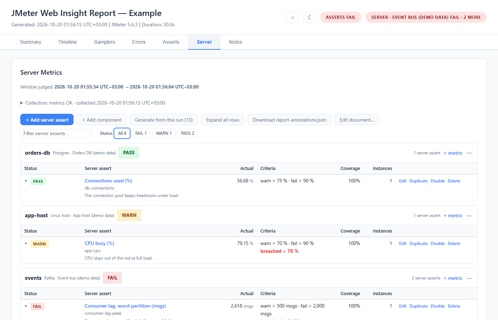
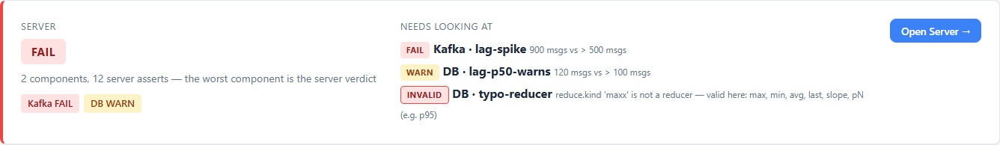
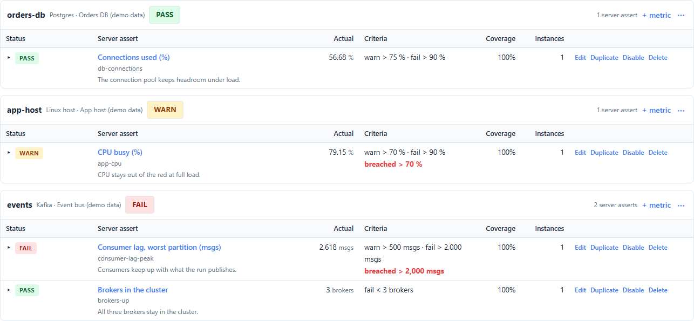
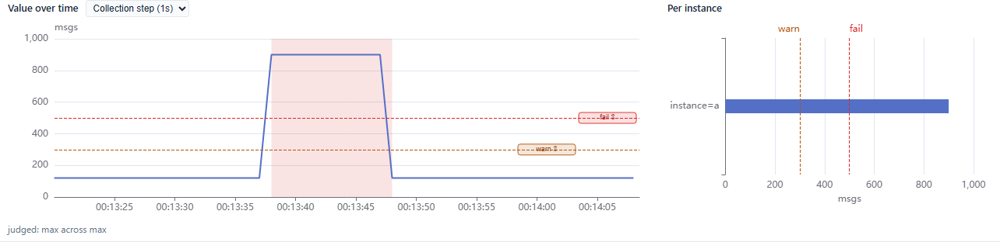
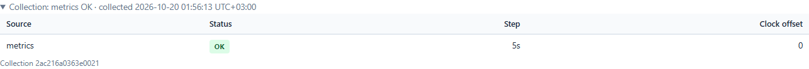
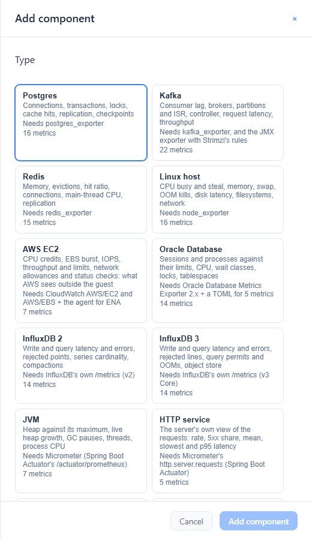
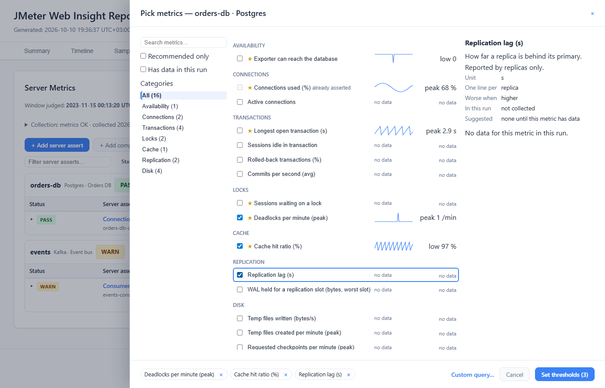
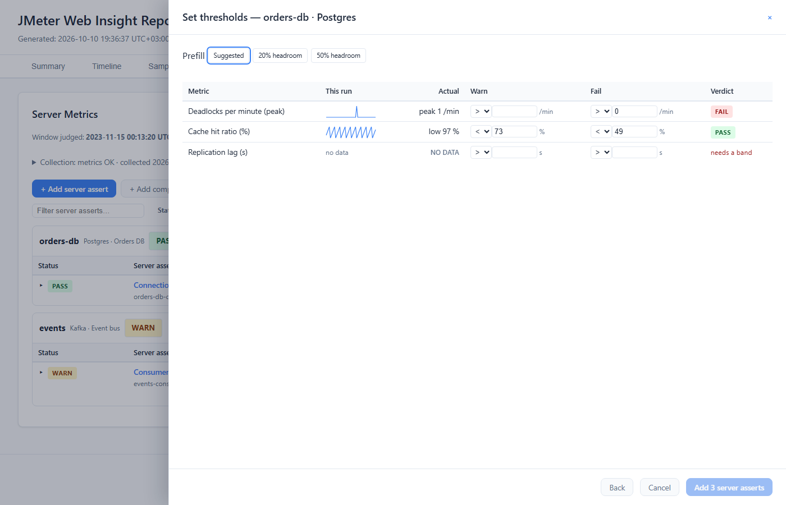
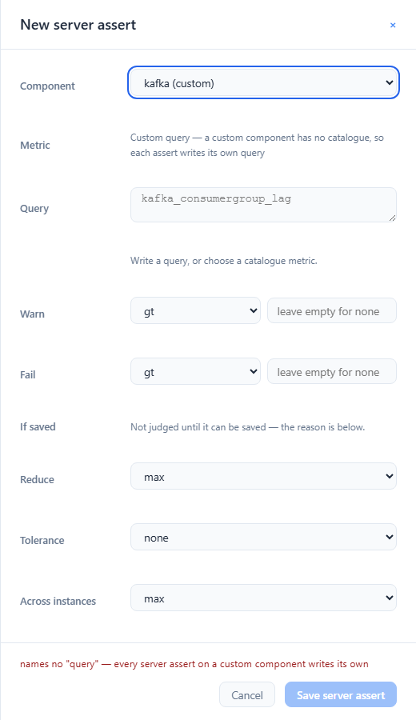
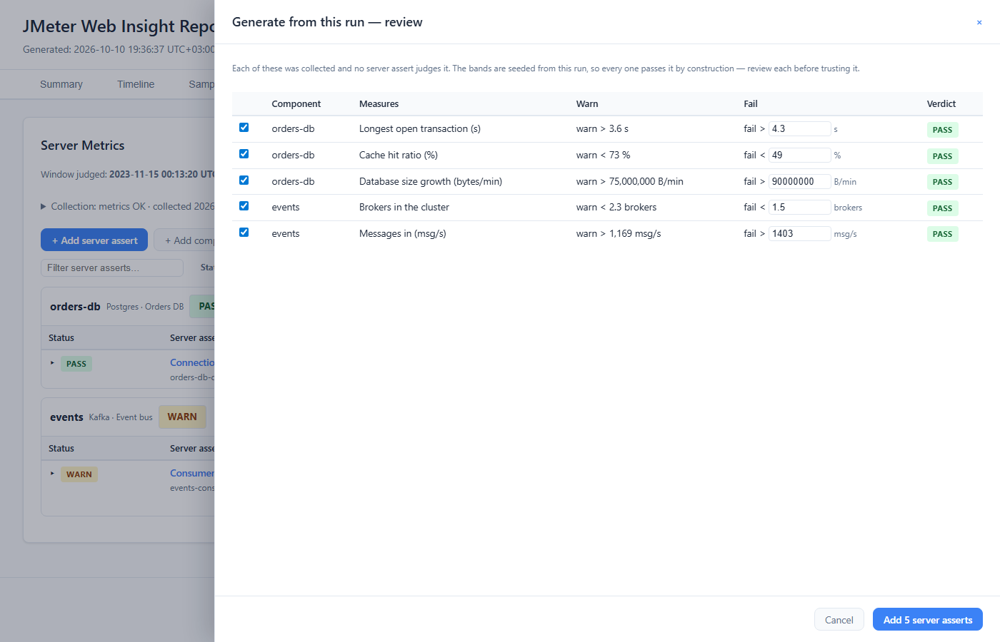

# Server Tab

> **Where it sits:** after Asserts, before Notes. It is always shown, including on a run that
> declared no server metrics, where it says so and how to add some.

## Expected against actual

A client assert judges what JMeter measured. A **server assert** judges what the system under test
did while JMeter was measuring it: CPU, heap, consumer lag, connection pools. Anything Prometheus
holds, or anything you can export as a CSV.

The model has three parts, and it is the same three parts every time:

| | What it is | Where it comes from |
|---|---|---|
| **Expected** | The components under test, and the server asserts about them: a metric, how to reduce it to one number, and the bands that number must stay inside | You write them, in the `serverMetrics` block of `report-annotations.json` (or in this tab) |
| **Actual** | The metrics, fetched over the run's own window | `wir-collect`, after the run, into `server-metrics.json`. Where it fetches from is a command-line flag, never part of the file |
| **The comparison** | Each server assert's verdict, per component, plus `serverStatus` in the CI/CD JSON and a JUnit suite per component | The report, generated with both files |

You write what you expect. `wir-collect` fetches what happened. The report compares the two.

That order matters. You can write server asserts before anything has been collected. The tab shows
them, the editor works, and each row says it is waiting for its actual half. A report that has no
metrics yet is a good place to write the expectations.

Client and server verdicts are **kept apart on purpose**. The client badge, the gate strip and the
CI/CD JSON's `status` describe the client rules and nothing else. The server side has its own header
chip, its own `serverStatus` and its own JUnit suites. Nothing anywhere folds the two into one word.
A pipeline that wants one answer writes the `and` itself (see [Gating a pipeline](#gating-a-pipeline)).

A minimal file:

```json
{
  "assertions": [
    { "id": "checkout-p95", "target": { "sampler": "POST /api/checkout" },
      "metric": "p95", "fail": { "gt": 800 } }
  ],
  "serverMetrics": {
    "components": {
      "orders-db": { "type": "postgres", "description": "Orders DB",
                     "match": "instance=\"orders-db:5432\"" },
      "api":       { "type": "custom",   "description": "API pods" }
    },
    "asserts": [
      {
        "id": "db-connections",
        "component": "orders-db",
        "metric": "connections.used.pct",
        "warn": { "gt": 70 },
        "fail": { "gt": 90 }
      },
      {
        "id": "api-cpu",
        "description": "CPU of the API pods while the test ran",
        "component": "api",
        "query": "sum by (pod) (rate(container_cpu_usage_seconds_total{namespace=\"shop\", container=\"api\"}[1m]))",
        "unit": "cores",
        "reduce": { "kind": "max", "over": { "sustainedFor": "1m" } },
        "fail": { "gt": 3.5 }
      }
    ]
  }
}
```

**Components** name what is being measured. `type` is a type from the built-in
[catalogue](#the-catalogue) (`postgres`, `kafka`, `redis`, `host-linux`, `aws-ec2`, `oracle`,
`influxdb2`, `influxdb3`, `jvm`, `http-service`, `kubernetes-pod`, `mysql`) or `custom`.
`description` is the label the card, the header chip, the Summary card and the CI/CD JSON's `label`
show; the id names the JUnit suite and the console line. `match` is optional: a
PromQL label selector that narrows every catalogue query on that component to the right instances.

A server assert names its `component` and **either** a catalogue `metric` **or** its own `query`:

- `db-connections` asks the catalogue for `connections.used.pct`. The query, the unit (`%`), the
  reducer (`max`) and `across` all come from the catalogue, narrowed by the component's `match`.
  Anything the assert writes itself (`unit`, `reduce`, `across`) overrides the catalogue's.
- `api-cpu` writes its own PromQL. That is the escape hatch for anything the catalogue does not
  cover, and the only way on a `custom` component. Read it as: *take each pod's series over the
  run, find the highest level it held for a whole minute, take the worst pod, and fail if that is
  above 3.5 cores.*

Writing both `metric` and `query`, or neither, is refused (`INVALID_RULE`). The `3.5`, the `70` and
the `90` are this example's expectations, not recommendations. The numbers are yours to set.

**Every component can fail the build.** There is no observe-only component. To watch a metric
without failing anything, give its assert a warn band and no fail band: a WARN never moves the exit
code.

**No connection details are in the file.** Not the Prometheus URL, not a token, not a file path.
They are flags to `wir-collect` (see [Where the metrics come from](#where-the-metrics-come-from)).
The annotations document is written into every report, so anything in it is published.

---

## The three steps

Server metrics are fetched **after** the run, over the window the JTL recorded. That gives you a
pipeline of three commands. Each one is an ordinary process with an ordinary exit code.

```bash
#!/usr/bin/env bash
set -euo pipefail

JTL=results.jtl
ANNOTATIONS=report-annotations.json

rm -f "$JTL"     # -l appends; a JTL left by the last run widens the window to both runs
rm -rf report    # jmeter -g -o refuses a directory that is not empty

# 1. The run. If the plan carries the Web Insight listener, it writes an interim report that
#    judges the client rules. The server asserts are shown there, waiting for their metrics.
jmeter -n -t plan.jmx -l "$JTL" -Jwebinsight.report.annotations="$ANNOTATIONS"

# 2. The actual: fetch what the server asserts ask for, over the run's own window.
#    Exits 0 whenever it wrote the payload, even if the source was down.
./wir-collect.sh --jtl "$JTL" --annotations "$ANNOTATIONS" --out server-metrics.json \
  --prometheus-url https://prometheus.example.internal/api/v1 --prometheus-token-env PROM_TOKEN

# 3. The comparison: the report that judges both sides, decides the exit code, and is the
#    one to archive.
jmeter -g "$JTL" -o report \
  -Jwebinsight.report.annotations="$ANNOTATIONS" \
  -Jwebinsight.report.servermetrics=server-metrics.json \
  -Jwebinsight.report.junit=true
```

The same steps in a Jenkinsfile, with the token supplied by Jenkins and never written down:

```groovy
stage('Performance') {
  steps {
    withCredentials([string(credentialsId: 'prometheus-token', variable: 'PROM_TOKEN')]) {
      sh '''
        rm -f results.jtl
        rm -rf report
        jmeter -n -t plan.jmx -l results.jtl \
          -Jwebinsight.report.annotations=report-annotations.json
        ./wir-collect.sh --jtl results.jtl --annotations report-annotations.json \
          --out server-metrics.json \
          --prometheus-url https://prometheus.example.internal/api/v1 \
          --prometheus-token-env PROM_TOKEN
        jmeter -g results.jtl -o report \
          -Jwebinsight.report.annotations=report-annotations.json \
          -Jwebinsight.report.servermetrics=server-metrics.json \
          -Jwebinsight.report.junit=true
      '''
    }
  }
  post {
    always {
      junit 'report/web-insight-report.xml'
      archiveArtifacts artifacts: 'report/**, server-metrics.json'
    }
  }
}
```

Points that cost people a build:

- **Step 3 names the annotations file.** `jmeter -g -o` demands an empty output directory, so there
  is nothing beside the report for it to auto-detect. Without
  `-Jwebinsight.report.annotations`, step 3 declares no server asserts and judges nothing.
- **Step 3 is the report that gates.** Pass gating flags such as
  `-Jwebinsight.report.failonassert=true` to step 3 only. On step 1, a client FAIL would stop a
  `set -e` script, or a Jenkins `sh` step, before the server metrics were ever compared.
- **Step 3 exits 1 on a series that could not be collected** (SOURCE FAILED), or on data below the
  coverage floor (`failonerror`, on by default). In a `set -e`
  script that is the last step, so nothing is lost. If the script runs its own jq gate after step 3,
  give step 3 `-Jwebinsight.report.failonerror=false` and gate with the [STRICT](#gating-a-pipeline)
  line, which refuses the same thing.
- **Step 1 can still exit 1** on a file it cannot honour, such as a server assert naming an unknown
  component. That is the same configuration error step 3 would refuse, so stopping early loses
  nothing. Fix the file.
- **A title on step 3 means a `--test-name` on step 2.** The run's identity hashes its name, and
  `jmeter -g` names the run by its report title. With `-Jwebinsight.report.title="Checkout soak"` on
  step 3, step 2 needs `--test-name "Checkout soak"`. Otherwise the payload is refused as another
  run's (see [wir-collect](#wir-collect)).
- **A ramp-up is given to both, in milliseconds.** `wir-collect --rampup 60000` and
  `-Jwebinsight.report.rampup=60000`. If they disagree, the report says so as a finding, because
  the asserts are judged over the payload's window while the charts mark the report's ramp-up.
- **Metrics can be re-collected without re-running the test.** Steps 2 and 3 only read the JTL.
  Re-collect after a Prometheus outage, or after editing the server asserts, and regenerate.

---

## Reading the tab



From the top: the judged window, the Collection line, the actions, one filter row, any findings,
and then one card per component holding its server asserts. The client filter bar (samplers,
metric, granularity, time range) is hidden on this tab, because none of it applies here. It comes
back on the other tabs.

### The Summary card

The Summary tab carries a **Server** card under the Asserts card, in the same shape:



- **The verdict the run was gated on**: the worst component's, which is the server verdict. It is
  the build's own word, the CI/CD JSON's `serverStatus` and the header chip's, never worked out
  again on the page.
- **What it covers**: `2 components, 12 server asserts — the worst component is the server verdict`.
- **One count per component**, by its description: `Kafka FAIL`, `DB WARN`. Asserts that name no
  declared component are counted too, as `(no component) NOT EVALUATED`, so a `NOT EVALUATED` word
  always has its entry beside it.
- **Needs looking at**: the three worst server asserts, breaches and checks that never ran, worst
  first, each named as the board names it: the component by its description, then the assert —
  `Kafka · lag-spike`, or for a catalogue metric its label with the id under it
  (`Event bus · Consumer lag, worst partition (msgs)`, `events-consumer-lag-max`). A breach shows
  the actual against the limit (`900 msgs vs > 500 msgs`); a check that never ran shows its reason.
- **Open Server →** opens this tab.

Before anything is collected (step 1's report) the card reads `NOT COLLECTED`, and says how many
server asserts were declared. Over a refused payload it reads `REFUSED`. The header chip says the
same word. On a large report whose data file (`web-insight-data.js` beside the default report,
`<name>-data.js` beside a report you named) did not load, the card reads `UNAVAILABLE` and says the
server verdict in the header came from the run itself and is correct. On step 1's report or over a
refused payload, it still reads `NOT COLLECTED` or `REFUSED`, and says it cannot list what was
declared.
A run that declared no server asserts has no card at all: it has not passed anything, so nothing
claims it did.

### The header chip

Beside the client badge, one chip speaks for the server side:


| Chip | Means |
|---|---|
| `Server · Kafka FAIL · 2 more` | The worst component (Kafka), its status, and how many other components the tab holds |
| `Server · nothing judged` | The asserts were evaluated, but no component was reported |
| `Server · NOT COLLECTED` | Server asserts are declared and no payload was given yet: the interim report, step 1 |
| `Server · REFUSED` | Server asserts are declared and the payload given was refused. The tab says why. When an enabled assert depended on it, the run exits 1 (`failonerror`) |
| *(no chip)* | No server assert is declared: no `serverMetrics` block, or components and no asserts yet |

`NOT COLLECTED` and `REFUSED` are drawn in the neutral style. They are states, not verdicts: the
CI/CD JSON has no `serverStatus` on such a run. JUnit carries a `serverMetrics` suite that says the
same thing (see [Export & CI/CD](11-Export-Integration.md#when-server-asserts-are-declared-and-nothing-was-judged)).

"Worst" is ranked **FAIL > NOT EVALUATED > WARN > PASS**. NOT EVALUATED ranks above WARN because a
component the build depended on that decided nothing is worse news than a warning. Clicking the chip
opens this tab.

The client badge does not change. When no client rule gave a verdict (the file declares none, or
none of them decided anything), it reads `SERVER ASSERTS ONLY` once the server asserts are judged,
and `ASSERTS NOT EVALUATED` before that (step 1's report, or over a refused payload). Either way it
tells you to look at the chip rather than claiming a pass.

The CI/CD JSON's top-level **`serverStatus`** is the same fold, so the chip and the JSON cannot
disagree:

```json
{
  "status": "FAIL",
  "serverStatus": "FAIL",
  "serverComponents": [
    { "id": "kafka", "label": "Kafka", "type": "custom", "collectionId": "df8778b7fa474d95",
      "status": "FAIL", "declared": 4, "evaluated": 3, "passed": 1, "warned": 0, "failed": 1,
      "notJudged": { "total": 2, "disabled": 1, "loadNotAchieved": 1, "…": 0 } },
    { "id": "db", "label": "DB", "type": "custom", "status": "WARN", "…": "…" }
  ],
  "serverAsserts": [
    { "id": "up-fails", "component": "kafka", "query": "up", "unit": "msgs",
      "reduce": { "kind": "max" }, "across": "max", "status": "FAIL", "actual": 49.0,
      "coverage": 1.0, "instances": 1, "warn": { "gt": 10.0 }, "fail": { "gt": 20.0 },
      "breached": { "gt": 20.0 } }
  ]
}
```

`serverStatus` is present exactly when `serverComponents` is. A server assert that names a catalogue
metric also carries `"metric"` in `serverAsserts[]`. The full shape, and the JUnit suites, are in
[Export & CI/CD](11-Export-Integration.md).

### PASS can sit beside a problem, and the exit code reports it

A component's status is the worst of its asserts **that decided something**. That matches the
client gate, where a broken rule contributes nothing to `gate.status`. The consequence: suppose a
component holds one server assert that PASSed, and another whose source failed (`SOURCE FAILED`) or
whose data came in under the floor (`LOW COVERAGE`). The component reads **PASS**, and so do
`serverStatus` and the chip.

The run still **exits 1** under `failonerror` (the default), because a check the build depended on
never ran. The status is the verdict on what was measured. A configuration or collection error is
reported by the exit code, the `CONFIG ERROR` console line, the JUnit `<failure>` and the STRICT jq
line below. If your pipeline sets `failonerror=false` and gates on the JSON, use STRICT. The DEFAULT
line reads that run as a pass.

### The header and filters

**Window judged** comes first: the run's first and last sample from the JTL, marked
`ramp-up excluded` when a ramp-up was given and `collection.excludeRampUp` is on (the default).
Before anything is collected, and over a refused payload, it reads `nothing collected yet`.

Under it, the **Collection** is one line, such as
`Collection: metrics PARTIAL · collected 2026-10-03 12:35:40 UTC+03:00`. It opens to the
detail (see [The Collection line and the findings](#the-collection-line-and-the-findings)).

Every time on this tab is in your browser's time zone and says which, as `UTC±hh:mm`. Each one
carries its own offset, so a window from winter and a collection from summer can differ by an
hour in the same zone. The chart ticks are bare times; the window line above them names the offset.

Then the actions:

| Button | Does |
|---|---|
| **+ Add server assert** | Opens the [editor](#the-editor) on a new server assert. Shown once a component is declared |
| **+ Add component** | Opens the [Add component](#adding-a-component) dialog |
| **Generate from this run (N)** | Opens a [review](#generate-from-this-run) of the collected series no server assert judges. Shown only when there is something to seed |
| **Expand all rows** / **Collapse all rows** | Opens every row on the board, or closes them all |
| **Download report-annotations.json** | The whole document, client rules and server asserts together. The same file the Asserts tab downloads |
| **Edit document…** | The whole file as JSON, the same editor as the Asserts tab's, opened over this tab. The way to every `serverMetrics` key no form here edits: `environments`, the run-level `requiresLoad`, a component's id or type. **Apply as draft** makes it the page's document; Escape closes it |
| `N unsaved changes` | The unsaved pill, the same count the Asserts tab shows, a note typed on the Notes tab included. Absent on a page nobody has edited |

When every seed would be stood down by a run-level `requiresLoad` that did not hold, Generate is
replaced by a sentence saying so. Under the actions, a line can say what happened to a draft when
the page was loaded (see [Drafts and saving](#drafts-and-saving)).

Then one filter row:

- **Filter server asserts…** finds a row by its id, its catalogue metric's label or id, its
  description or its component.
- **Status chips** with counts, worded as the Asserts tab's: `All 12`, `FAIL 1`, `WARN 1` and so on,
  one per status on the board. Every reason a server assert was not judged is a chip of its own, as
  on the Asserts tab. The counts follow the other filters, the text you are typing included, so the
  chips always add up to what `All` says. A screen reader hears which chip is on.
- **Clear filters**, shown when any filter is on, as soon as you type.

A filter narrows the board to the cards it found something in. With no filter on, every declared
component has a card, an empty one included.

### Component cards

The board is one card per component, in the file's order. The one exception is an id that is a
whole number, such as `"1"` or `"2"` (but not `"01"`): the page lists those first, in numeric order,
because a browser keeps such keys first in an object, and a file the page saves writes them first
too. The order judges nothing. The run, the CI/CD JSON and JUnit keep the file's order.


The card's header reads, left to right:

- **The component's id**, then its type and description: `Custom · Kafka`, `Postgres · Orders DB`.
- **Its badge**: the verdict **this run was gated on** (`FAIL`), with the counts in the tooltip.
  The description is already beside it, so the badge does not repeat it; it is the badge's name for
  a screen reader. Click the badge to narrow the board to that card; click it again to release it.
  A component the document declares and this run did not judge reads `NOT IN THIS RUN`.
- **`N server asserts`**.
- **+ metric**, which adds a server assert to this component (see
  [Adding metrics: the picker](#adding-metrics-the-picker)).
- **⋯**, which shows the component's two actions under the header (Escape or a click elsewhere
  hides them):
  - **Edit description / match** opens the component dialog on it. The id and the type stay as
    they are, because every assert on the component is named and collected by them; change those
    with **Edit document…**. A new `match` changes the catalogue queries collected under the
    component, so its asserts read `NEEDS RE-COLLECTION` until you collect again. An emptied field
    is removed from the file.
  - **Delete component** removes the component and every server assert on it, as one draft with an
    **Undo**. The button says how many go with it (`Delete component and its 3 server asserts`).
    Left behind, those asserts would name nothing the file declares, and the next run would exit 1.

  Only a component the document declares has a ⋯ and a **+ metric**. The `(no component)` card has
  neither. A component the run judged and the document no longer declares (after **Delete
  component**, say) keeps its card for its badge, the verdict this run was gated on, and the card
  says the document no longer declares it.

Once you edit server asserts on the page (or a client rule one of them names in `requiresLoad` or
`divideBy`), a badge whose rows now fold to something else also shows `→ PASS if saved` (or
whatever the rows now add up to), and a note in the header explains the arrow. It reads
`→ ? if saved` when an assert on the component has no verdict on the page (it needs re-collection,
or its series reached the page capped), so the fold cannot be known, and `→ not declared if saved`
on a component the document no longer declares. The badge's tooltip says which. The build's verdict
and the edited one stay visibly separate. A page nobody has edited never shows an arrow, and
neither does a file that declares components and no server asserts yet: the next run would judge
nothing there.

Asserts that name no declared component get a `(no component)` card of their own. They still build,
and still exit 1, as the `(no gate)` entry in the CI/CD JSON — `(no gate)` is that entry's id, and
its label, the header chip and the console verdict line all say `(no component)`. A component with no server asserts yet
says `No server asserts on <id> yet — add one with + metric.`

### The board



Each card holds a table, with the same columns on every card so they line up:

| Column | What it tells you |
|---|---|
| **Status** | PASS, WARN or FAIL when the server assert judged something, otherwise why not (below). Marked `edited` (changed on the page), `live` (judged again in the page because the assert, a client rule it names, or its component or the block around it was edited; an untouched row's verdict is the build's, and carries no marker) or `from the build` (a capped series, see [Limits](#limits)). The ▸ beside it opens the row |
| **Server assert** | A catalogue assert by its metric's label (`Connections used (%)`), with its id under it, dim: the id names the JUnit testcase and is what a CI log is searched for. A custom assert by its id, with its description under it. An assert written without an id gets one derived from its component and its metric or query, marked `derived id`. `÷ load:throughput` and `needs load:throughput` mark the [advanced keys](#advanced) |
| **Actual** | The one number the bands were compared with |
| **Criteria** | The bands, `warn > 300 msgs · fail > 500 msgs`, plus the band that was breached |
| **Coverage** | How much of the **collected window** has data (below) |
| **Instances** | How many series the query returned, all judged. `21 (20 drawn)` when the chart draws fewer than were judged. A dash exactly when Coverage shows a dash too: nothing was measured. A series that was measured and decided nothing, such as `LOW COVERAGE`, still shows its instances, the count the CI/CD JSON and JUnit give |
| *(actions)* | **Edit**, **Duplicate**, **Disable** / **Enable**, and **Delete**, which offers an **Undo** |

The reducer appears under the name only when the assert chose its own, such as
`max sustained for 5s across max`. A catalogue metric's default reducer, or a plain `max` across
`max`, is not repeated on every row.

The board has no Source or Query column. The collection has one source, the component is the
card, and the resolved query stays in `server-metrics.json` and in the CI/CD JSON's
`serverAsserts[]`.

Rows are **worst first** within each card. A server assert that decided nothing gets a full-width
line under it with the sentence that explains why.

Actual and Criteria are written in the unit the verdict compares in. For a `slope` that is per
minute, `B/min` (`/min` alone when the assert has no unit). For a `divideBy` ratio it is per unit
of the load, the way the chart axis writes it: `% ÷ load:throughput`. A slope ratio is both,
`B/min ÷ load:throughput`. The Summary card, the Per instance panel, Set thresholds, the Generate
review, the editor's band boxes and JUnit write the same unit. The CI/CD JSON's `unit` stays the
declared unit.

A band is written with every digit the file gives it, never rounded: `warn > 0.4 s · fail > 2.955 s`.
A measured number, such as Actual, a chart tooltip or a run's peak, has at most two decimals in
every unit, with trailing zeros dropped (`2.95 s`, `2.5 ms`, `900 msgs`), and never reads `0` when
it is not zero. An Actual that two decimals would
put on a band it did not reach, or across one, gets the digits that keep it on its side:
`3.004 s` beside `breached > 3 s`, not `3 s`. Large numbers are grouped the same way in both:
`60,000,000 B/min` against `fail > 50,000,000 B/min`. Digits are written the same in every
browser language, `,` grouping and `.` as the decimal point, as the Test Summary cards and the
band boxes write them, and as on the Asserts tab. The Asserts tab writes by this same rule,
through the same code: bands as declared, and an Actual on its own side of every band the rule
declares, from its own base of whole `ms` and `s` and two decimals otherwise. The JUnit XML writes
the same digits: `max 3.004 s breached > 3 s` in the failure message and `actual:    3.004 s` in
its body, where two decimals would write `3.00 s`. So does the reason a server assert carries when its
load rule FAILED, which quotes the client's measured load beside the load rule's band:
`load rule 'load:throughput' FAILED: throughput 12.496/s breached < 12.5 /s`, not `12.50/s`.

### Why a server assert was not judged

A server assert has the same four statuses as a client rule. The fourth, NOT_JUDGED, carries a
reason, and the board shows the reason with the sentence that explains it underneath:

| Board reads | Reason | Cause | Fails the run? |
|---|---|---|---|
| `DISABLED` | `DISABLED` | `"enabled": false`. Not collected either | No |
| `UNMATCHED` | `NO_MATCH` | The source answered and the query matched no series (for a CSV: no row names this component and metric) | No, it is counted and reported |
| `NO VALUE` | `NO_VALUE` | No point fell inside the judged window, the reducer had nothing to say, or a `divideBy` divisor measured zero | No |
| `INVALID` | `INVALID_RULE` | The file is wrong, or the payload was collected for another version of it. In the file: an unknown component, component type or catalogue metric; `metric` and `query` both or neither; a `custom` component with no `query`; no band at all, or an unreadable one; an unknown reducer, or a tolerance it cannot take; a [refused key](#retired-and-refused-keys). Against the run: a `requiresLoad` or `divideBy` that names no client rule, or a rule that is not a throughput rule; a `divideBy` rule that matched more than one sampler; a `sustainedFor` longer than one step that is not a whole number of the collection's steps. Against the payload: no series was collected for this assert's query (the file changed after `wir-collect` ran). The sentence names which | **Yes**, under `failonerror` |
| `SOURCE FAILED` | `SOURCE_FAILED` | The series could not be fetched: authentication, DNS, timeout, a 5xx, a placeholder the collector could not resolve, a catalogue metric with no Prometheus query asked of Prometheus or a recording, or a CSV row of this series that could not be read | **Yes**, under `failonerror` |
| `LOW COVERAGE` | `LOW_COVERAGE` | Data came back, but below the coverage floor | **Yes**, under `failonerror` |
| `LOAD NOT ACHIEVED` | `LOAD_NOT_ACHIEVED` | The client load rule it `requiresLoad` FAILED or was not judged, or the rule it `divideBy` was not judged. A `divideBy` rule that FAILED still divides | Not by itself. A load rule that FAILED: that FAIL is the client verdict, and exits 1 only under `failonassert`. A load rule that was not judged: that rule's own reason decides, so an `INVALID` client rule exits 1 under `failonerror`, and a disabled, unmatched or unmeasurable one fails nothing |

On a report with no collected metrics (step 1's report, or one whose payload was refused), a server
assert has no verdict to show:

| Board reads | Means |
|---|---|
| `NOT EVALUATED` | The report has no collected metrics to judge the assert against. On step 1's report the line under the row reads *Not collected yet — run wir-collect with this file against this run's results, then regenerate the report to judge this server assert.* Over a refused payload it reads *Not judged — the server-metrics payload given to this report was refused, so nothing collected answers for this server assert.*, and the tab's notice says why it was refused. What needs no metrics is still decided on such a report: a disabled assert reads `DISABLED`, a refused one `INVALID`, one stood down by its load rule `LOAD NOT ACHIEVED`. A `NOT EVALUATED` row sorts last in its card, and its chip is drawn in the same neutral style as `DISABLED` |

Two more states exist only on the page, while you edit:

| Board reads | Means |
|---|---|
| `NEEDS RE-COLLECTION` | Nothing collected answers for the assert: you changed what it fetches (its component, metric or query, or its component's `match`), or it is new on this page and this collection holds nothing for it. For a catalogue metric that means the collector asked for it and got no data, which usually means the exporter does not publish it. The verdict is withheld, and the reason row says which case it is. Save and re-run `wir-collect` |
| `NOT RE-JUDGED` | The series reached the page capped, and the build's verdict no longer answers for the assert: the assert is new or edited, a client rule it names in `requiresLoad` or `divideBy` was edited, or the block around it changed what it is judged under (the run-level `requiresLoad`, say). The page will not estimate from the thinned points. What needs no points is still decided live: a disabled or refused assert, its load rule, the series' collection status, a `sustainedFor` the step cannot hold. Save and run `jmeter -g` with the same payload |

The report's own reasons and words are shared with the client side. See
[Why a rule was not judged](10-Asserts-Apdex.md#why-a-rule-was-not-judged).

### Coverage is of the collected window

Coverage is the share of expected steps in the window that have a point. It is decided **when
`wir-collect` runs**, over the whole collected window. It is not recomputed when the report is
judged. Every place that shows it says "of the collected window" for that reason.

The judged window can be shorter: a ramp-up is cut from the front. On a run with a long ramp-up,
that makes coverage **optimistic**. A source that died two thirds of the way through can show 90%
coverage of the collected window while the judged window holds much less. When an assert's numbers
look thin, open its row and look at the gaps.

The floor (`collection.coverageFloor`, default `0.9`) is applied at collection time too. Change it
and re-collect: a raised floor applies only from the next collection. The payload does not record
the floor it was collected under. A `LOW COVERAGE` row whose coverage the floor in the file would
now pass says so, and asks you to re-run `wir-collect`.

### Opening a row: two panels

Every row starts **closed**, a FAIL included, so a card reads as a list of verdicts. The ▸ beside
the status (or a click on its name) opens it, and ▾ closes it again. **Expand all rows** in the header
opens every one.

An open row has two panels:



**Value over time** is the collected series, one line per instance, against the run's timeline:

- It is drawn at the **collection's step** by default: every point `wir-collect` fetched. The
  selector beside its title, like the Samplers tab's chart selector, buckets it coarser: any rung
  of the report's ladder (`1s`, `5s`, `10s`, `30s`, `1min`, `5min`, `10min`) above the step and
  shorter than the judged window. A `max` or `min` assert's bucket holds its extreme point, so a
  `max` assert is drawn as a max; every other reducer's bucket holds the average of its points. The choice applies to
  every open row, and nothing else moves it: the Granularity in the client filter bar, which is
  hidden on this tab, does not reach these charts.
- The warn and fail bands are drawn as lines, and the breached stretches are shaded.
- The band lines have handles, `warn ⇕` and `fail ⇕`: drag one to [retune](#drag-to-retune) the
  threshold. The handle names its band, so the line carries no label of its own. A handle stays
  inside the plot, a band at the axis minimum included, and two close bands' handles sit side by
  side rather than on top of each other.
- A server assert that was **not judged** draws no breach shading. Its band lines are dashed and
  muted, so the declared limit stays visible, and the note reads `not judged — <reason>`.
- Gaps in the data are drawn as gaps, not bridged with a straight line.
- Above the draw cap, the extra instances are listed as "and N more instance(s) not drawn". Every instance was still judged.
- A series `wir-collect` read under another tool's name (`--csv FILE --from TOOL`) says which, in the
  note under the panels: `read as postgresql.percent_usage_connections (datadog, gauge, x100)`, the
  scale only when it is not 1. A series read under the catalogue's own name says nothing.
- The value axis stretches to include the bands, so a limit above the data is still on the plot.

**Per instance** is one bar per instance: the assert's own reducer applied to that instance's
points in the judged window, against the warn and fail lines. Its axis is in the unit the verdict
compares in, so a slope's bars are per minute and a `divideBy` ratio's are divided by the load. The
unit is written under the axis. Each line is labelled `warn` or `fail` at its top, the lower band's
label to the left of its line and the higher one's to the right, so two close bands stay readable.
On a row that was not judged the lines are muted and the labels are not. It shows which instance
carried the verdict, and how far the others were from it. It is a picture, not a verdict: the
server assert still has one verdict, taken `across` the instances.

Below about 900px wide the two panels stack, and they are as wide as the card you can see, not as
the board's table; at narrow widths their time labels thin out rather than print over each other.
From 1240px down the four row actions take two lines and the **Server assert** column slims to make
room (about 326px at 1180, 202px at 1024), so a name stays on one or two lines. Below about 1024px
the column stays about 200px wide and the board scrolls sideways inside its card.

For a `slope` assert, or a `divideBy` one whose divisor the page cannot name, Value over time draws
no bands against the series, because the verdict is not taken on that axis. The note under the
panels says why. Per instance still draws a slope's bands, because its bars are the slopes
themselves. A `divideBy` assert with no divisor draws no bands there either.

Axis ticks from a million up are written with their SI prefix (`6G`, `1.5M`), so they fit beside
the plot. Every number the board and the tooltips state is written in full.

### The Collection line and the findings

The Collection line in the header names the collection's one source, `metrics`, its status and
when it was collected. Click it to open the detail:



| Column | |
|---|---|
| **Source** | `metrics`. Hover it for the backend (`prometheus`, `file` for a recording, or `csv`) and the URL, recording directory or CSV path it was read from. A URL is redacted: userinfo stripped, credential parameters and every secret value masked. A CSV collected with `--from` says so under the id — `read as datadog's export` — because its numbers may have been converted from what the file holds; so does a wide one (`wide CSV`), a long one read with `--csv-columns` and `--component` (`columns time=_time metric=_field value=_value, every row in orders-db`) and a `--time-zone` (`times without a zone read in UTC`) |
| **Status** | `OK`, `PARTIAL` (some series failed and the others came back, e.g. `1 of 8 series failed - first: …`) or `FAILED` (nothing came back) |
| **Step** | The resolution the series were fetched at |
| **Clock offset** | The `--clock-offset` that was applied, `0` when none |

How the metrics were fetched is the collector's business, so the backend and its address are not
on the tab itself; `server-metrics.json` records both. The source's error is printed under its row.
Under the table, the `collectionId`. The time the
metrics were collected is on the Collection line itself, once; hover it for the collector's own UTC
stamp.

The line is **open by default only when the source did not answer in full** (any status but `OK`):
that is when you need the error. On a clean collection it stays one line.

Under the filter row, the findings list what the file got wrong, under a heading such as
`1 configuration problem`. The sentences, their order and the names they are filed under are those
of `jmeter.log` and the CI/CD JSON's `findings[]`. The list describes the document the page holds
now, not only the one the report was generated with:

- A line under the heading says which document it is. On a page nobody has edited it reads
  *In the file this report was generated with.* After a server edit it reads
  *In this draft, as the next run will read it*, followed by how many problems the generated file
  had. A client-only edit does not change it, unless it changes the list itself: a client rule that
  a server assert names in `requiresLoad` or `divideBy` can make that assert refused, or no longer
  refused.
- A problem you fix on the page leaves the list, and one you introduce joins it: a duplicate of a
  refused assert, a warn band the fail band covers, an imported band with a typo in its operator, a
  `defaultEnv` that names no declared environment, or a `coverageFloor` that is not a fraction.
  A draft that fixes everything reads *No configuration problems in this draft*.
- Two findings the page cannot check again: a ramp-up that the payload and the report disagree
  about, and a refused payload. Those are kept as the build found them. If
  `serverMetrics.collection` has changed since, the ramp-up one is marked *as generated*.
- The findings about `environments` are the build's until you change the environments, and are
  checked again after that. The report holds a credential in a var masked, so only the build saw
  the value it refused.
- A row with no verdict on the page still says what no collection can change. A `NEEDS RE-COLLECTION`
  row adds a refusal re-collecting will not answer, such as a `requiresLoad` naming no client rule
  or a `sustainedFor` that no window of the collection's step can span. A capped row is judged on
  everything that does not need its points, so the same refusals appear there too. A
  `NOT RE-JUDGED` row has passed all of them, and adds nothing.

The header chip and the Summary card keep the build's word whatever the draft says.

---

## Writing and tuning server asserts

The usual order: add a component, pick its metrics, set their thresholds. The editor is for
everything else, and for anything the catalogue does not cover.

### Adding a component

**+ Add component** in the header opens the dialog. On a tab with no component yet, the same type
cards are offered inline, under **+ Add your first component**.



| Field | |
|---|---|
| **Type** | One card per type: **Postgres**, **Kafka**, **Redis**, **Linux host**, **AWS EC2**, **Oracle Database**, **InfluxDB 2**, **InfluxDB 3**, **JVM**, **HTTP service**, **Kubernetes pod** and **MySQL**, each naming what it covers, what its metrics need (`Needs postgres_exporter`; Kafka's broker internals also need the JMX exporter with Strimzi's rules; AWS EC2's come from CloudWatch's `AWS/EC2` and `AWS/EBS`, and its ENA allowances from the CloudWatch agent; Oracle's five need [a custom metrics file](#oracle-the-custom-metrics-file); InfluxDB serves its own `/metrics`; JVM and HTTP service read [Micrometer's names](#jvm-and-http-service-micrometer-names); a Kubernetes pod's come from cAdvisor and kube-state-metrics) and, in the dialog, how many catalogue metrics it has, and **Custom**, for anything else, where each assert writes its own query |
| **Id** | The name its server asserts, its card and the JUnit suite use, such as `orders-db` |
| **Description** | The label on its card, the header chip and the Summary card, such as `Orders DB` |
| **Advanced → Match** | Optional: a label selector added to every catalogue query, for when two components of one type share a source. See [`match`](#components) |

An id another component already has, and a reserved id (`assertions`, `(no gate)`), are each
refused by name. **Add component** stays disabled until the id is usable, an empty one included. Any other
id the run accepts is accepted here too.

**Add component** writes the component into the document's `serverMetrics.components`, as a draft
like any other edit: the pill counts it, and a Save writes it. The board gets its card, and then:

- for a **catalogue** type, the [metric picker](#adding-metrics-the-picker) opens on it;
- for **Custom**, the [editor](#the-editor) opens on it with a custom query.

The component stays when you **Cancel** the picker or leave the editor without saving, and a toast
says what that means: a component with no server assert reads `NOT EVALUATED` on the next run, and
so does the server verdict unless another component FAILs. Its **Undo** takes the component back
out. Focus goes back to the new card's **+ metric**, so you can carry on adding to it; the toast
goes as soon as anything else changes the document, the component's first server assert
included, because its Undo would put back the document as it was before the component and lose
that change too.

### Adding metrics: the picker

**+ metric** on a catalogue component's card opens the metric picker. It is a wide dialog with three
columns:



- **Filters**: a search box, **Recommended only**, **Has data in this run**, and the type's
  categories. A category's count is how many of its metrics the other filters leave, so with
  **Has data in this run** ticked a category with nothing collected reads `(0)`.
- **The metrics**: the type's catalogue, grouped by category. Each row has ★ when it is
  recommended, this run's sparkline and [the number its verdict would compare](#the-number-from-this-run),
  and a checkbox. A metric already asserted on this component is disabled and marked
  `already asserted`.
- **The detail** of the focused metric: its description, unit, what one line is per, which way is
  worse, what it did in this run (that number, over how many instances the collector returned),
  the suggested band or why there is none (nothing collected, no number, a band from this run
  that could never fire, or no room left below the metric's ceiling), and a small chart of the run. It always describes a metric the list
  shows: when a filter hides the focused one, the first metric listed takes its place.

Below 1000px wide the three columns stack, and the list keeps at least half the window's height,
so several metrics are always in view; the dialog scrolls, and so does the list inside it. At a
phone width the Set thresholds table, wider than the dialog, scrolls sideways inside its own box.

The sparklines and numbers are there because `wir-collect` collects **every catalogue metric** of each
declared component, beside the ones the server asserts ask for, and keeps those that returned data.
So you pick a metric having already seen what it did. A metric with no data says `no data`. This
works for the first assert too: save the file with the component alone, run `wir-collect` over it
and regenerate the report, and the picker has this run's values for every metric the source
returned.

Picked metrics collect as chips in the footer; × on a chip unpicks it. **Custom query…** in the
footer leaves the picker for the editor, on the same component, for anything the catalogue does
not have. **Set thresholds (N)** goes to the second step.

A **custom** component has no catalogue, so its **+ metric** goes straight to the editor.

### Setting thresholds

The second step is one table for everything you picked:



| Column | |
|---|---|
| **Metric** | The catalogue metric's label |
| **This run** | Its sparkline, folded across instances the way the verdict folds them |
| **Actual** | [This run's number](#the-number-from-this-run), named by what it is: `peak 2.9 s`, `low 97 %`, `slope … B/min`. `NO DATA` when nothing was collected, a dash when the run gives no number |
| **Warn**, **Fail** | An operator and a value each, with the unit the band is compared in (`B/min` for a slope). A box left empty, or holding only spaces, is no band |
| **Verdict** | What the board will call this assert once it is added, as you type: a live verdict, `NEEDS RE-COLLECTION` for a metric this run has no data for, `NOT RE-JUDGED` on a series the page holds capped. Under it, any warning the editor would give the same assert, such as a warn band the fail band already covers. Warnings never block Add. A row Add would refuse says why instead: `needs a band` while it has neither band, `not a number` while a box holds text that is not one |

Three **Prefill** rules fill the bands of every row at once. Each row stays editable afterwards.

| Prefill | Bands |
|---|---|
| **Suggested** (the default) | The catalogue's safe default where the metric has one: deadlocks fail `> 0`, an exporter's `up` fail `< 1`. Otherwise this run's number with headroom, pointed the way the metric gets worse: higher for most metrics, lower for the ones where lower is worse, such as cache hit ratio or the broker count. The fail band is 50% beyond it, the warn band halfway there, and neither past the metric's ceiling (below) |
| **20% headroom** | The fail band 20% beyond this run's number, the warn band 10%, and neither past the metric's ceiling (below) |
| **50% headroom** | The fail band 50% beyond this run's number, the warn band 25%, and neither past the metric's ceiling (below) |

"Beyond" is the way the metric gets worse, so on a metric that is worse lower the bands sit below
the run.

A band that can never fire is never proposed. On a metric that gets worse lower, a run that touched
0 has no headroom below it, and the rules would give `fail < 0`: a broker count that went to 0 would
PASS. Such a row takes the catalogue's safe default instead, under every rule, and without one it is
left empty. So is a metric with no data in this run, which has nothing to take headroom from.

The same holds at the top. The catalogue declares a **ceiling** on the metrics that cannot read
past one: for example 100 on the Postgres percentages (connections used, rolled-back transactions,
cache hit ratio), 1 on a 0/1 flag such as `up`, and 10 s on the InfluxDB latency p95s, whose
histograms stop there. A percentage that can read past 100, such as MySQL's connections used or a
Kubernetes container's CPU against its limit, has none. Upward, the headroom is then a share of the
smaller of this run's number and the room left below the ceiling. Connections used at a 68 % peak gives warn `> 76` and fail `> 84`,
where 50% of the run alone would give fail `> 102`, a band the metric can never reach. Nothing at or
below half the ceiling changes: at 20 % the fail band is still `> 30`. Each band is checked after it
is rounded, and one at or past the ceiling, or one that rounding put on the run itself, is not
proposed. From a 99 % peak there is no room left, so the row is left empty, and the picker's
Suggested line says why: `leaves no room below this metric’s ceiling of 100 %`. A band you type or
drag yourself is judged as written, and one past the ceiling gets a warning, in the editor, after a
drag and among the run's findings, which never blocks anything:

> fail > 150 % can only fire above the ceiling of 100 % the catalogue declares for
> connections.used.pct. If it never reads above its ceiling the band never fires and the server
> assert reports PASS on every run

It is worded *if* because a ceiling can be nominal. A `slope` and a `divideBy` ratio are not in the
metric's unit, so no ceiling bounds them and they get no such warning.

An empty row reads `needs a band`, and **Add N server asserts** is disabled until every row has one.
**Back** returns to the picker with your picks intact.

#### The number from this run

Everything the picker, Set thresholds and Generate show or propose from this run is one number per
metric: the one its verdict would compare. That is the catalogue's reducer and `across` over the
judged window, on every instance the collector returned, so:

- a `max` metric shows its peak, and a `min` one, such as `up` or the cache hit ratio, its low, from
  its worst instance;
- `database.size.growth`, a `slope`, shows and is banded in bytes **per minute**, never the size it
  grew from;
- on a series the page holds [capped](#limits), it is the build's own number for that metric,
  carried in the page for this. The page's thinned copy can miss the instance that decides, and
  holds too few points to recompute a percentile or an average from. When the build had no number, nothing is proposed from the run. Nor is anything when the
  file open on the page judges another window than the one the report was generated with (its
  `collection.excludeRampUp` changed, on a run with a ramp-up): the build's number answers for the
  build's window only.

The server asserts written to the file name the metric and its bands, and nothing else. For
deadlocks, whose catalogue default is "any deadlock fails", Suggested writes:

```json
{ "component": "orders-db", "metric": "deadlocks", "fail": { "gt": 0 } }
```

The catalogue supplies the query, the unit and the reducer, so a newer catalogue improves them
without a change to your file. The verdict column is a guide on this run: the bands are still
yours, and a band taken from one run passes that run by construction.

### The editor

**+ Add server assert** (shown once a component is declared), **Edit** on any row, Custom query… in
the picker and a custom component's **+ metric** all open the same panel. **Edit** titles it with
the assert's name as the board gives it (`Edit server assert — Connections used (%)`, its id under
it):



The fields read in the order an assert does: what it judges, then its bands and the verdict they
make, then how the series is reduced, and the details last.

| Field | |
|---|---|
| **Component** | A declared component, shown with its type: `orders-db (Postgres)`, `kafka (custom)`. A component of unknown type reads `(cannot be used)`; one the document no longer declares is marked as such |
| **Metric** | The component's catalogue metrics by label, grouped by category as the picker groups them, then **Custom query…** last for an assert's own `query`. The line under it names the metric id the file will carry (`metric: connections.used.pct`). Picking a metric sets **Reduce** and **Across instances** to the catalogue's. Moving through the list with the arrow keys or by typing does not, until you leave the select on a different metric, so a reducer you chose survives looking. A component with no catalogue (`custom`) has no choice to make, so there is no select: the field says it takes a custom query |
| **Query** | Shown for Custom query… only: the PromQL (or, for a CSV, the text in its `metric` column), with `${env.*}` and `${run.*}` placeholders if you need them. A long query wraps. Enter adds no line break, because a query is its exact text and the payload is searched for it. A catalogue metric's query is the catalogue's, so the field is hidden |
| **Warn**, **Fail** | An operator and a number each, with the unit the band is compared in beside it: the unit, `/min` added for a `slope`, ` ÷ <rule>` for a **Divide by**. Leave one empty for no band, unless the file declared a band there that the run [could not read](#a-band-the-run-could-not-read): then the empty box keeps it, and the row has a **×** |
| **If saved** | The verdict the board would show for this assert if you saved it now, as you type: the chip, the actual against the band it breached, and `judged live` when the page recomputed a verdict (`live` on one that decided nothing, such as `DISABLED`). It is the board's own answer, so it never estimates. On a series the page holds capped it keeps the build's verdict while the assert is as the run judged it (`the build’s verdict — this series is capped here`) and reads `NOT RE-JUDGED` once you change it; a query this run did not collect reads `NEEDS RE-COLLECTION`. While Save is refused there is no verdict, only a pointer to the reason under the form |
| **Reduce** | `max`, `min`, `avg`, `last`, `slope`, `p50`, `p90`, `p95` or `p99`. Another percentile the file carries is offered too, marked `(from the file)` |
| **Tolerance** | Offered on `max` and `min`, and on any assert that already carries one, so a tolerance the run refuses on another reducer can be removed: *sustained for* a duration, or a *breach budget* fraction. A tolerance you choose needs a value: left empty, Save is refused with the run's own sentence. To remove one, set Tolerance to *none*. Erasing its value does not remove it |
| **Across instances** | `max` (the worst instance when higher is worse), `min` (the worst when lower is worse) or `avg`. A custom query starts at `max`; a catalogue metric starts at the catalogue's — `min` on most metrics where lower is worse, such as `up`, a hit ratio or free memory — and only a different choice is written |
| **Unit** | A label shown beside every number. It converts nothing. For a catalogue metric, empty means the catalogue's. For a custom query, empty means no unit, and Save writes no `unit` key unless the file already had one |
| **Requires load**, **Divide by** | See [Advanced](#advanced) |
| **Description**, **Id** | Leave the id empty and the assert gets the id the run derives from the component and the metric or query, as one added with **+ metric** or Generate does. The field shows that id as its placeholder, and it is not written into the file. One another assert already has is refused |

The [Validate query](#validate-query) line sits under Metric (or Query). Enabling and disabling is
not a field: it is **Disable** / **Enable** on the row.

A [refused key](#retired-and-refused-keys) the assert carries has no field either. The editor lists
it at the top in the run's own words, with a `Remove "<key>" from this server assert` button, so
the assert can be saved without it.

**Save server assert** is disabled, with the sentence, for anything the run would refuse. The editor
and `jmeter -g` share one set of refusals. An id another server assert already has is refused
(`Another server assert already has that id.`). Warnings that do not refuse, such as a warn band
the fail band already covers, are listed above the button. A warning about a run-level key the form
has no field for, such as `serverMetrics.requiresLoad`, says to fix it with **Edit document…** in this
tab's toolbar.

#### A band the run could not read

A band **the file declared and the run could not read** (two operators, an unknown operator, text
where a number belongs, a bare `1e400`) fits in no box. The box shows empty and reads *the file's
band*, and the row shows the band under it as a save will write it back:
`The file's fail band is kept: {"gtt":500}.` Save is refused in the run's own words, and **If saved**
gives no verdict while the band stands:

> fail operator 'gtt' is not one of gt, gte, lt, lte — so this server assert declares a limit it
> cannot apply, and would report PASS without ever testing fail

An empty box there means *the file's band*, not *no band*. Type a number to replace it, or press **×**
on the row to remove it. Picking an operator, or typing a number and clearing it again, leaves the
file's band where it was, so the download never drops a band you did not remove. The Asserts tab's
editor works the same way.

The band is saved back as written, and a bare `1e400` as `"Infinity"`, the text the report itself
writes for it. That holds anywhere in the file, not only in a band: a coverage floor, a component's
description or a key the plugin does not know is saved the same way. So opening the file a report was
generated from is no change, and the next run still refuses the band.

Components are added with **+ Add component**. To change one's description or `match`, use **⋯** on
its card; for its id or type, **Edit document…**.

### Validate query

Under the metric (or the query), one line says what the payload holds for exactly that component
and the query the assert resolves to: for a catalogue metric, the catalogue's query with the
component's `match` expanded. It is an **exact lookup, never an estimate**:

| Line | Means |
|---|---|
| `Collected: 3 instances · coverage 98% of the collected window · status OK` | This query was collected. The verdict is real |
| `Collected: 21 instances (20 drawn) · … · capped in this page, so it is judged but not re-judged here` | Collected, but the page holds a [capped](#limits) copy. The count is the collector's |
| `Collected with status EMPTY: … reads UNMATCHED until it is collected again.` | It was collected and will not be judged on its numbers, with the reason |
| `Not collected. Download the file and re-run wir-collect to fetch it.` | Nothing collected answers for this text. The page will not guess |
| `Collecting again will not help: the query has an invisible character at its start (U+00A0) …` | The query starts or ends with an invisible character that is not trimmed: a no-break or zero-width space, a bidi mark, a soft hyphen, a variation selector, a tag character or a C1 control. The warning names it by its code point. No source returns that series, so delete the character rather than re-collect. Said only when nothing came back for that text: a series that returned points (a source whose name carries the same character, or an emoji that ends in a variation selector) is answered with the `Collected` line instead |
| `Nothing has been collected for this report yet.` | The report has no collected metrics: step 1's report, or a payload that was refused |
| `Write a query, or choose a catalogue metric.` | Custom query… with the Query box still empty: nothing to look up yet |

Editing what an existing server assert fetches turns its row to `NEEDS RE-COLLECTION`. A verdict
computed from the old series under the new query would be confidently wrong, so none is shown.
The row's reason says *Its component or query changed* (or *component or metric*). A server assert
that is new on the page says instead that this collection holds nothing for it. For a catalogue
metric, the collector asked for the whole catalogue, so the reason says this collection *has no
data* for it and the exporter may not publish it.

### Generate from this run

**Generate from this run (N)** offers one server assert for every collected series that no server
assert on the page judges and that came back `OK` or `PARTIAL`. Nothing is added straight away: it opens a review.



| Column | |
|---|---|
| *(checkbox)* | Ticked by default. Untick a seed to leave it out |
| **Component** | The component the series was collected for |
| **Measures** | A catalogue metric by its label; a custom series by its query |
| **Warn** | The seeded warn band, if there is one |
| **Fail** | The seeded fail band, with its value editable. Emptied, or left holding only spaces, the seed has no fail band and keeps its warn band |
| **Verdict** | What the board will call the seed once it is added, as you edit its fail value, with any warning the editor would give it |

**Add N server asserts** adds the ticked ones, with any fail value you changed. It is disabled
while nothing is ticked, a fail value is not a number, or a ticked seed would be left with no band
at all. Untick a seed to leave it out.

What a seed is depends on what was collected:

- **A catalogue metric** (collected for the picker) is seeded **as that metric**, with the bands
  [Suggested](#setting-thresholds) would give it, from [this run's number](#the-number-from-this-run). The
  file names the metric, never its PromQL. Its description says
  `seeded from this run — review this threshold before trusting it`. A metric whose run gives no
  band, and has no safe default, is not seeded.
- **A custom series** is seeded as a query on its component, `max`, with a fail band above the
  observed maximum by half its magnitude (900 seeds 1350). On a capped series that is the build's
  maximum. Its description says
  `seeded from the observed maximum (…) — review this threshold before trusting it`.

Each seed is checked before it is offered:

- it would pass a Save, and so the next run;
- judged against this run, it PASSes. On a series the page holds capped, it is held against the
  build's own number for this run instead, and a capped series the build carried no number for is
  not seeded. Such a seed reads `NOT RE-JUDGED` in the review, as it will on the board, and the line
  under it says the number it was held against and whether the fail value now in the box still
  passes it.

So **every seed passes the run it came from, by construction**. Review each one: it is a starting
point, not a judgement about what the system should do. If every candidate would be stood down by a
run-level `requiresLoad` that did not hold, the button is replaced by a sentence saying so.

### Drag to retune

Open a server assert's row and drag a warn or fail line in **Value over time**. Releasing it
commits a draft, the verdict recomputes in the page, and the row is marked `edited` and `live`.
The handle moves the number the verdict is compared with, in the verdict's units: a `divideBy`
assert is drawn divided by its load, so its handle is per unit of load too. A `slope` assert, and a
`divideBy` one whose divisor the page cannot name, have no handles, because their bands are not
drawn against the series. Retune those in the editor.

The handles follow the chart's legend, as the Asserts tab's do. A legend click that rescales the axis
puts each handle back on its line. The lines are drawn with the first instance, so while the legend
hides that instance they are gone and so are the handles.

The usual loop: write a server assert with a first guess, run the three steps, then drag the line to
where the system's real behaviour says it belongs, and save.

### Drafts and saving

Every change is a draft until you save, exactly as on the Asserts tab, and the two tabs share one
document:

- **Drafts persist in your browser**, keyed by the run. A refresh keeps them, and they do not
  follow you into another run's report. The server half is also tied to the collection it was made
  against (see below).
- **A restored draft is announced here.** When a refresh brings server edits back, a line under the
  actions says `Draft restored — N server-assert changes to this report were kept in this browser
  and are not downloaded yet.`, with **Discard drafts**, the same Discard as the Asserts tab's.
- **Server edits from another collection are not restored, and the page says so.** A server draft
  holds only for the collection it was made against. Edits made on the interim report (step 1,
  nothing collected yet) are therefore not brought back on the step-3 report, while the client half
  of the same draft is. A line on this tab says how many were not restored and why, and the Asserts
  tab points here. They are still saved for the report they were made on: open it and download the
  file there. Editing here — a note, a client rule — leaves them saved, and so do **Discard
  drafts**, which discards only this page's own changes, and **Dismiss**, which hides the line for
  this page. The first server-assert edit on this page replaces them, and the line goes. When that
  edit is a **Delete** — a row or a component — or a component left with no server assert, its
  **Undo** puts them back while it is still offered, and the line returns unless you dismissed it.
  Any other server edit — a Disable, a Save, a drag, Generate, an assert added — has no Undo, so
  after one of those they are gone.
- **The unsaved pill is on both tabs**, and both count the same document: `N unsaved changes` in
  this tab's header is the number the Asserts tab shows, a note typed on the Notes tab included.
  A new component counts as a change. A file opened with no `"version"` key reads as the default
  version, so it adds no change of its own.
- **The draft banner lives on the Asserts tab**, and counts server edits too. It adds
  `server asserts: K changed — see the Server tab`, and labels its own verdict
  `Client verdict if saved and re-run`, because it never speaks for the server side.
- **Save from either tab.** **Download report-annotations.json** in this tab's header writes the same
  file as the Asserts tab's: the whole document, client rules and the `serverMetrics` block
  together, with any key this version does not recognise carried through. **Edit document…** is on
  both tabs too. *Copy file* is on the Asserts tab; *Discard drafts* is there and on this tab's
  restored-draft line, and drops this page's drafts on both sides, with an Undo. Server edits held
  for another collection are not this page's, and stay saved.
- **Delete** on a row is a draft too, and offers an **Undo**. Focus moves to the Undo, so the keyboard
  reaches it at once, and the toast stays up while it has focus. Tab or Escape from it goes back to
  the next row's ▸, else the previous row's ▸, else the card's **+ metric**, else
  **+ Add component**. Enter on Undo puts
  the row back with focus on its Delete, and holding Enter down does not press that Delete. The
  Asserts tab's Delete works the same way.
- **An Undo is offered only while nothing else has changed.** Every Undo — Delete on either tab,
  Discard drafts, Delete component, and the empty-component toast — puts back the document as it was
  before its action, so it would also take back any change made after it. The toast therefore goes
  the moment anything changes the document, on either tab, a typed note included; if focus was on
  its Undo, it moves to where Tab would have taken it. Filtering, sorting, expanding rows and
  switching tabs change nothing, and leave the Undo in place.
- **Save** puts focus back on the saved row's **Edit**. When the filters hide the saved row (the
  `FAIL` chip on, the failing assert loosened), focus goes to **Clear filters** instead and a toast
  says the row is hidden; the Asserts tab does the same.
- The saved document **masks every credential shape the file would be refused for**, so a mistake
  in the file is not copied into a download.

**Next-run fidelity**: feed the saved file to `jmeter -g` with the same payload and it reproduces
the verdicts the page showed. The page and the engine are tested against the same set of cases, and
an edited file downloaded from a real page is re-run with `jmeter -g` and compared field by field.

---

## Server asserts for common components

### The catalogue

Twelve component types are built in. A catalogue metric carries what it means (its label and a
sentence for the picker), its unit, its reducer, how instances fold, which way is worse, its
Prometheus query (with the component's `match` slotted in) and each tool's name for it. Most fold
with `max`, the instance that is worst when higher is worse. Where lower is worse — an `up` flag, a
hit ratio, free memory or disk, a credit balance — they fold with `min`, so one database that went
down fails `up`'s `fail < 1` however healthy its twin was. The bands are still yours: the right
number depends on the hardware, the workload and what "healthy" means for that service. A safe
default ships only where a healthy machine meets it whatever it runs. For example: `up` fails below
1 on every type that has it, and so do Kafka's active controller, Redis's replication link and EBS
burst balance; a fail on any deadlock, OOM kill, panic, failed status check or compaction,
under-replicated, under-min-ISR or offline partition, unclean leader election, container restart,
or connection Redis or MySQL refused at its limit; a warn on swapping, on ISR shrinks, on failed
produce requests, on rejected writes and object-store errors, on an EC2 instance that hit its EBS
limit or a network allowance, and on any server 5xx. How many 5xx should fail the run is your
service's error budget, so `http-service` ships no fail band for them. An InfluxDB server's own write
and query error share is different: it warns above 0% and fails above 1%. Every safe default is in
the catalogue files linked below. NIC errors and drops have none: the kernel also counts a
frame of an unknown protocol as dropped, so a healthy host's rate need not be 0. Write a generous
first guess, collect, then drag.

| `type` | What it is for | What to run | Recommended metrics |
|---|---|---|---|
| `postgres` | A PostgreSQL server: connections, transactions, locks, cache, replication, checkpoints | postgres_exporter (prometheus-community), default collectors; on PostgreSQL 17 and later `checkpoints.requested` also needs its `stat_checkpointer` collector, which is off by default | `up`, `connections.used.pct`, `transaction.longest.seconds`, `locks.waiting`, `deadlocks`, `cache.hit.pct` |
| `kafka` | A Kafka cluster: consumer lag and groups, brokers, partitions and ISR, controller, request latency, broker threads, throughput | kafka_exporter for lag, consumer groups, brokers and partitions; the JMX exporter with Strimzi's rules for broker internals. The request latency p99s, `request.handler.idle` and `consumer.lag.seconds.max` have no Prometheus query: collect them from an export of a tool the catalogue names for each (Datadog names all four) | `consumer.lag.max`, `consumer.lag.final`, `brokers`, `partitions.under_replicated`, `partitions.under_min_isr`, `partitions.offline`, `isr.shrinks`, `elections.unclean`, `requests.produce.failed` |
| `redis` | A Redis node: memory against maxmemory, evictions, hit ratio, connections, main-thread CPU, replication | redis_exporter (oliver006) | `up`, `memory.used.pct`, `keys.evicted`, `connections.rejected`, `keyspace.hit.pct`, `command.latency.avg`, `cpu.main.pct`, `slowlog.entries` |
| `host-linux` | A Linux machine or VM, seen from inside: CPU, steal, memory, swap, OOM kills, disk, filesystems, network | node_exporter, default collectors | `cpu.busy.pct`, `cpu.steal.pct`, `load.per.core`, `memory.available.pct`, `swap.pages.rate`, `oom.kills`, `disk.await.ms`, `filesystem.free.pct`, `network.errors.rate`, `tcp.retransmit.pct` |
| `aws-ec2` | An EC2 instance, seen from outside: the ceilings the guest cannot see — CPU credits, EBS burst, IOPS, throughput and limits, ENA network allowances, status checks | an export from CloudWatch's `AWS/EC2` and `AWS/EBS` (`--csv --from cloudwatch`); it has no Prometheus query. The ENA allowances also need the CloudWatch agent's `ethtool` section. Four KPIs are computed with metric math ([below](#aws-ec2-four-kpis-computed-with-metric-math)) | `cpu.credit.balance`, `ebs.burst.balance.pct`, `ebs.limit.exceeded`, `status.check.failed`, `network.allowance.exceeded` |
| `oracle` | An Oracle database: sessions and processes against their limits, CPU, wait classes, locks, tablespaces | the Oracle Database Metrics Exporter 2.x (`oracle/oracle-db-appdev-monitoring`), default metrics, plus [the custom metrics file](#oracle-the-custom-metrics-file) for five metrics | `up`, `sessions.used.pct`, `processes.used.pct`, `sessions.active.per.cpu`, `sessions.blocked`, `wait.concurrency.sessions`, `db.cpu.pct`, `deadlocks` |
| `influxdb2` | An InfluxDB 2 OSS server: write and query latency and errors, rejected points, series cardinality, compactions | nothing to install: InfluxDB 2 serves its own `/metrics`; scrape it with Prometheus | `up`, `write.latency.p95`, `write.errors.pct`, `write.rejected`, `query.latency.p95`, `query.errors.pct`, `memory.used.bytes`, `series.count`, `compactions.failed` |
| `influxdb3` | An InfluxDB 3 server: the same ids as `influxdb2` where the two engines share a KPI, plus query permits, query OOMs, the object store and panics | nothing to install: InfluxDB 3 serves its own `/metrics`, with a token unless the server runs `--disable-authz metrics`. Names were read in InfluxDB 3 Core's source; Enterprise is closed source and unverified | `up`, `write.latency.p95`, `write.errors.pct`, `write.rejected`, `query.latency.p95`, `query.errors.pct`, `memory.used.bytes`, `query.permit.wait.p95`, `query.ooms`, `panics` |
| `jvm` | A Java service's JVM: heap against its maximum, live heap growth (a leak's signature), GC pauses, threads, process CPU | Micrometer's Prometheus registry, as Spring Boot Actuator serves it at `/actuator/prometheus`. Another library names these otherwise: [write a custom query](#a-jvm-on-another-library-and-a-host-metric-the-type-lacks-custom-queries) | `heap.used.pct`, `heap.live.growth`, `gc.pause.max`, `gc.pause.time.pct`, `cpu.process.pct` |
| `http-service` | The service's own view of the requests JMeter sends: rate, 5xx share, mean, slowest and p95 response time, measured inside the application | Micrometer's `http.server.requests` timer, as Spring Boot Actuator records it for Spring MVC and WebFlux. `latency.p95` also needs the request histogram switched on (below) | `errors.5xx.pct`, `latency.mean`, `latency.max` |
| `kubernetes-pod` | The containers of a pod against their CPU and memory limits: CPU throttling, working set, restarts, OOM kills | cAdvisor, as the kubelet serves it, and kube-state-metrics. Give the component a `match` on `namespace`, `pod` or `container` (below) | `cpu.limit.used.pct`, `cpu.throttled.pct`, `memory.limit.used.pct`, `restarts` |
| `mysql` | A MySQL or MariaDB server: connections against `max_connections`, threads running, row lock waits, slow queries, the InnoDB buffer pool, replica lag | mysqld_exporter (prometheus-community), default collectors | `up`, `connections.used.pct`, `connections.refused`, `threads.running`, `row.lock.waits` |

Every metric of each type, with its label, description, unit and query, is in the plugin's
[`catalogue/` resources](https://github.com/aharon890/JmeterWebInsightReport/tree/main/jmeter-report-core/src/main/resources/com/jmeterwebinsightreport/core/servermetrics/catalogue) (`index.json`, `postgres.json`, `kafka.json`, `redis.json`,
`host-linux.json`, `aws-ec2.json`, `oracle.json`, `influxdb2.json`, `influxdb3.json`, `jvm.json`,
`http-service.json`, `kubernetes-pod.json`, `mysql.json`), and the metric picker lists them; the
report page carries the same files. Exporter metric names differ between
exporter versions and JMX rule sets. Where yours differ, write a `query` instead of a `metric`.

An EC2 instance is two components: a `host-linux` one for the guest (`match` on the node's
`instance`) and an `aws-ec2` one for what AWS sees, keyed by its `InstanceId` (and its volumes'
`VolumeId`). They have different identities and different resolutions: CloudWatch's basic
monitoring is 5-minute data and detailed monitoring 1-minute, and CPU credit metrics are 5-minute
whatever you enable, so set `--step` to the export's period. `AWS/EC2 CPUUtilization` is not the
guest's CPU busy (it is the hypervisor's view); `host-linux` names the CloudWatch agent's
`cpu_usage_active` instead.

A metric with no Prometheus query, as every `aws-ec2` one is, has no query to send: its series is
known as `<type>:<metric>`, with the component's `match` in braces when it has one, and only a file
collected with `--csv` can answer it. Collected live or from `--recording`, an assert on it is
SOURCE_FAILED with "has no prometheus query in the catalogue - export it to a file and collect it
with --csv". Four `kafka` metrics are such metrics too, because the exporters the type assumes
cannot answer them: Strimzi's JMX rules leave request metrics out, so `request.produce.latency.p99`
and `request.fetch_consumer.latency.p99` have no series; they export the request handlers' idle share
as an average since the broker started, which barely moves in a test, so `request.handler.idle` is
read from Datadog's one-minute rate; and kafka_exporter has no lag in seconds, so
`consumer.lag.seconds.max` is CloudWatch's or Datadog's estimate. With JMX rules of your own, write
a custom query for them instead.

Kafka on KRaft with dedicated controller nodes reports `controller.active`, `partitions.offline`
and `elections.unclean` from the controllers, not the brokers: scrape them too. Scraped from the
brokers alone, those three find no series, and their asserts are NOT_JUDGED (no match): skipped,
not failed, and not a configuration error, so the run says nothing louder than the skip.

#### aws-ec2: four KPIs computed with metric math

Four `aws-ec2` KPIs are each two to five CloudWatch metrics, with no single one to name, so the
catalogue's CloudWatch name for them is `null`. Compute each in CloudWatch with metric math (a graph's
math expression, or `GetMetricData`), as its description in the picker says, and export the result
under the catalogue's own name — the `metric` column reads `ebs.iops`, not a CloudWatch name — which
`--csv` reads with `--from cloudwatch` or without it, as it is: no conversion is applied to it.
[From CloudWatch](#from-cloudwatch) computes `ebs.iops` in a `get-metric-data` request beside two
plain metrics and writes the CSV.

| KPI | CloudWatch metrics | Metric math |
|---|---|---|
| `ebs.iops` (ops/s) | `AWS/EBS` `VolumeReadOps` and `VolumeWriteOps`, statistic Sum, per `VolumeId`; or `AWS/EC2` `EBSReadOps` and `EBSWriteOps` for the instance's total on a Nitro instance that is not bare metal, at a period of at least 300 s under basic monitoring: they are 5-minute data there, and at a 60 s period each datapoint is still five minutes' sum, which `PERIOD(m1)` divides by 60 — five times the rate | `(m1 + m2) / PERIOD(m1)` |
| `ebs.throughput.rate` (B/s) | `AWS/EBS` `VolumeReadBytes` and `VolumeWriteBytes`, statistic Sum, per `VolumeId`; or `AWS/EC2` `EBSReadBytes` and `EBSWriteBytes` for the instance's total on a Nitro instance that is not bare metal, at a period of at least 300 s under basic monitoring, for the same reason | `(m1 + m2) / PERIOD(m1)` |
| `ebs.limit.exceeded` (0/1) | `AWS/EC2` `InstanceEBSIOPSExceededCheck` and `InstanceEBSThroughputExceededCheck` (per `InstanceId`) and `AWS/EBS` `VolumeIOPSExceededCheck` and `VolumeThroughputExceededCheck` for every volume attached to the instance, statistic Maximum: the volume checks carry `VolumeId`, so each volume is its own two series, and a root and a data volume make six series with the instance's two. Nitro instances only (the instance checks not on bare metal). `AWS/EBS` publishes neither volume check for a magnetic (`standard`) or Multi-Attach enabled volume, so such a volume's limit goes unseen | `MAX(METRICS())` on a graph holding only those, every volume's two and the instance's two: the largest at each point, so it stays 0 or 1, never their sum |
| `network.allowance.exceeded` (/min) | `CWAgent` `ethtool_bw_in_allowance_exceeded`, `ethtool_bw_out_allowance_exceeded`, `ethtool_pps_allowance_exceeded`, `ethtool_conntrack_allowance_exceeded` and `ethtool_linklocal_allowance_exceeded`, statistic Maximum, for every network interface of the instance: the ENA driver counts on each interface since its last reset, so the agent publishes one series per interface, with dimensions `interface` and `driver`, plus the agent's hostname unless its `omit_hostname` is true, or in its place what its `append_dimensions` adds (`InstanceId` in AWS's example). On Linux, the agent publishes them only when its `ethtool` section lists the five in `metrics_include`, as custom metrics (on Windows they are the `ENA Packets Shaping` counters, under other names) | `60 * (SUM(RATE(METRICS())) + SUM(ABS(RATE(METRICS())))) / 2` on a graph holding only those, every interface's five: the counters are cumulative, so a rate per second for each series, clamped at 0, summed, times 60. A driver reset starts a counter again, and `RATE` across it is negative: summed as it is, it would cancel a real exceed on another series. `(r + ABS(r)) / 2` is `r`, or 0 where `r` is negative, and it is taken over the sums because metric math adds no two arrays and `IF` takes none. A series reads 0 in the period of its reset, not what it counted since |

`ebs.limit.exceeded` and `network.allowance.exceeded` are recommended and ship a warn above 0: when
either fires, the test hit an AWS ceiling, not a limit of the system under test. `ebs.iops` and
`ebs.throughput.rate` have no band: compare them with what the volume or the instance is provisioned
for. On Nitro instances `AWS/EBS` also publishes `VolumeAvgIOPS` (ops/s) and `VolumeAvgThroughput`
(KiB/s), a volume's average over each minute; exported under `ebs.iops`, and times 1024 under
`ebs.throughput.rate`, they answer the same KPIs there. The table gives the form every instance
publishes.

#### Oracle: the custom metrics file

The exporter's default metrics have no blocked-session count, no CPU, hard-parse or deadlock
statistic and no log switches, so five `oracle` metrics — `sessions.blocked`, `db.cpu.pct`,
`log.switches.per.min`, `parses.hard.rate` and `deadlocks` — read series this file adds. Save it
as `oracle-custom-metrics.toml`, the name the config below lists, beside the exporter:

```toml
# Custom metrics the oracle catalogue type reads.
# Series: oracledb_blocked_sessions_value, oracledb_sysstat_cpu_used_by_this_session,
# oracledb_sysstat_parse_count_hard, oracledb_sysstat_enqueue_deadlocks and
# oracledb_log_switches_last_minute.

[[metric]]
context = "blocked_sessions"
metricsdesc = { value = "Sessions waiting on a row or table lock another session holds." }
request = '''
select count(*) as value
from gv$session
where blocking_session_status = 'VALID'
  and wait_class = 'Application'
'''

[[metric]]
context = "sysstat"
labels = [ "inst_id" ]
metricsdesc = { value = "Cumulative statistic from gv$sysstat." }
metricstype = { value = "counter" }
fieldtoappend = "name"
request = '''
select inst_id, name, value
from gv$sysstat
where name in ('CPU used by this session', 'parse count (hard)', 'enqueue deadlocks')
'''

[[metric]]
context = "log_switches"
metricsdesc = { last_minute = "Redo log switches in the last minute." }
request = '''
select count(*) as last_minute
from (
  select thread#, sequence# from v$log_history
  where first_time > sysdate - 1/1440
  union
  select thread#, sequence# from v$log
  where status = 'CURRENT' and first_time > sysdate - 1/1440
)
'''
```

and list it under `metrics.custom` in the exporter's config file:

```yaml
metrics:
  custom:
    - oracle-custom-metrics.toml
```

The exporter names a series `oracledb_<context>_<field>`; with `fieldtoappend` the field is the
row's value instead, lower case, spaces turned to `_` and brackets dropped, so `parse count (hard)`
becomes `oracledb_sysstat_parse_count_hard`. The `sysstat` series are typed counters (`CPU used by
this session` is in hundredths of a second, which the `db.cpu.pct` query turns into a percentage of
`cpu_count`). The blocked-session count reads `blocking_session_status = 'VALID'`, the one state in
which Oracle's reference says `blocking_session` names a holder, and only in the Application wait
class, which Oracle defines as row-level and explicit lock waits: a session waiting on a commit
names LGWR as its blocker too, and without the class the count would climb with the commit load.
It returns one row even when it is 0, so a healthy run has a series rather than a gap. The log
history holds a row only for a log already switched out, so the log the latest switch opened is
counted from `v$log`, where it is `CURRENT`; without it a minute with one switch reads 0. Both
views are `v$`, not `gv$`: they come from the control file every instance shares. Keep the
contexts as written: the catalogue's queries name these series exactly, and a renamed context
leaves its metric with no data.

Three more Oracle points. The exporter (2.x) types `oracledb_wait_time_<class>` as a counter of
seconds, which the wait-class queries rate; the older `iamseth/oracledb_exporter` used the same
names for a gauge, and these queries misread it. It reports a `TEMPORARY` tablespace's
`used_percent` as a 0–1 fraction beside 0–100 for the rest, so `tablespace.used.pct` leaves TEMP out.
And `db.cpu.pct` needs exporter 2.0.4 or later: before it the default `db_system` metric carries no
`inst_id`, so the query's division by `cpu_count` matches nothing.

#### InfluxDB 2 and 3

`influxdb2` and `influxdb3` share the ids of the ten KPIs both engines have (`write.latency.p95`,
`write.rejected`, `query.errors.pct` and the rest), so moving a file from one version to the other
changes only the component's `type`; each adds four of its own. Their queries differ, because the
engines' metrics do: `write.errors.pct` counts `status="5XX"` on `http_api_requests_total` in 2.x
and `status="server_error"` on `http_requests_total` in 3.x, while 3.x's `query.errors.pct` reads
the failed phase of `influxdb_iox_query_log_phase_entered_total`. Two of their series are not InfluxDB's alone:
`up` is Prometheus' own series for every target, and 2.x's `memory.used.bytes` reads
`go_memstats_heap_inuse_bytes`, which every Go program exports. Give the component a `match` that
picks InfluxDB's (`job="influxdb"`, say): without one, `up`'s safe default fails when any other
target is down, and the memory reads the largest Go heap Prometheus scrapes. Both versions'
duration histograms stop at 10 s, so a p95 reads at most 10 and a band above it can never fire.

#### JVM and HTTP service: Micrometer names

`jvm` and `http-service` read the names Micrometer's Prometheus registry writes, which is what
Spring Boot Actuator serves at `/actuator/prometheus` once `micrometer-registry-prometheus` is on the
classpath and the endpoint is exposed (`management.endpoints.web.exposure.include=prometheus`). A
gauge's name ends in its base unit and a timer's in `_seconds`, with `_count`, `_sum` and `_max`:
`jvm_memory_used_bytes`, `jvm_gc_pause_seconds_max`, `http_server_requests_seconds_count`. A service
on another library, on Spring Boot with OpenTelemetry meter conventions, or with the request timer
renamed (`management.observations.http.server.requests.name`) names these otherwise: declare a
`custom` component and write the queries (see
[below](#a-jvm-on-another-library-and-a-host-metric-the-type-lacks-custom-queries)).

- **`latency.p95` needs the request histogram**, which Spring Boot leaves off. Without
  `management.metrics.distribution.percentiles-histogram.http.server.requests=true` there is no
  `http_server_requests_seconds_bucket` series and the assert is NOT_JUDGED (no match). The
  histogram stops at 30 s unless `maximum-expected-value` raises it, so the p95 never reads past its
  top bucket.
- **`latency.max` and `gc.pause.max` are Micrometer's `_max`**, the largest value in a window that
  decays over 2 minutes: every scrape sees the slowest request, or the longest pause, since about two
  minutes before it, so the run's first scrapes can carry one from before the run.
- **A series starts the first time its tags occur.** Micrometer creates a timer for a tag set the
  first time it records one: a 5xx status the service had not returned since it started, or a GC
  cause the JVM had not had. `rate()` takes the new series' first count as its baseline, so those
  first 5xx, or that first pause, are not counted. `errors.5xx.pct` reads 0, not nothing, on a
  service that has returned no 5xx at all.
- **`heap.used.pct` divides by the heap's maximum.** Its peak includes a full young generation, so a
  healthy JVM under load peaks high: judge it beside `heap.live.growth`, the leak signal, or against
  a baseline run. Generational ZGC (the only ZGC from JDK 24) and generational Shenandoah give their
  young pool the whole heap's maximum as well as their old pool; the query leaves those young pools
  out of the maximum, or a full heap would read half full.
- **`heap.live.growth` moves only after a collection that frees old-generation memory.** Micrometer
  sets the live data size after a major collection, or one that shrank the old generation, and holds
  it at 0 before the first; the query leaves the 0 out. Until the JVM's first such collection it has
  no data (NOT_JUDGED, no match), and a run with none reads flat: judge a leak on a soak.
- Prometheus' own scrapes of `/actuator/prometheus` are requests too, a few per minute beside the
  load.
- In-flight requests are not in the catalogue: whether Spring Boot publishes
  `http.server.requests.active` depends on the Spring Boot and Micrometer versions.

#### Kubernetes pods: match on namespace, pod or container

Every `kubernetes-pod` query is per container, and two of them divide a cAdvisor series (CPU
used, the working set) by a kube-state-metrics one (the container's limit), joined on `namespace`,
`pod` and `container`. `cpu.throttled.pct` is a ratio of two cAdvisor counters, throttled CFS
periods over all of them. Those are the labels both exporters carry, so the
component's `match` should use them: `namespace="shop"`, or `namespace="shop", pod=~"api-.*"`. A
match on `job` or `instance` names one exporter's scrape only and leaves the other side of the
division empty. Without a `match` every container in the cluster is judged, `kube-system`'s
included, and `restarts`' safe default fails the run on a restart anywhere. A container with no CPU
or memory limit has no limit series, so its percentages have no data.

`restarts` fails on any restart during the run. `restarts.oom` counts only the restarts whose last
termination was an out-of-memory kill: it reads kube-state-metrics'
`kube_pod_container_status_last_terminated_reason`, which the project marks experimental, and
which keeps that reason until the container terminates again, so the query counts a minute's
restarts only while the reason is `OOMKilled`. kube-state-metrics recommends kube-scheduler's
`kube_pod_resource_limit` over its own container limits when pods declare pod-level resources; a
custom query can read it.

#### MySQL and MariaDB

`mysql` reads mysqld_exporter's default collectors, which read MariaDB the same way: every status
variable the queries use has the same name there. The replica's lag is the column
`SHOW REPLICA STATUS` calls `Seconds_Behind_Source` and `SHOW SLAVE STATUS` `Seconds_Behind_Master`
(MySQL 8.0.22 to 8.3 keep the old names in `SHOW SLAVE STATUS`, and MariaDB keeps them in both). The
exporter asks `SHOW SLAVE STATUS` first and names the series after the column, so MySQL 8.4, which
removed that statement, reports `Seconds_Behind_Source` and older MySQL and MariaDB
`Seconds_Behind_Master`; the query reads either. A replica whose replication is stopped reports no lag at all rather than a large one.
`connections.used.pct` can read just past 100: MySQL lets one more connection in for an
administrator, and more on its administrative interface.

#### Which name each tool uses

Every tool names a KPI its own way, and the catalogue holds each tool's name for each metric — its
`names` block, per tool (`telegraf`, `datadog`, `otel`, `cloudwatch`): the `metric` to look for, the
`kind` of number the tool hands over (`gauge`, `counter`, `rate` or `sum-per-period`), an optional
`scale` (100 for a fraction the catalogue reads as %, 60 for a rate it reads per minute) and an
optional `note`. `--csv FILE --from TOOL` reads the file by those names and converts each value
(see `--from` under [Where the metrics come from](#where-the-metrics-come-from)). A name is written
the way that tool's
export writes it:

| Tool | Name | Example |
|---|---|---|
| `telegraf` | `<measurement>.<field>`, exactly what `--csv-columns metric=_measurement+_field` joins from an InfluxDB export | `postgresql.deadlocks`, `cpu.usage_steal` |
| `datadog` | the metric's name | `postgresql.percent_usage_connections` |
| `otel` | the metric's name, not the one an export to Prometheus rewrites it to | `postgresql.deadlocks` |
| `cloudwatch` | `<Namespace>:<MetricName>` | `AWS/EC2:CPUCreditBalance`, `CWAgent:mem_available_percent` |

The `note` says which of the tool's series to export when the name alone is not enough: a tag
filter (`tag cpu=cpu-total`), a fold over the tool's own tags (`one series per db tag: export the
sum per server`), a CloudWatch statistic and dimension (`statistic Minimum, per InstanceId`), or an
input that is off by default. A `null` means the tool has no single metric for the KPI — it is a
ratio, a difference or a sum of the tool's metrics, or the tool has nothing at all: compute the
series in the tool (a formula, a metric-math expression) and export it under the catalogue's own
name (`connections.used.pct`), which `--from` reads as it is. A metric with no Prometheus query and
no tool's single metric — `aws-ec2`'s [four metric-math KPIs](#aws-ec2-four-kpis-computed-with-metric-math)
— ends its description by saying how: `No single CloudWatch metric: <what to combine, and how>, and
export the result as <name>.` A tool the catalogue says nothing
about for a metric has a name that was not verified, or one another metric of the type already reads
as a different series (a file holds one series per name: Datadog's per-partition
`kafka.consumer_lag` is `consumer.lag.max`'s), or is outside the type's scope (`aws-ec2` names
CloudWatch only); the same rule applies. `oracle`, `influxdb2` and `influxdb3` name no Telegraf
metric: Telegraf has no Oracle input (`inputs.sql` runs the query you write, under your names), and
reads InfluxDB 2 and 3 only through `inputs.prometheus`, whose names depend on its
`metric_version`. The InfluxDB types name no Datadog, OpenTelemetry or CloudWatch metric either:
Datadog has no InfluxDB check of its own, and neither OpenTelemetry's names through its Prometheus
receiver nor Timestream for InfluxDB's CloudWatch namespace could be verified. `http-service` names
no tool's metric: Datadog's APM metrics carry the span name (`trace.<SPAN_NAME>.hits`), which
depends on the integration, and OpenTelemetry's `http.server.request.duration` is a histogram that
the rate, the 5xx share, the mean and the p95 are each computed from. `jvm` names no Telegraf
metric (its `jolokia2` input names fields as its config says), and `mysql`'s Telegraf names hold
with `metric_version = 2`.

**`match`** narrows a component to its own instances. A catalogue query has a `${match}` slot where
it has no selector of its own and a `${andMatch}` slot inside one it already has, so
`"match": "instance=\"orders-db:5432\""` turns `pg_up${match}` into `pg_up{instance="orders-db:5432"}`
and `{state="active"${andMatch}}` into `{state="active",instance="orders-db:5432"}`. Without a
`match` both expand to nothing. Two components of one type with no `match` resolve to the same
query, and the payload still keeps their series apart by component.

### A JVM on another library, and a host metric the type lacks: custom queries

The `jvm` type reads Micrometer's names. A JVM instrumented otherwise is a `custom` component whose
asserts write their own queries; the ones below are starting points. Check each in Prometheus first.
A host metric `host-linux` does not offer (free space on one mount, say) is a custom assert the same
way: `node_filesystem_avail_bytes{mountpoint="/"}` with `slope` (bytes per minute) and an `lt` band.

**A JVM on the Prometheus Java client (`client_java` 1.x)**

Its heap gauges have Micrometer's names; its GC time is a summary, `jvm_gc_collection_seconds`, with
no maximum, and its thread count and CPU are named otherwise.

| Measures | Query | Reduce | Band direction |
|---|---|---|---|
| Heap used, % of max | `100 * sum by (instance) (jvm_memory_used_bytes{area="heap"}) / sum by (instance) (jvm_memory_max_bytes{area="heap"} > 0)` | `max` | `gt` |
| Time in GC, % | `100 * sum by (instance) (rate(jvm_gc_collection_seconds_sum[1m]))` | `p95` (sustained, not a single spike) | `gt` |
| Live threads | `max by (instance) (jvm_threads_current)` | `max` | `gt` |
| Process CPU, cores | `sum by (instance) (rate(process_cpu_seconds_total[1m]))` | `p95` | `gt` |

A `rate(…[1m])` window must cover at least two scrapes. With a 30 s scrape interval, `[1m]` is the
shortest that works.

To aim a query at one environment's hosts, put the selector in an environment variable:
`node_load1{cluster="${env.cluster}"}` (see [Environments](#environments-and-interpolation)).

---

## Advanced

These keys are optional and inert when unused. The flow above needs none of them.

### `requiresLoad`: judge only under the load you asked for

A heap limit written for 200 requests a second says nothing about a run that reached 40. Name the
client rule that declares the load, and the server assert is judged only when that rule held:

```json
"serverMetrics": {
  "requiresLoad": "load:throughput",
  "asserts": [ { "id": "heap", "requiresLoad": "load:throughput", "…": "…" } ]
}
```

- The block-level key is the default for every server assert. A per-assert key overrides it.
- It names a client rule **by id**, and the rule's metric must be `throughput`. A `loadValidity`
  block becomes the rule `load:throughput` (see
  [Load validity](10-Asserts-Apdex.md#load-validity-was-the-run-even-valid)).
- Load rule PASS or WARN: the server assert is judged. Load rule FAIL: it is
  `LOAD_NOT_ACHIEVED`, naming the actual and the limit. Load rule not judged (a renamed sampler, say):
  `LOAD_NOT_ACHIEVED`, worded "was not judged" and never "missed".
- Naming no rule, or a rule that is not about throughput, is `INVALID_RULE`. That is checked with
  or without a payload, so a typo shows up on step 1's report and not only at step 3.

### `divideBy`: per unit of load

`"divideBy": "load:throughput"` divides the reduced number by that rule's **measured** value. CPU
cores per request/s and heap bytes per request/s become comparable between runs at different
loads. The rule must be a throughput rule that matches exactly one target, because a rule over many
samplers has many measured values and none of them is *the* divisor. Anything else is
`INVALID_RULE`. A load rule that decided nothing leaves the server assert `LOAD_NOT_ACHIEVED`, and a
measured zero leaves it `NO_VALUE`. The board, the Summary card and JUnit write the unit as
`cores ÷ load:throughput`, and JUnit's testcase body names the rule on a `divideBy:` line.

---

## Gating a pipeline

The exit code is the first gate, and it needs nothing extra:

| What happened | Exit with the defaults |
|---|---|
| A component FAILed | 0, or 1 with `-Jwebinsight.report.failonassert=true` |
| A server assert the file got wrong | 1 (`failonerror`) |
| A source failed or coverage fell short | 1 (`failonerror`) |
| A query matched nothing (`NO_MATCH`) | 0, counted and reported |
| A server assert parked with `enabled: false` (`DISABLED`), one with no point in the judged window (`NO_VALUE`), or one whose load rule FAILED or was not judged (`LOAD_NOT_ACHIEVED`) | 0, counted and reported |
| A component with no server asserts yet | 0 |
| No payload given (step 1) | 0. The server asserts are not evaluated and `serverComponents` is omitted. JUnit's `serverMetrics` suite says so with a `<skipped>` |
| A payload given and refused (missing, another run's, unreadable) while an enabled server assert is declared | 1 (`failonerror`), with the ERROR finding `serverMetrics.payload`, and the same sentence as a JUnit `<failure>` |
| The same with no enabled server assert declared | 0, with a warning |

To gate on the CI/CD JSON, copy one of these two lines. Both are tested on every build. Both treat a run with no client rule as passing the client half, and a run with no server block as
passing the server half.

**DEFAULT** refuses a client FAIL and `serverStatus` FAIL, the verdicts. It does not refuse a
component that judged nothing or a check that could not run. A check that could not run
(`INVALID_RULE`, `SOURCE_FAILED`, `LOW_COVERAGE`, or a refused payload) exits 1 through
`failonerror`, so pair this line with `failonerror` (the default). A query that matched nothing,
a parked assert, a value that could not be measured, a load that was not established and a
component with no asserts exit 0, as the table above says, and neither line refuses them. The four
not-judged reasons are counted in `serverComponents[].notJudged`; a component with no asserts is
counted in none of them, and reads `NOT_EVALUATED` with `declared` 0:

```bash
jq -e '(.gate.failed // 0) == 0 and (.serverStatus // "PASS") != "FAIL"' report/web-insight-report.json
```

**STRICT** refuses everything DEFAULT refuses, plus every check the file asked for that never ran,
as far as the JSON can show it: `INVALID_RULE` on the client gate and on any server component;
`SOURCE_FAILED` or `LOW_COVERAGE` on any server component (every component builds, and so does the
`(no gate)` entry, so asserts in no declared component are counted); and any ERROR finding, which
covers an annotations file that could not be read and a refused payload a server assert needed. It
is meant for `failonerror=false`. It cannot see an artifact that failed to be written. Only the exit
code reports that:

```bash
jq -e '(.gate.failed // 0) == 0 and (.serverStatus // "PASS") != "FAIL" and (.gate.notJudged.invalidRule // 0) == 0 and ([.serverComponents[]? | .notJudged.invalidRule + .notJudged.sourceFailed + .notJudged.lowCoverage] | add // 0) == 0 and ([.findings[]? | select(.severity == "error")] | length) == 0' report/web-insight-report.json
```

The console prints one clause per server component after the client verdict, for a log you grep:
`Server kafka: FAIL — 1 declared, 1 failed`.

---

## Limits

- **Post-run only.** Nothing is fetched or judged while the test runs. The window is the JTL's first
  to last sample, fetched afterwards.
- **One source per collection.** `wir-collect` takes exactly one of `--prometheus-url`,
  `--recording` and `--csv`. Metrics held in two places need exporting into one.
- **Clocks are assumed to agree (NTP), unless you say otherwise.** The window comes from JMeter's
  timestamps and the series from the source's. When the servers' clocks are known to be off, give
  `wir-collect --clock-offset`: a signed duration added to every timestamp the source reports, so
  `-30s` lines up servers whose clocks run 30 s ahead of the load generator. The Collection line
  shows the offset that was applied. Skew between distributed JMeter workers is not corrected.
- **Keep `--step` at or above the scrape interval.** Between scrapes Prometheus repeats the last
  sample, so a step finer than the scrape interval counts those repeats as data. Coverage reads
  higher than the data supports, and `sustainedFor` and `breachBudget` count repeated samples as
  time held. A `sustainedFor` must also be a whole number of steps: at `15s`, `"20s"` can never be
  true, and the assert is `INVALID_RULE`, naming the step.
- **`slope` is per minute.** A least-squares fit over the judged window, in units per minute, so
  `"fail": {"gt": 1048576}` on a bytes series means "growing faster than 1 MiB a minute". Every
  surface writes it per minute: `fail > 1,048,576 B/min` on the board, `fail > 1048576 B/min` in
  JUnit.
- **Coverage is of the collected window**, decided at collection time (above).
- **Prometheus returns at most 11,000 points per series per query.** Keep the run's length divided
  by `--step` under that. A ten-hour soak needs a step of 4 s or more.
- **The page holds a capped copy.** Up to 20 instances per series and 4,000 points per instance,
  thinned rather than truncated, with the true counts stated. An instance is thinned by keeping each
  stretch's lowest and highest point, so its line still reaches the spike or the dip a `max` or a
  `min` was judged on. That is all the line promises. At the collection's step, the default, it
  joins the kept points in time order, so it swings between each stretch's low and high rather than
  following the series. At a coarser rung a `max` or `min` assert's bucket takes the highest or
  lowest kept point in it, and any other assert's bucket averages the kept points: an average of
  extremes (the midpoint of a stretch's low and high, where those two are all the bucket holds), not
  the mean of what was collected. The build judges the full payload. A
  capped series keeps the build's verdict on the page (`from the build`), and an edited or new assert
  on one reads `NOT RE-JUDGED`, on the board and in Set thresholds alike. The picker, Set thresholds
  and Generate take the build's own number for such a series, never the thinned copy's; where the
  build has none, nothing is proposed from the run.
- **A capped `across: avg` verdict cannot be re-derived from the page.** It is the average over
  every collected instance, and the page draws at most 20 of them from thinned points, so averaging
  the drawn instances' bars does not give the build's number. The build's actual is the one to read.
- **Thresholds are literal numbers.** No per-environment thresholds. Interpolation reaches the
  `--prometheus-url` value and queries only.
- **One verdict per server assert.** Instances are charted individually and judged through `across`
  (`max`, `min` or `avg`). There is no per-instance verdict.
- **Sources are Prometheus, recordings of it, and CSV files.** No "+ Assert from chart" on server
  charts.

---

## wir-collect

Step 2. It reads the JTL for the window and the run's identity, reads the `serverMetrics` block,
fetches every distinct component and query that an enabled server assert names from the one source
its flags give, and writes one payload. Beside those it fetches every catalogue metric of each
component of a catalogue type and keeps the ones that returned data, which is what the
[metric picker](#adding-metrics-the-picker) shows. That works before the first server assert: a
file that declares catalogue components and no assert yet is collected too.

```text
usage: wir-collect --jtl <results.jtl> --annotations <report-annotations.json> --out <server-metrics.json> (--prometheus-url URL [--prometheus-token-env NAME] | --recording DIR | --csv FILE [--from TOOL] [--layout wide [--columns MAP]] [--csv-columns SPEC] [--component ID] [--time-zone ZONE]) [--step 15s] [--clock-offset 0s] [--env NAME] [--test-name NAME] [--rampup MILLIS] [--max-wait 10m] [--no-wait]
```

| Option | |
|---|---|
| `--jtl FILE` | The finished run. Its first and last sample are the window |
| `--annotations FILE` | The file that declares `serverMetrics`: components and server asserts |
| `--out FILE` | Where the payload is written, e.g. `server-metrics.json` |
| `--prometheus-url URL` | A Prometheus HTTP API, e.g. `https://prometheus.example/api/v1` |
| `--prometheus-token-env NAME` | With `--prometheus-url`: the environment variable holding a bearer token |
| `--recording DIR` | Recorded Prometheus responses, replayed instead of a live server |
| `--csv FILE` | A CSV export, one row per point: `time,component,metric,instance,value` |
| `--from TOOL` | With `--csv`: the file was exported from `telegraf`, `datadog`, `otel` or `cloudwatch`. Its `metric` column holds that tool's names, and a value read under one is converted to the catalogue's unit. See [Where the metrics come from](#where-the-metrics-come-from) |
| `--layout long\|wide` | With `--csv`: `long` (the default) is one row per point; `wide` is a time column and one column per series, the shape of Grafana's CSV download. See [From Grafana](#from-grafana-the-wide-layout) |
| `--columns MAP` | With `--layout wide`: a CSV of `column,component,metric,instance` naming each export column by its exact header |
| `--csv-columns SPEC` | With a long `--csv`: the file's names for the columns, as `key=column` pairs — `time`, `component`, `metric`, `instance`, `value`; a key not given keeps its own name. `metric=_measurement+_field` joins two columns as `<measurement>.<field>`. See [From InfluxDB 2](#from-influxdb-2-csv-columns-and-a-fixed-component) |
| `--component ID` | With a long `--csv`: every row belongs to component `ID`, for an export with no component column whose asserts are all on `ID` — an assert on any other component finds no rows and reads `UNMATCHED`. Refused beside `--csv-columns component=` (exit 1). Beside a component column of the file's own, the file is refused and every series fails ([below](#from-influxdb-2-csv-columns-and-a-fixed-component)) |
| `--time-zone ZONE` | With `--csv`: the zone of a time written with none — an IANA id (`Europe/Berlin`), `UTC`, or an offset (`+03:00`). Without it such a time is refused |
| `--step DURATION` | The resolution asked for, and the coverage grid. Default `15s` |
| `--clock-offset DURATION` | Added to every timestamp the source reports: `-30s` lines up servers whose clocks run 30 s ahead. Default `0` |
| `--env NAME` | The `serverMetrics.environments` entry to resolve `${env.*}` from. Default: the file's `defaultEnv` |
| `--test-name NAME` | The same text as `-Jwebinsight.report.title` when step 3 sets one. Default: `JMeter Web Insight Report` |
| `--rampup MILLIS` | Leave the first MILLIS of the run out of the judged window. The same number as `-Jwebinsight.report.rampup` |
| `--max-wait DURATION` | How long a source may take to settle. Default `10m` |
| `--no-wait` | Take what the source holds now. Right for a re-collection long after the run, a recording or a CSV |
| `--help`, `-h` | The options, the exit codes and the plain `java -cp` command |

Exactly one of `--prometheus-url`, `--recording` and `--csv` is required; two are refused.
`--key=value` works too. An unknown or repeated option is refused, because a misspelt
`--test_name` that was quietly ignored would change the run's identity. `--recording` and `--csv`
paths are relative to where the command runs, and are written into the payload as typed.

**Settling.** Straight after a run, Prometheus may not yet hold the last scrapes. Unless told
`--no-wait`, the collector polls until each series reaches the end of the window and two polls
agree, for up to `--max-wait`, then takes what arrived. The coverage floor decides what that was
worth.

**Exit codes.**

| Code | Means |
|---|---|
| `0` | The payload was written, **whatever each series' status**. A failed source, a bad CSV row or an empty query is recorded in the payload, and step 3 decides what it means (`failonerror`) |
| `1` | Nothing was written: bad arguments (no source flag, or two), an unreadable or empty JTL, an unreadable annotations file, a file with nothing to collect (no server assert and no component of a catalogue type), an undeclared `--env` or `--component`, an unwritable `--out`, a ramp-up as long as the run, or (from `wir-collect.sh`) no `java`, no JMeter install, or not exactly one plugin JAR in `lib/ext` |

There is no other code, on purpose. A collector that exited non-zero on a dead source would
stop a `set -e` script or a Jenkins `sh` step before step 3, and step 3 is the only report that
gates: the collector would be deciding what a collection failure means, which is the report's call.

A file with catalogue components and no server assert writes a payload of those components'
catalogue metrics and exits 0, under the same rule. If the source holds none of them, the payload
has no series and the summary line says so. A `custom` component alone still exits 1: it has no catalogue, so there is nothing to
fetch until an assert writes a query. A file whose every assert is disabled writes an empty payload
too, and its summary says no enabled server assert had a query to collect.

Each series gets one ASCII line, for grepping a CI log, followed by a summary. A series is named
by its component and what the file asked for: `orders-db/connections.used.pct` for a catalogue
metric, `api/<query>` for a custom one, so two components asking one query print two lines.
`coverage=` is of the collected window, as everywhere else. The payload is written with LF line
endings on every OS.

```text
wir-collect: OK api/sum by (pod) (rate(container_cpu_usage_seconds_total{...}[1m])) coverage=100% of the collected window
wir-collect: wrote /ci/ws/server-metrics.json - run 967a1b397b7fb1d2, collection eab10c9be95a3345, 1 series, 0 not judgeable
```

Typography gets an ASCII spelling (an em dash prints as `-`), and anything else outside ASCII its
Java escape — a backslash, `u` and four hex digits — so a query that a no-break space pads reads `EMPTY bus/\u00a0lag` rather than looking like the plain-space
padding the query is trimmed of. A tab or a line break inside a multi-line query prints as `\t` or
`\n`, so one series stays one line. Such a series also gets a `WARNING` line naming the character,
and saying so when it comes from an `${env.*}` value rather than the file. It gets none when it
came back `OK`, `PARTIAL` or `INSUFFICIENT`: the source answered the text as written, character
and all:

```text
wir-collect: EMPTY bus/\u00a0lag coverage=0% of the collected window
wir-collect: WARNING bus/\u00a0lag: the query has an invisible character at its start (U+00A0) that is not trimmed like a plain space, so no series will match it - delete it (it comes from a value ${env.q} interpolates)
```

### Where the metrics come from

**`--prometheus-url URL`** queries a live Prometheus. The token is never on the command line:
`--prometheus-token-env PROM_TOKEN` names the environment variable that holds it. A URL with
userinfo (`https://bob:secret@…`) is refused. A query parameter whose name contains `token`, `key`,
`secret`, `password`, `passwd`, `auth`, `credential` or `sig` (`api_key`, `access_token`) must take
its value from `${secret.NAME}`,
an environment variable the collector resolves and masks wherever the URL is written. The URL may
also carry `${env.*}` placeholders.

**`--recording DIR`** replays recorded Prometheus `query_range` responses, one file per query,
named by the first 16 hex characters of the SHA-256 of the resolved query text:
`<digest>.json`, where the digest is `printf '%s' 'up' | sha256sum | cut -c1-16`. A missing file
reads as `EMPTY`, an unreadable one as `FAILED`. Use it for offline replay and for repeatable
tests.

**`--csv FILE`** reads an export from anything that is not Prometheus. The format:

```text
time,component,metric,instance,value
2026-10-02T14:02:15+03:00,orders-db,connections.used.pct,pg-1,41.5
2026-10-02T14:02:15+03:00,api,queue-depth,,17
```

- **Long format**: one row per point. A header row is required; columns are found by name, in any
  order, and extra columns are ignored. Quoted cells and a UTF-8 BOM are allowed.
- **`time`**: ISO 8601 **with** an offset or `Z`, or epoch milliseconds. A time with no zone is
  refused, never guessed, unless `--time-zone` says which zone the file's times are in. An all-digit
  time below 100000000000 (before 1973) is refused as epoch seconds — `time "1759406535" looks like
  epoch seconds - this reader takes epoch milliseconds` — because read as milliseconds it lands in
  January 1970, outside the run, and the series would come back `EMPTY` with nothing to say why.
- **`component`**: a component id from the file. A series is its component and its query, so two
  components of one type are told apart by this column alone.
- **`metric`**: a catalogue metric's name (`connections.used.pct`), or a custom assert's `query`
  text exactly as written.
- **`instance`**: optional. Empty is one instance; a value becomes the chart label
  `instance=<value>`.
- **`value`**: a number with `.` as the decimal point and no thousands separator. Empty or `NaN` is
  a gap, not zero. Without `--from` it is the metric's value in the catalogue's unit and nothing is
  converted, so a counter must be exported as the rate the catalogue's query would have computed.
- Rows more than one step outside the run's window are dropped.
- **A bad row fails only the series it belongs to**, naming the line — e.g.
  `metrics.csv line 1328: time "2023-11-14 22:13:20" has no time zone - …` — and the source
  reads `PARTIAL`. A missing required column fails the whole file, quoting the header it has.
- A `metric` cell that is a name padded with an invisible character a plain trim leaves (a
  no-break, zero-width or bidi character) is a bad row of the series that name asks for, not a
  series of its own: `m.csv line 3: metric "connections.used.pct" has an invisible character at
  its end (U+00A0) that is not trimmed like a plain space, so no row written that way is read as
  this series - delete it`.
- A file another tool wrote under other column names, or with no component column, is read with
  `--csv-columns` and `--component`: see [From InfluxDB 2](#from-influxdb-2-csv-columns-and-a-fixed-component).

Whichever flag is used, the payload names the collection's one source `metrics`.

#### `--from`: a file exported from another tool

Every monitoring tool names a metric its own way and hands over its own kind of number: Telegraf
and OpenTelemetry export raw cumulative counters, Datadog some metrics as rates per second, CloudWatch
a sum per period, and a fraction where the catalogue reads a percentage. A value read as it stands
would be judged on the wrong number, and pass or fail without a word. `--from TOOL` says which tool
the file came from — `telegraf`, `datadog`, `otel` or `cloudwatch`, and only with `--csv`:

```bash
./scripts/wir-collect.sh --jtl results.jtl --annotations report-annotations.json --out server-metrics.json \
       --csv datadog-export.csv --from datadog
```

The `metric` column then holds that tool's names, written as [the catalogue writes them for that
tool](#which-name-each-tool-uses) — `postgresql.deadlocks` from Telegraf or Datadog,
`AWS/EC2:CPUCreditBalance` from CloudWatch — and the export holds the series each name's note
describes. The catalogue says, for each metric, what each tool calls it, what kind of number that
is, and the scale to apply. For a catalogue metric the collector looks, in this order:

1. **Under the tool's name** for it, and converts each value to the catalogue's unit.
2. **Under the catalogue's own name** (`connections.used.pct`), and reads the values as they are. This
   is the way in for a series you computed yourself, already in the catalogue's unit.
3. **Neither**: when the catalogue says the tool has no single metric for it, the series fails with
   `telegraf has no single metric for postgres.connections.used.pct - put the computed series in the
   file under connections.used.pct`; when the catalogue does not name it in that tool's export at
   all, with `the catalogue does not name … in otel's export - put the series in the file under …`.
   A tool that names it but is missing from the file is a missing series, as without `--from`.

How a value is converted, by the kind of number the tool hands over:

| Kind | Conversion |
|---|---|
| `gauge` | Used as it is |
| `rate` | Already per second; used as it is |
| `counter` | A raw cumulative count, turned into a rate per second between consecutive values and stamped at the later one. A drop is a restart, counted from zero; the first value gives no point, and a gap is skipped. It is converted before the run's window is applied, so the run's first rate comes from the row just before the run |
| `sum-per-period` | Divided by the export's period: the most common spacing between an instance's rows, or `--step` for an instance with one row |

Then the value is multiplied by the **scale**: 100 for a 0–1 fraction the catalogue reads as %, 60
for a rate per second the catalogue reads per minute, 0.001 for milliseconds read as seconds.

A custom assert's `query` is never one of a tool's names: it is looked up and read exactly as
without `--from`. The payload records the tool on the source and, on every series read under the
tool's name, that name, its kind and the scale, and the report shows both: the Collection panel's
source row says the file was read as the tool's export, and an open row's note says
`read as postgresql.percent_usage_connections (datadog, gauge, x100)`. A collection without `--from`
writes neither. The tool enters the `collectionId` only when given: the same file read as a tool's
export is a different collection, with different numbers.

#### From Grafana: the wide layout

Grafana sits in front of Prometheus, InfluxDB, CloudWatch, Datadog and the rest, so its CSV download
is the export most people can produce. It is **wide**: a time column, then one column per series.

**Exporting it.** On the panel: menu → **Inspect** → **Data** → **Data options**:

- **Series joined by time**: on. Every series goes into one file, a column each.
- **Formatted data**: **off**. Off, the time is epoch milliseconds and each value a plain number. On,
  the time has no zone (it is the dashboard's, or the browser's) and a value may carry a unit
  (`41.5%`, `1.20 K`), which is refused.
- **Download CSV**, not **Download for Excel**: that one is UTF-16 and tab-separated, and is refused
  by name.

**Naming the columns.** A header is free text chosen by whoever built the dashboard, and a raw
exporter metric is not a catalogue metric (`connections.used.pct` and `connections.active` are both
computed from `pg_stat_activity_count`), so nothing is guessed. Set the panel's **legend** to the
component and the metric before exporting, `component/metric` or `component/metric/instance`:

```text
"Time","orders-db/connections.used.pct/pg-1","orders-db/connections.used.pct/pg-2","events/consumer.lag.max"
1700000000000,40,12,100
1700000001000,43,,112
```

With a Prometheus legend, that is `orders-db/connections.used.pct/{{instance}}`. Each part is
trimmed; the instance becomes the chart label `instance=<value>`, and without one the column is one
instance with no label.

**`--columns MAP`**, for a legend you cannot change, or a metric name with a `/` in it: a custom
assert's query, or a CloudWatch name read with `--from cloudwatch` whose namespace is one of AWS's
(`AWS/EC2:CPUCreditBalance`; the agent's `CWAgent:` names have none). The legend convention splits a
header at every `/`, so `web/AWS/EC2:CPUCreditBalance` reads as component `web`, metric `AWS` and
instance `EC2:CPUCreditBalance`, and a header with four parts is not read at all. The map is a CSV
that names each export column by its exact header text, and its `metric` cell holds the name whole.
Its columns are found by name, in any order:

```text
column,component,metric,instance
orders-db:5432 deadlocks,orders-db,deadlocks,pg-1
web CPUCreditBalance,web,AWS/EC2:CPUCreditBalance,
```

A map entry wins over the header convention. An entry for a column the export does not have maps
nothing, and the console says so.

```bash
./scripts/wir-collect.sh --jtl results.jtl --annotations report-annotations.json --out server-metrics.json \
       --csv grafana.csv --layout wide --columns columns.csv --step 15s
```

- **The time column** is the one whose header is `Time` (any case), or else the first.
- **A column neither names is ignored and listed**, one line for all of them:
  `wir-collect: 1 column not mapped to a component and metric: "orders-db:5432 pg_stat_activity_count"`.
- **So is a column that names a series nothing asks for** — a typo in the legend's component, or a
  header that only looks like `component/metric` (a label-set legend with a path in it, an expression
  with a `/`, a CloudWatch name in an `AWS/` namespace):
  `wir-collect: 1 column names a component and metric the annotations do not ask for:
  "order-db/connections.used.pct/pg-1"`. Without it the only trace is the series it was meant for,
  `EMPTY` further down.
- **An empty cell or `NaN` is a gap**, never a zero. Joined by time is an outer join, so an empty cell
  is a series with no point at another series' timestamp.
- **A cell that is not a plain number fails its series**, naming the line. One that looks formatted
  says so: `value "41.5%" is not a plain number - it looks formatted, with a unit or a thousands
  separator: export it with Formatted data off`.
- **Two columns naming the same series and instance** fail that series, naming both columns.
- A `;` or tab delimiter is refused by name; an older Grafana's `sep=,` first line is skipped.
- `--from TOOL` works on a wide file exactly as on a long one: a column may name the tool's metric.
  A legend can carry a name with no `/` in it (Datadog's, OpenTelemetry's, Telegraf's, CloudWatch's
  `CWAgent:` ones). A CloudWatch name in an AWS namespace (`AWS/EC2:`, `AWS/RDS:`) has one, so a
  column holding one is named through `--columns`.

**`--time-zone ZONE`** reads a time written with no zone (`2026-10-02 14:02:15`, a `T` or a space,
seconds and a fraction optional) in that zone: an IANA id (`Europe/Berlin`), `UTC`, or an offset
(`+03:00`). It works in both layouts. Use it for a file whose times carry no zone, such as an export
made with Formatted data on (whose values must still be plain numbers), and set it to the dashboard's
zone. A time with its own offset, and epoch milliseconds, are what they say whatever it is. A time
the zone's daylight-saving change repeats or skips (02:30 on the night the clocks go back happens
twice) is refused rather than resolved to one of its moments: give the offset the file was written
in instead (`+02:00`), or export epoch milliseconds.

**`--step`: match the panel's interval.** Grafana exports the points the panel drew, at its
interval (`$__interval`: typically 15 s to 60 s on a one-hour run), not the raw scrape. Coverage
counts one slot per `--step`, so a 60 s export read at the default 15 s covers a quarter of the slots
at most and reads `LOW_COVERAGE`. The collector says so for every CSV series whose points are more
than 1.5 steps apart, and for one further apart than a step at all when that left it short of the
coverage floor (20 s rows in 15 s slots cover three in four):

```text
wir-collect: orders-db/connections.used.pct points are 60s apart but --step is 15s - coverage counts 15s slots; pass --step 60s
```

The payload records `"layout": "wide"` and the `"timeZone"` on the source, each only when given, and
the Collection panel says both beside the source's id — `wide CSV, times without a zone read in UTC`.
A long collection with no zone writes neither. Each enters the `collectionId` only when given.

#### From InfluxDB 2: CSV columns and a fixed component

InfluxDB 2 writes one format from all three of its paths — `influx query --raw`, the API
(`POST /api/v2/query` with `Accept: application/csv`) and a cell's CSV download — its **annotated
CSV**. It is long, one row per point, but its columns have their own names (`_time`, `_value`,
`_measurement`, `_field`, and one per tag), and it names no component:

```text
#group,false,false,true,true,false,false,true,true,true,true
#datatype,string,long,dateTime:RFC3339,dateTime:RFC3339,dateTime:RFC3339,double,string,string,string,string
#default,mean,,,,,,,,,
,result,table,_start,_stop,_time,_value,_field,_measurement,host,region
,,0,2022-12-31T05:41:24Z,2023-01-31T05:41:24.001Z,2023-01-01T00:52:00Z,15.43,mem,m,A,east
```

```bash
influx query --raw 'from(bucket: "telegraf")
  |> range(start: 2026-10-02T14:00:00Z, stop: 2026-10-02T15:00:00Z)
  |> filter(fn: (r) => r._measurement == "postgresql" and r._field == "numbackends")
  |> filter(fn: (r) => r.host == "orders-db" and r.db == "orders")' > influx.csv

./scripts/wir-collect.sh --jtl results.jtl --annotations report-annotations.json --out server-metrics.json \
       --csv influx.csv --csv-columns time=_time,value=_value,metric=_measurement+_field,instance=host \
       --component orders-db
```

- **`--csv-columns SPEC`** names the file's column for each of the reader's own, as `key=column`
  pairs: `time`, `component`, `metric`, `instance`, `value`. A key not given keeps its own name, and a
  column is matched as a header always is, trimmed and in any case. `metric=_measurement+_field` joins
  two columns into `<measurement>.<field>` — `postgresql.numbackends`, the name Telegraf gives a metric
  it writes to InfluxDB; a row with either half empty names no series. Only `metric` joins. An unknown
  key, a key given twice or a key with no column is refused, naming it.
- **One row per instance per time.** InfluxDB writes one table per tag set, and Telegraf's
  `postgresql` measurement has one per database (its `db` tag) as well as per `server` and `host`.
  Mapped to `instance=host`, every database's rows land on one instance, and a repeated timestamp keeps
  the last row read: one database's number, whichever table came last, and nothing says so. Filter the
  query down to one series per instance, as the `db` filter above does, or map `instance` to the tag
  that tells the tables apart (`instance=db`, one instance per database).
- **The metric is the file's name for it.** `postgresql.numbackends` (the backends connected to one
  database) is not what any catalogue metric means, so the assert that reads it is a custom one whose
  `query` is that name (`"query": "postgresql.numbackends"`). A catalogue assert reads the rows named
  by the catalogue's own name (`connections.active`).
- **`--component ID`** puts every row in that component. It is for a file whose asserts are all on
  that one component: a payload is one collection, and step 3 reads one, so an assert on any other
  component finds no rows and reads `UNMATCHED` — counted and reported, never judged. A file that
  covers several components needs a component column, or `--csv-columns component=<tag>` naming a tag
  whose values are the component ids. An id the annotations do not declare is refused (exit 1), and so
  is `--component` beside `--csv-columns component=`: the component is said in one place. Beside a
  component column of the file's own, the file is refused instead: every series fails, naming both,
  the payload is written with the source `FAILED`, and `wir-collect` exits 0, like any other source
  that could not be read.
- **`--from telegraf`** reads a catalogue metric under Telegraf's name for it, converted to the
  catalogue's unit ([which name each tool uses](#which-name-each-tool-uses)). `metric=_measurement+_field`
  joins exactly that name: rows of `postgresql`'s `deadlocks` field read `postgresql.deadlocks`, a
  raw counter, which `deadlocks` turns into deadlocks per minute; summed per server first, as its
  note says, since Telegraf writes one series per database. Where Telegraf has no single metric for a
  KPI (`connections.used.pct` is a ratio, and `connections.active` needs `inputs.postgresql_extensible`),
  the catalogue says `null`, and the assert reads the computed series only under the catalogue's own
  name — `numbackends` alone answers no catalogue metric. A custom assert's query is read as written
  either way.
- **The annotations need no flag.** A line whose first cell starts with `#` is skipped, the leading
  empty column maps nothing, and each block — a table whose columns differ starts one after a blank
  line, with fresh annotations and a header of its own — is read by its own header: the line after
  `#group`, `#datatype` or `#default`, or, after a blank line, a line that names the time column. Any
  other `#` line is a comment and starts nothing. `_start` and `_stop` are the query's range, not the
  point: leave them unmapped. Times are RFC 3339 with a `Z`.
- **A column the spec maps and the header lacks fails the file**, naming it and quoting the header:
  `influx.csv line 4: the header has no column "_tme" (--csv-columns time) - the header is: "",
  "result", "table", ...`. An export handed over with no flags is refused the same way, and the
  sentence names both flags.

#### From InfluxDB 3

InfluxDB 3 writes no annotations: `influxdb3 query --format csv` (or `/api/v3/query_sql` with
`format=csv`) writes the SQL result's columns, as many fields side by side as the `SELECT` names.
Shape the SQL long, in the reader's own column names, and `--csv-columns` is not even needed:

```bash
influxdb3 query --database telegraf --format csv \
  "SELECT time, 'postgresql.numbackends' AS metric, host AS instance, numbackends AS value
     FROM postgresql
    WHERE host = 'orders-db' AND db = 'orders'
      AND time >= '2026-10-02T14:00:00Z' AND time < '2026-10-02T15:00:00Z'" > influx3.csv

./scripts/wir-collect.sh --jtl results.jtl --annotations report-annotations.json --out server-metrics.json \
       --csv influx3.csv --component orders-db --time-zone UTC
```

- **`--time-zone UTC` is required.** InfluxDB 3 writes `time` in UTC with no zone
  (`2025-01-20T17:01:40.690067`), and a zone-less time is refused unless told — never guessed.
- **`--component`** stands in for the component column the result does not have, for a file whose
  asserts are all on that component, as above.
- **One row per instance per time**, as above: `db = 'orders'` keeps one database's rows. Without it,
  every database's rows land on one instance and the last one read wins; select `db AS instance`
  instead to keep them apart.
- `metric` is whatever the assert names: a custom assert's query text, as here
  (`"query": "postgresql.numbackends"`), or a catalogue metric's own name (`'connections.active' AS
  metric`) for a column that measures what that metric means. `UNION ALL` of one `SELECT` per metric
  puts several in one file.

#### From Dynatrace

The metrics API v2, `GET /api/v2/metrics/query` with `Accept: text/csv; header=present`, is long, with
the metric id, a column per dimension, a time with no zone (UTC) and the value:

```bash
curl -s -H "Authorization: Api-Token $DT_TOKEN" -H "Accept: text/csv; header=present" \
  "https://<environment>.live.dynatrace.com/api/v2/metrics/query?metricSelector=builtin:host.cpu.usage&from=2026-10-02T14:00:00Z&to=2026-10-02T15:00:00Z&resolution=1m" \
  > dynatrace.csv

./scripts/wir-collect.sh --jtl results.jtl --annotations report-annotations.json --out server-metrics.json \
       --csv dynatrace.csv --csv-columns metric=metricId,instance=dt.entity.host \
       --component web --time-zone UTC --step 60s
```

```text
metricId,dt.entity.host,time,value
builtin:host.cpu.usage,HOST-0956C3557E9109C1,2026-10-02 14:00:00,19.0
```

- **Pass `resolution=1m`** (or finer). The default is about 120 points per series over the whole range,
  whatever its length, and coverage counts one slot per `--step`: set `--step` to the resolution.
- `time` and `value` keep their own names; the spec maps the metric id and the dimension that is the
  instance. `--time-zone UTC`, because the CSV's times carry no zone.
- The metric is Dynatrace's id, so the assert that reads it is a custom one whose `query` is that id
  (`"query": "builtin:host.cpu.usage"`).

The payload records `"columns"` — the spec in one spelling, its keys in the order time, component,
metric, instance, value — and `"component"` on the source, each only when given, and the Collection
panel says both beside the source's id: `columns time=_time metric=_measurement+_field instance=host
value=_value, every row in orders-db`. Each enters the `collectionId` only when given.

#### From CloudWatch

`aws cloudwatch get-metric-data` (AWS CLI version 2) returns every query's points as JSON, and the
few lines of Node.js below write them as the long CSV. Each query's `Label` names its series,
`component|metric|instance`: with `--from cloudwatch` the metric is the catalogue's CloudWatch name
for it, `<Namespace>:<MetricName>` ([which name each tool uses](#which-name-each-tool-uses)), and a
KPI computed with metric math is labelled with the catalogue's own name. For an `aws-ec2` component
`web` — the instance's status check, a gp2 volume's burst balance, and `ebs.iops` computed for that
volume — `cloudwatch-queries.json`:

```json
[
  { "Id": "status", "Label": "web|AWS/EC2:StatusCheckFailed|i-0abc12345def67890",
    "MetricStat": { "Metric": { "Namespace": "AWS/EC2", "MetricName": "StatusCheckFailed",
      "Dimensions": [ { "Name": "InstanceId", "Value": "i-0abc12345def67890" } ] },
      "Period": 60, "Stat": "Maximum" } },
  { "Id": "burst", "Label": "web|AWS/EBS:BurstBalance|vol-0123456789abcdef0",
    "MetricStat": { "Metric": { "Namespace": "AWS/EBS", "MetricName": "BurstBalance",
      "Dimensions": [ { "Name": "VolumeId", "Value": "vol-0123456789abcdef0" } ] },
      "Period": 60, "Stat": "Minimum" } },
  { "Id": "reads", "ReturnData": false,
    "MetricStat": { "Metric": { "Namespace": "AWS/EBS", "MetricName": "VolumeReadOps",
      "Dimensions": [ { "Name": "VolumeId", "Value": "vol-0123456789abcdef0" } ] },
      "Period": 60, "Stat": "Sum" } },
  { "Id": "writes", "ReturnData": false,
    "MetricStat": { "Metric": { "Namespace": "AWS/EBS", "MetricName": "VolumeWriteOps",
      "Dimensions": [ { "Name": "VolumeId", "Value": "vol-0123456789abcdef0" } ] },
      "Period": 60, "Stat": "Sum" } },
  { "Id": "iops", "Label": "web|ebs.iops|vol-0123456789abcdef0",
    "Expression": "(reads + writes) / PERIOD(reads)" }
]
```

`cloudwatch-to-csv.js` needs Node.js and nothing else:

```js
// cloudwatch-to-csv.js FILE...: aws cloudwatch get-metric-data output -> wir-collect's long CSV.
// Each query's Label names its series: component|metric|instance.
const fs = require('fs');
const cell = v => /[",\r\n]/.test(String(v)) ? '"' + String(v).replace(/"/g, '""') + '"' : String(v);
const rows = ['time,component,metric,instance,value'];
for (const file of process.argv.slice(2)) {
  for (const r of JSON.parse(fs.readFileSync(file, 'utf8')).MetricDataResults) {
    const [component, metric, instance = ''] = r.Label.split('|');
    if (!metric) throw new Error(file + ': query ' + r.Id + ' is labelled "' + r.Label + '", not component|metric|instance');
    r.Timestamps.forEach((t, i) => rows.push([t, component, metric, instance, r.Values[i]].map(cell).join(',')));
  }
}
process.stdout.write(rows.join('\n') + '\n');
```

```bash
aws cloudwatch get-metric-data --metric-data-queries file://cloudwatch-queries.json \
    --start-time 2026-10-02T14:00:00Z --end-time 2026-10-02T15:00:00Z \
    --scan-by TimestampAscending --output json > cloudwatch.json
node cloudwatch-to-csv.js cloudwatch.json > cloudwatch.csv

./scripts/wir-collect.sh --jtl results.jtl --annotations report-annotations.json --out server-metrics.json \
       --csv cloudwatch.csv --from cloudwatch --step 60s --no-wait
```

```text
time,component,metric,instance,value
2026-10-02T14:00:00+00:00,web,AWS/EC2:StatusCheckFailed,i-0abc12345def67890,0
```

- **The label is the mapping.** CloudWatch hands each query's `Label` back with its points; `|`
  separates the parts because a CloudWatch name has a `:` in it, and one in an AWS namespace a `/`
  as well. A query with
  `"ReturnData": false` only feeds an expression and writes no rows. A query left without a label
  gets CloudWatch's default one, and the script stops on it, naming the query.
- **The times are read as written.** The CLI version 2 prints a timestamp in ISO 8601 with its offset
  (`2026-10-02T14:00:00+00:00`; `cli_timestamp_format = iso8601` is its default), which `--csv` reads
  as it stands. `--start-time` is inclusive and `--end-time` exclusive: give the run's window. The CLI
  fetches every page of a long answer itself.
- **`--step` is the period**, and one collection has one: 60 s here, because status checks and
  `AWS/EBS` are 1-minute data. `cpu.credit.balance` is 5-minute data whatever the monitoring, so a
  file that asserts on it is exported with `"Period": 300` throughout and collected at `--step 300s`.
- **Read under its CloudWatch name**, `AWS/EC2:StatusCheckFailed` and `AWS/EBS:BurstBalance` are
  converted as the catalogue says (both gauges, used as they are); `ebs.iops` is read under the
  catalogue's own name, as it is — the [metric-math KPIs](#aws-ec2-four-kpis-computed-with-metric-math)
  are computed in the request, as here.
- **Through Grafana's CloudWatch data source**, a name in an AWS namespace cannot be a legend: the
  [header convention](#from-grafana-the-wide-layout) splits on `/`, so
  `web/AWS/EC2:StatusCheckFailed/i-0abc12345def67890` is not a component, a metric and an instance,
  and the column is listed as not mapped. (The agent's `CWAgent:` names have no `/`, and a legend
  can carry them.) Name such a column in a `--columns` map, whose `metric` cell holds the name
  whole, and pass `--from cloudwatch` beside it:

  ```text
  column,component,metric,instance
  StatusCheckFailed i-0abc12345def67890,web,AWS/EC2:StatusCheckFailed,i-0abc12345def67890
  ```

#### From Datadog

Datadog's `GET /api/v1/query` returns one query's points as JSON — Datadog now recommends
`/api/v2/query/timeseries` over it, but still documents it — and the few lines of Node.js below write
them as the long CSV. One request per metric, written for what the catalogue's note for it asks
([which name each tool uses](#which-name-each-tool-uses)):

```bash
curl -s -G "https://api.datadoghq.com/api/v1/query" \
     -H "Accept: application/json" -H "Authorization: Bearer ${DD_BEARER_TOKEN}" \
     --data-urlencode "from=1790949600" --data-urlencode "to=1790953200" \
     --data-urlencode "query=max:postgresql.percent_usage_connections{host:orders-db} by {host}.rollup(max, 60)" \
     > connections.json
node datadog-to-csv.js orders-db postgresql.percent_usage_connections=connections.json > datadog.csv

./scripts/wir-collect.sh --jtl results.jtl --annotations report-annotations.json --out server-metrics.json \
       --csv datadog.csv --from datadog --step 60s --no-wait
```

`datadog-to-csv.js` needs Node.js and nothing else:

```js
// datadog-to-csv.js COMPONENT METRIC=FILE...: GET /api/v1/query responses -> wir-collect's long CSV.
// Each FILE is one query's response, written under METRIC; a series' tag_set is its instance.
const fs = require('fs');
const cell = v => /[",\r\n]/.test(String(v)) ? '"' + String(v).replace(/"/g, '""') + '"' : String(v);
const [component, ...pairs] = process.argv.slice(2);
const rows = ['time,component,metric,instance,value'];
for (const pair of pairs) {
  const metric = pair.slice(0, pair.indexOf('=')), file = pair.slice(pair.indexOf('=') + 1);
  const response = JSON.parse(fs.readFileSync(file, 'utf8'));
  if (response.status !== 'ok') throw new Error(file + ': ' + (response.error || JSON.stringify(response.errors || response)));
  for (const s of response.series) {
    for (const [t, v] of s.pointlist) {
      if (v !== null) rows.push([t, component, metric, s.tag_set.join(','), v].map(cell).join(','));
    }
  }
}
process.stdout.write(rows.join('\n') + '\n');
```

```text
time,component,metric,instance,value
1790949600000,orders-db,postgresql.percent_usage_connections,host:orders-db,0.4
```

- **The host is your site's**: `api.datadoghq.com` for an account on `app.datadoghq.com`,
  `api.datadoghq.eu` for `app.datadoghq.eu`; Datadog's API reference lists one per site. The token is
  a personal or service access token with the `timeseries_query` permission.
- **`from` and `to` are the run's window in seconds since the epoch** (14:00 to 15:00 UTC here). Each
  point comes back as `[milliseconds, value]`, and the script writes the milliseconds as the time,
  which `--csv` reads as epoch milliseconds. The script leaves out a point whose value is `null`: a
  gap, never a zero.
- **`.rollup(<aggregator>, 60)` sets the spacing to `--step`.** Without it the API picks the interval
  from the range (20 s for an hour), and coverage counts one slot per `--step`. The aggregator says
  what each interval keeps, and it follows the `kind` in the catalogue's Datadog entry for the metric:
  - a `gauge` keeps the end its asserts judge: `max` for one that fails high, as
    `connections.used.pct` here, `min` for one that fails low, as `memory.available.pct`.
  - a `rate` takes `avg`. An Agent check's `rate()` is stored as a gauge, the change per second over
    each check interval, 15 s by default. One deadlock reads 1/15 a second in its interval and 0 in
    the other three, so `avg` gives the minute its 1 deadlock, and `max` would give it 4.
  - a `sum-per-period`, a count per check interval, takes `sum`: the minute's count, which
    `--from datadog` divides by the 60 s between points.
  - a `counter`, a raw total, takes `max`: a total that only climbs is highest at the interval's last
    point, and `--from datadog` takes the rate between consecutive points.
- **The note's fold is the query's.** `one series per db tag: export the sum by host` is
  `sum:postgresql.deadlocks{host:orders-db} by {host}.rollup(avg, 60)`, a `rate`. A series'
  `tag_set`, from `by {host}`, becomes its instance, `host:orders-db`.
- **The metric is the name the script is given**, the catalogue's Datadog name for it, and
  `--from datadog` converts what is read under it: `postgresql.percent_usage_connections` is a 0–1
  fraction, read ×100 as `connections.used.pct`. Several responses go in one file:
  `node datadog-to-csv.js orders-db postgresql.percent_usage_connections=connections.json postgresql.deadlocks=deadlocks.json`.

### Why `--test-name` must match the report title

The payload carries the run's `runId`, a hash of the run that includes its name. The report refuses
a payload whose `runId` is not its own, because drawing another run's metrics under this run's
headings is exactly what the id exists to prevent. The tab then says the payload was refused, and
why.

`jmeter -g` names a run by its report title, `JMeter Web Insight Report` unless
`-Jwebinsight.report.title` says otherwise. `wir-collect` defaults to the same text. Set a title on
step 3 and step 2 needs the same text in `--test-name`. Feeding step 3 a different JTL from the one
step 2 read has the same effect.

### Running it from a release

Deploy the release's JAR to `$JMETER_HOME/lib/ext` as usual. `wir-collect` runs from that
JAR with JMeter's own `lib/` on the classpath, because Jackson and slf4j come from JMeter. That is why
it is `java -cp`, never `java -jar`. `--help` prints these lines with your JAR's real name:

```bash
# Linux, macOS
java -cp "$JMETER_HOME/lib/ext/jmeter-web-insight-report-X.Y.Z.jar:$JMETER_HOME/lib/*" \
     com.jmeterwebinsightreport.WirCollect --jtl results.jtl ...
```

```bat
REM Windows cmd.exe (the separator is ';')
java -cp "%JMETER_HOME%\lib\ext\jmeter-web-insight-report-X.Y.Z.jar;%JMETER_HOME%\lib\*" com.jmeterwebinsightreport.WirCollect --jtl results.jtl ...
```

Keep the quotes. The `*` is the JVM's classpath wildcard, not the shell's.

**The wrapper scripts** are attached to the release beside the JAR, and are in its source archive,
under `scripts/`:

- **`wir-collect.sh`** is self-contained. Copy it beside a Jenkinsfile, onto a CI image or into
  `$JMETER_HOME/bin`, and it needs nothing else. Run it as `bash wir-collect.sh ...`: a file
  downloaded from a release has no executable bit, so `./wir-collect.sh` needs a `chmod +x` first.
  It finds JMeter from `JMETER_HOME`, then from `jmeter` on `PATH` (symlinks followed, so
  Homebrew's wrapper resolves), honours `JAVA_HOME`, refuses a `lib/ext` holding two plugin JARs,
  and builds the right classpath under Git Bash, MSYS2 and Cygwin as well.
- **`wir-collect.bat`** is a thin wrapper that runs `wir-collect.sh` with `bash`. Use it only where
  Git's (or MSYS2's) `bash` comes before `C:\Windows\System32` on `PATH`. Otherwise `bash` is the WSL
  launcher. On a plain Windows machine, use the `cmd.exe` line above.

**On a machine with more than one JMeter**, set `JMETER_HOME` to the one that holds the plugin JAR
you mean to collect with. Without it the script takes the JMeter that `jmeter` on `PATH` belongs to,
and collects with whichever plugin JAR that one holds.

---

## Reference

### The `serverMetrics` block

```json
"serverMetrics": {
  "components":   { "<id>": { "type": "postgres", "description": "…", "match": "…" } },
  "environments": { "<NAME>": { "vars": { "<key>": "<value>" } } },
  "defaultEnv":   "<NAME>",
  "requiresLoad": "<client rule id>",
  "collection":   { "coverageFloor": 0.9, "excludeRampUp": true },
  "asserts":      [ { … } ]
}
```

Unknown keys are ignored and carried through a Save untouched. A few keys are refused instead,
each with a sentence naming what to write ([below](#retired-and-refused-keys)). A container of the wrong shape (`"asserts": {}`,
`"warn": 640`, `"reduce": "max"`) fails the whole annotations file at load, as a client rule's would.
A written `null` means absent.

Durations are written `500ms`, `30s`, `2m`, `1h`: lowercase, no space, never a bare number, because a
bare number is ambiguous between seconds and milliseconds.

### Components

| Key | | Default |
|---|---|---|
| `type` | `postgres`, `kafka`, `redis`, `host-linux`, `aws-ec2`, `oracle`, `influxdb2`, `influxdb3`, `jvm`, `http-service`, `kubernetes-pod` or `mysql` ([the catalogue](#the-catalogue)), or `custom` | required |
| `description` | The label on its card, the header chip, the Summary card and the CI/CD JSON's `label`. The JUnit suite is named by the id | the id |
| `match` | A PromQL label selector, expanded into a catalogue query's `${match}` / `${andMatch}` slots. Read trimmed of surrounding spaces; an invisible character at either end (a no-break or zero-width space, a bidi or tag character, a C1 control) is not trimmed, goes into every catalogue query of the component as it is, and raises a warning under the component that names it by its code point. A `custom` component's asserts write their own query, so its match is never expanded and never warned about | — |

A component with no type or an unknown type is a configuration error, and every server assert on
it is `INVALID_RULE`, with a sentence naming the component, its type and the types there are.
`assertions` and `(no gate)` are reserved ids: the JUnit report already names suites that. There is
no implicit component — every server assert names a declared one.

### Credentials stay out of the file

The annotations document is written into every report and sidecar. Connection details are
`wir-collect` flags, so the file has no place for a credential at all. What is checked:

- an `environments.*.vars` value holding a URL with userinfo or a credential parameter is refused;
- a `sources` block is refused whatever it holds, and never read.

The page and the download mask each of those shapes too. A credential in a shape none of them
recognises, such as text in a `description` or a bare value in a var a query uses, is not detected,
and it is published as written. On the command line, see
[Where the metrics come from](#where-the-metrics-come-from).

### Environments and interpolation

```json
"environments": {
  "TEST":    { "vars": { "cluster": "eu-test" } },
  "STAGING": { "vars": { "cluster": "eu-stg" } }
},
"defaultEnv": "TEST"
```

`wir-collect --env STAGING` picks one, `defaultEnv` otherwise, and the choice is stamped into the
payload. Placeholders are resolved in **queries and the `--prometheus-url` value only**:

| Placeholder | Resolves to |
|---|---|
| `${env.NAME}` | the selected environment's `vars.NAME`. `${env.name}` is the environment's own name, unless its `vars` declare a `name` |
| `${run.startTs}`, `${run.endTs}` | the window, epoch milliseconds |
| `${run.runId}`, `${run.testName}` | the run's identity and name, for a query that selects the test's own traffic by label |
| `${secret.NAME}` | the environment variable `NAME`. The `--prometheus-url` value only, and refused in a query, which is written as resolved |

An unknown name, or anything else shaped like a placeholder (`${evn.x}`, `${ENV.x}`, a nested one),
is refused. Left in place it would reach Prometheus as literal text, match nothing and read as
`NO_MATCH`. Bands are never interpolated: a threshold is a literal number. A `defaultEnv` that names
no declared environment is a configuration error.

### Server asserts

| Key | | Default |
|---|---|---|
| `id` | Names the JUnit testcase and every message | derived from the component and the metric or query |
| `description` | Free text | — |
| `enabled` | `false` parks it: `DISABLED`, and not collected | `true` |
| `component` | A declared component id | required |
| `metric` | A catalogue metric of the component's type. Supplies the query, `unit`, `reduce` and `across` | one of `metric` or `query` |
| `query` | PromQL (or a CSV `metric` text), with `${env.*}` / `${run.*}`. Required on a `custom` component. Read trimmed of surrounding spaces, tabs and newlines, as every other text field is; an invisible character at either end (a no-break or zero-width space, a bidi or tag character, a C1 control) is not trimmed and raises a warning, because nothing will match it. One that an `${env.*}` value brings is invisible to the file's checks, so `wir-collect` prints the warning for the query it resolved | one of `metric` or `query` |
| `unit` | The series' unit: what the collected values are in, written beside the numbers. Converts nothing. A verdict's number is written in it with `/min` added for a `slope` (`B/min`, or `/min` with no unit) and ` ÷ <rule>` for a `divideBy` (`% ÷ load:throughput`), wherever a verdict's number is written: the board, the Summary card, the Per instance panel, the picker, Set thresholds, the Generate review, the editor and JUnit; the CI/CD JSON keeps it as declared. So a slope's `unit` is `B`, never `B/min`, which would read `B/min/min` | the catalogue's, for a `metric` |
| `reduce.kind` | `max`, `min`, `avg`, `last`, `pN` (0 < N < 100, e.g. `p95`, `p99.9`, nearest-rank), `slope` (least squares, **per minute**) | the catalogue's for a `metric`; otherwise required |
| `reduce.over` | `max` and `min` only, one of: `{"sustainedFor": "30s"}`, the highest (lowest) level held for at least that long; `{"breachBudget": 0.02}`, the level exceeded at most that fraction of the time | — |
| `across` | How instances fold into one number: `max` (the worst instance when higher is worse), `min` (the worst when lower is worse) or `avg` | the catalogue's for a `metric` (`min` on most metrics where lower is worse, such as `up` or a hit ratio, else `max`); otherwise `max` |
| `warn`, `fail` | One operator each, `gt`, `gte`, `lt` or `lte`, and a literal number. `fail` is tested first | at least one |
| `requiresLoad` | A client throughput rule id ([Advanced](#advanced)) | the block's `requiresLoad` |
| `divideBy` | A client load rule id ([Advanced](#advanced)) | — |

`metric` and `query` together, or neither, is `INVALID_RULE`.

A band takes **one** operator. `outside`, `min` and `max` are not operators: a corridor is two server
asserts, or two bands in opposite directions, so each says which end was missed. `sustainedFor` must
be a whole number of the collection's steps. One no longer than a step is the plain reducer.
`"0s"` is refused: a level held for no time is the reducer without a tolerance, so remove
`reduce.over` instead.
`breachBudget` is a fraction: 2% is `0.02`.

These shapes are **warnings, not refusals**, because the verdicts are still correct: a warn band the
fail band already covers; a downward band at or below zero on a reducer other than `slope` (a gauge
can be negative, so the report does not guess); an upward band at or past a catalogue metric's
[ceiling](#setting-thresholds), unless the assert is a `slope` or a `divideBy` ratio; and a `query` or
a component's `match` with an invisible character at either end. Two server asserts under one id is
a warning too.

### Collection

| Key | | Default |
|---|---|---|
| `collection.coverageFloor` | Fraction 0..1. Below it a series is `INSUFFICIENT` → `LOW_COVERAGE`. Applied by `wir-collect`. A bad value warns and keeps the default | `0.9` |
| `collection.excludeRampUp` | Cut `[start, start + --rampup]` from the judged window | `true` |

### Retired and refused keys

A file that carries one of these keys means something by it, so ignoring the key would change what
is judged. Each is refused with a sentence naming what to write instead.

**In the block**: a configuration error, exit 1 under `failonerror`:

| Key | Write instead |
|---|---|
| `sources` | Nothing in the file: where the metrics come from is a `wir-collect` flag (`--prometheus-url`, `--recording`, `--csv`) |
| `gates` | `components`, and a `component` on each server assert |
| `kpis` | `asserts`. Nothing under `kpis` is read |
| `packs` | `packs` is not a key: declare each server assert under `asserts`. The [catalogue](#the-catalogue) is the built-in set of metrics |

**On a component**:

| Key | Write instead |
|---|---|
| `failsBuild` | Nothing: every component can fail the build. To watch a metric without failing it, give it only a warn band |

**In a server assert**: `INVALID_RULE`:

| Key | Write instead |
|---|---|
| `source` | Nothing: name the `component` the assert judges |
| `gate` | `component` |
| `assert` | `"reduce": {"kind": …}` and `warn`/`fail` bands |
| `range` | Two bands in opposite directions, on two server asserts |
| `warnAt` | The warn band you mean, `"warn": {"gt": 640}`. There is no implicit 80% |
| `onMissing` | Nothing: a missing series is NOT_JUDGED with its reason, and the reason decides |
| `onLoadShortfall` | `"requiresLoad": "<load rule id>"` |
| `loadValidity` | Declare load once, as a client rule, and reference it with `requiresLoad` |
| `required` | Nothing: every server assert can fail the build; one to watch gets a warn band and no fail band |
| `scope` | Nothing: one window, the run's, minus the ramp-up with `collection.excludeRampUp` |
| `overlayOn` | Nothing: which chart a series overlays is chosen in the report |
| `sustainedFor`, `breachBudget`, `over` at the top level | Under `reduce.over`: `"reduce": {"kind": "max", "over": {"sustainedFor": "30s"}}` |

### The payload, `server-metrics.json`

Written by `wir-collect` (LF line endings on every OS), read by `-Jwebinsight.report.servermetrics`.
You rarely need to open it, but it is plain JSON:

```json
{
  "schema": "wir-server-metrics/1",
  "runId": "967a1b397b7fb1d2",
  "collectionId": "eab10c9be95a3345",
  "environment": "TEST",
  "collectedAt": "2026-08-22T14:30:47.216764100Z",
  "window": { "start": 1700000000026, "end": 1700000048490, "rampUpEnd": 1700000010026 },
  "sources": [
    { "id": "metrics", "type": "prometheus", "status": "OK", "stepMillis": 15000,
      "clockOffsetMs": 0, "resolvedUrl": "https://prom-test.example/api/v1" }
  ],
  "series": [
    { "source": "metrics", "component": "api", "query": "node_load1{cluster=\"${env.cluster}\"}",
      "resolvedQuery": "node_load1{cluster=\"eu-test\"}", "status": "OK", "coverage": 1.0,
      "instances": [ { "labels": { "instance": "api-1:9100" },
                       "points": [ [1700000000000, 0.42], [1700000015000, 0.57] ] } ] }
  ]
}
```

| Field | |
|---|---|
| `runId` | The run the payload belongs to. Must equal the report's, or the payload is refused |
| `collectionId` | A hash of the source, the resolved queries, the window and `collectedAt`. Stamped into each `serverComponents[]` entry. A page's server-assert drafts are tied to it: a draft made against another collection is not restored ([Drafts and saving](#drafts-and-saving)) |
| `window` | Epoch milliseconds. `rampUpEnd` only when `--rampup` was given |
| `sources[]` | The collection's one source, `metrics`: `type` is `prometheus`, `file` (`--recording`) or `csv`. `status` is `OK`, `PARTIAL` (some series failed, others came back) or `FAILED` (nothing came back) |
| `sources[].resolvedUrl`, `error` | The URL, recording directory or CSV path. A URL is redacted: userinfo stripped, credential parameters and every secret value masked |
| `sources[].from`, `layout`, `timeZone`, `columns`, `component` | How a CSV was read: `--from`, `--layout wide`, `--time-zone`, `--csv-columns` and `--component`, each only when given |
| `series[]` | One per distinct component and query. `component` says which component it was collected for, and `metric` which catalogue metric it is, when it is one |
| `series[].readAs` | Only on a series read under a tool's name (`--from`): the tool, its name for the metric, the kind of number and the scale applied |
| `series[].status` | `OK`, `PARTIAL` (gaps, above the floor), `INSUFFICIENT` (below it → `LOW_COVERAGE`), `EMPTY` (→ `NO_MATCH`), `FAILED` (→ `SOURCE_FAILED`). A series with no status is read as `NOT_REQUESTED` (→ `INVALID_RULE`): nothing in the collected file asked for it. `wir-collect` always writes one |
| `points` | `[timestamp, value]`, the timestamp a whole epoch millisecond on the JTL's clock |

The report refuses a payload that is missing, unparseable, of another `schema`, of another `runId`,
or carries a series status it does not know. A refused payload is not embedded. A server assert
whose query is not in an accepted payload (the file changed after collection) is `INVALID_RULE`:
re-collect.

---

## See also

- [Asserts Tab](12-Asserts-Tab.md): the client rules, and the Save and drafts the two tabs share
- [Asserts & Apdex](10-Asserts-Apdex.md): the statuses, the reasons, `failonerror` and `failonassert`
- [Export & CI/CD](11-Export-Integration.md): `serverStatus`, `serverComponents[]`, `serverAsserts[]`
  and the JUnit suites in full
