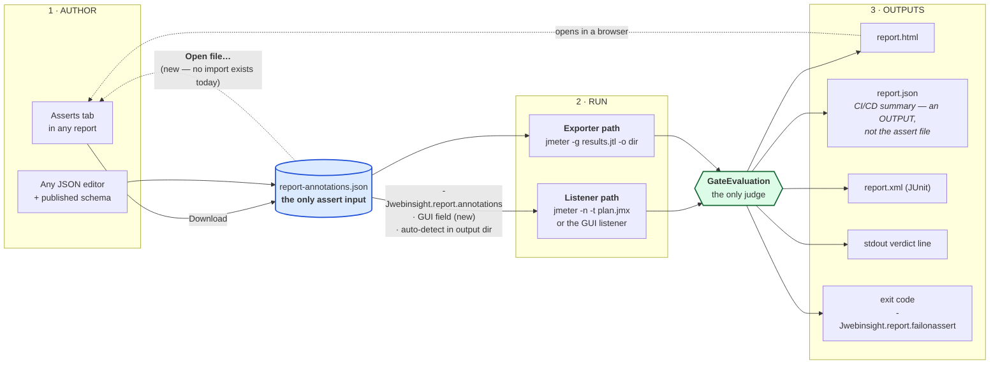
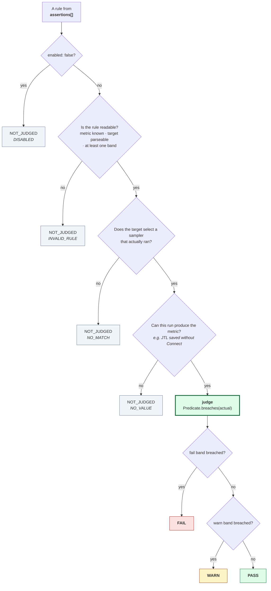
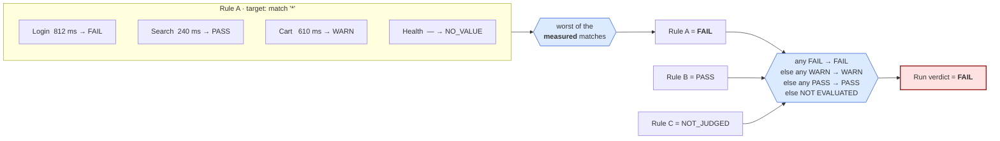
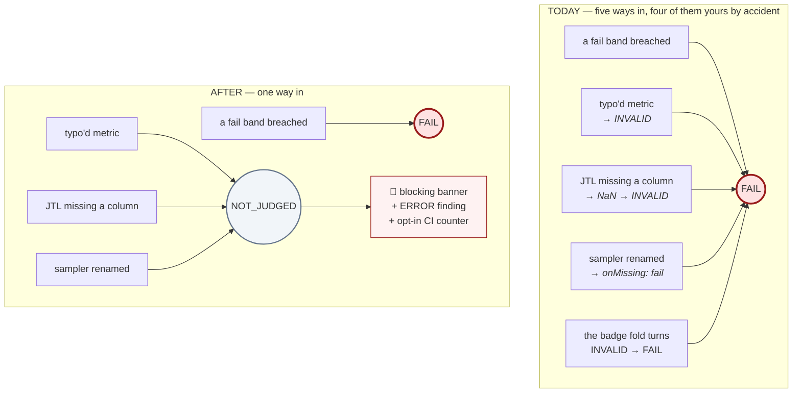
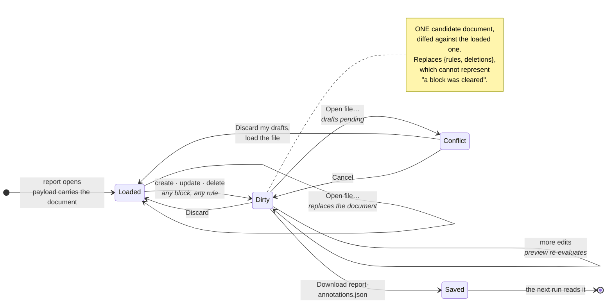
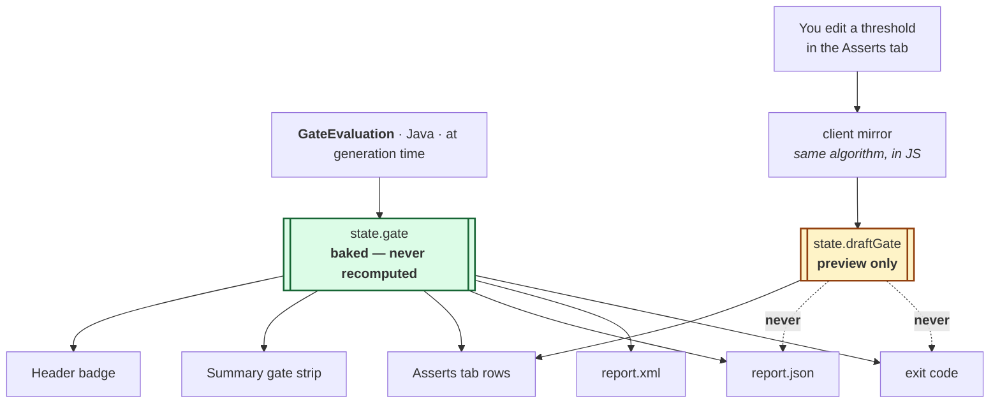
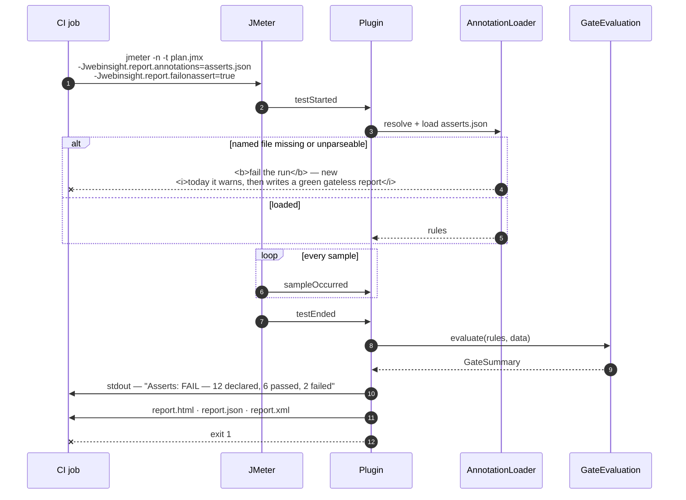

# Asserts — how it works, in diagrams

> Companion to [`asserts-core-hardening.md`](asserts-core-hardening.md). Every diagram shows the
> **target** design (after the core plan), except D4 and D8 which contrast today with the target.
> Mermaid renders in JetBrains markdown preview and on GitHub.

---

## D1 — The whole loop: where asserts come from, where verdicts go



**The loop is the point.** You author, you run, you read the actual values in the report, you retune
in the tab, you download, you run again. The report is both the output and the next input's editor.

---

## D2 — One rule → one status

This is the whole of requirement 2. **Only the green box can produce a status that gates.**



Every grey box is **neutral in both directions** — it cannot fail the run and it cannot pass it.
`fail` is tested before `warn`, so a value past both bands is a failure, not a warning.

---

## D3 — The two folds

The same rule is applied twice: matches → rule, rules → run. Nothing else folds anywhere.



Note `Health` in the fold. **Today one unmeasurable match poisons the entire rule to INVALID,
which erases the genuine FAIL from `Login`.** After: the rule reports the worst of what it could
measure, and the unmeasurable match is reported separately.

And note the last branch: a gate of nothing but NOT_JUDGED rules is **NOT EVALUATED, not PASS.**
A run that judged nothing has not passed anything.

---

## D4 — What actually changes: the paths to FAIL



**This is the trade as it shipped — and this diagram's AFTER column is about `gate.status`
only.** A typo stops being a *verdict*: no more FAIL with no number behind it. It does **not**
stop failing the build. A rule that could not be built is a **configuration error**, so since
**3.1.0** the run exits non-zero under `failonerror` (default **true**), prints
`WEB-INSIGHT-REPORT: CONFIG ERROR` on stderr, and still writes every artifact — failing a build
must not cost the report that explains why. A gate that genuinely **FAILED** exits 0; that is a
working gate returning an answer, and `failonassert` is how you ask for it to be fatal.
Reversed 2026-08-08, planned and executed in
[`asserts-config-errors-fail.md`](asserts-config-errors-fail.md).

What is still a `jq` you choose to write is a rule that merely *matched nothing* — that one can
legitimately be a plan running a subset:

```bash
jq -e '.gate.failed == 0 and .gate.notJudged.noMatch == 0' report.json
```

---

## D5 — CRUD in the browser: what state exists and how it moves



The current draft model can only describe rule edits. That is *why* no other block is editable —
not an oversight, a missing data structure.

---

## D6 — One evaluation, six surfaces — and the one that is only a preview



**The invariant that must never break:** what the artifacts say is what Java decided. Editing in the
browser shows you what *would* happen; it cannot change what *did*. The tab says *re-run to make
this real*.

The two implementations are kept honest by `assert-parity-vectors.json`, run in Java by
`AssertionParityTest` and in the browser by `asserts-parity.spec.ts`. **That vector file is the
only regression brake this feature has.**

---

## D7 — A headless run, end to end



Step 3 is the one gap that matters: a typo in the path is a **green** run today.

---

## D8 — Where the retired threshold block went

```mermaid
flowchart LR
    subgraph N["Today — a special case in five places"]
        direction TB
        N1["typed field + 3 accessors<br/>ReportAnnotations"]
        N2["bespoke ERROR finding<br/>GateEvaluation"]
        N3["written back by documentOf<br/>GatePayloadBuilder"]
        N4["unused Thymeleaf variable<br/>ThymeleafReportRenderer"]
        N5["deliberately dropped on save<br/>report.js + the known map"]
    end

    N ==>|"delete all of it"| G

    subgraph G["After — no special case at all"]
        direction TB
        G1["an unrecognised top-level key"]
        G2["preserved verbatim on save<br/><i>like _comment</i>"]
        G3["no finding, no special case<br/>— we do not know the key"]
    end

    style N fill:#fef2f2,stroke:#991b1b
    style G fill:#f0fdf4,stroke:#166534
```



The block stops being a feature the code knows about. A file carrying one is **exactly as
interesting as a file carrying any other key we do not recognise** — preserved, named once in a
warning, never evaluated.

---

## The one-paragraph version

A tester writes `report-annotations.json` — by hand or from the Asserts tab. A run reads it,
and **`GateEvaluation` judges it once**. Each rule gets one of four statuses, and only a breached
`fail` band can produce FAIL. The worst measured match decides the rule; the worst rule decides the
run; anything that could not be judged is neutral and shouts through a banner instead. That single
verdict is baked into the HTML, the CI JSON, the JUnit XML, stdout and the exit code. Opening the
HTML lets you retune against the real numbers, preview the effect, and download the file for the
next run.
